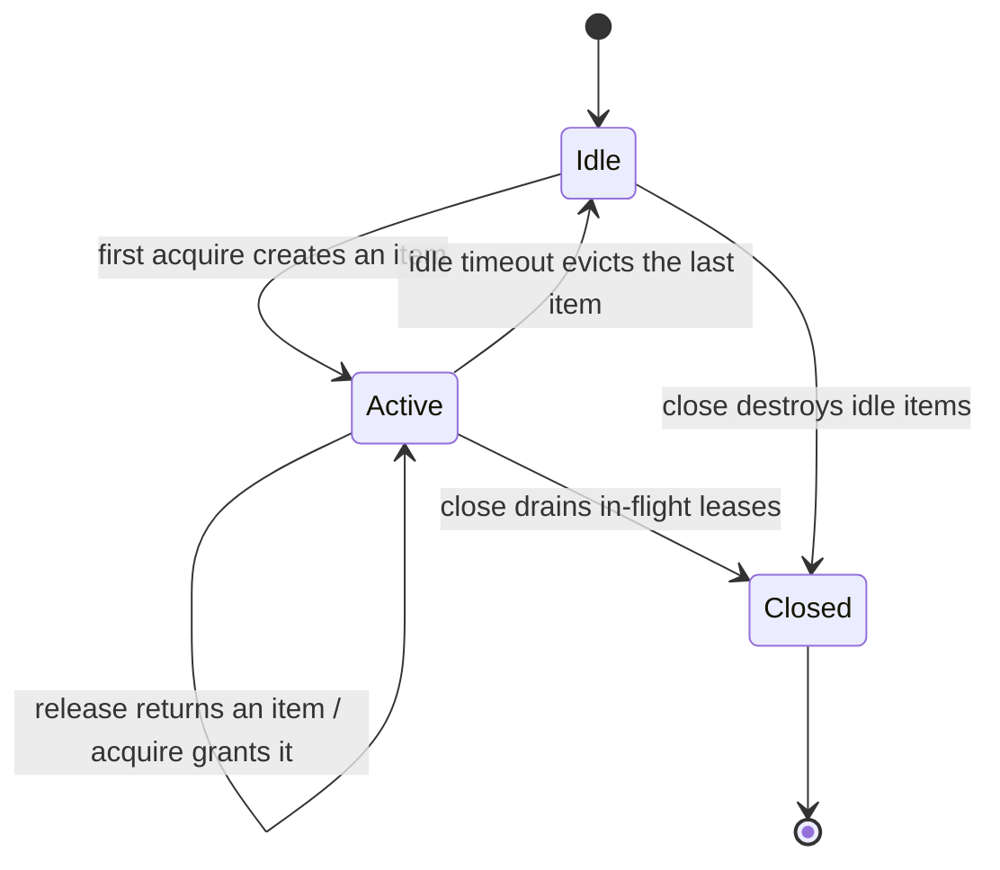

<!-- BUNDLE_SIZE:START -->

> 2.91 kB minified + gzipped

<!-- BUNDLE_SIZE:END -->

An API endpoint that opens a database connection per request pays the handshake on every call, and
under load the handshakes themselves become the bottleneck. Closing them on error paths is its own
trap: one early `return` without a close leaks the connection, and a retry storm opens more sockets
than the server allows. What the code needs is a fixed set of connections that callers borrow and
return, with broken ones destroyed instead of reused.

## Core Behavior

`Pool` creates expensive items once and grants them for exclusive use.

- `acquire` grants a lease: an idle item if one exists, a new item while the pool is under
  `maxSize`, otherwise a FIFO-waiting promise. A failed creation settles only its own caller.
- `lease.release()` returns the item for reuse; `lease.release({ broken: true })` destroys it, so a
  connection that errored mid-use is never handed to the next caller.
- Items idle beyond `idleTimeout` are evicted, and items returned after `maxLifetime` are destroyed
  even when healthy — long-lived connections rot.
- `close()` stops granting leases, waits for in-flight leases to return, destroys everything, and
  settles. Queued waiters settle with `Pool.Closed`.
- The error channel carries the factory's `E` beside the pool's own failures — `Pool.Timeout`,
  `Pool.Closed`, and `Aborted` — never a catch-all infrastructure error.

The destroy task is infallible by contract, like [`Resource`](/guides/resource/) release: expected
close failures are handled inside it. `Resource` is the nearest sibling — a single acquisition
bracket whose item lives for exactly one operation — while a pool's items outlive any one caller.
The [choosing guide](/basics/choosing/) places both next to the other lifecycle engines, and
[`Cache`](/guides/cache/) is the shared-value counterpart: a cache hands the same value to every
reader, while a pool grants one item to exactly one holder at a time.

## Example: Checkout Under Load

A checkout endpoint queries inventory through a fixed set of connections. Under a burst of requests,
callers beyond `maxSize` wait in line, a query that fails marks its connection broken, and shutdown
drains the in-flight queries before closing the connections.



```ts
import { Deferred, Duration, Pool, Result, Task } from "@pplnd/core";

type DbError = { readonly kind: "DbFailed"; readonly message: string; };

const pool = Pool.make<DbError, InventoryDb>({
  acquire: Task.Result.tryCatch((signal) => openInventoryDb(config, signal), {
    onError: (error) => ({ kind: "DbFailed", message: String(error) }),
  }),
  destroy: (db) => Task.tryCatch(() => db.close(), { onError: () => {} }),
  maxSize: 10,
  idleTimeout: Duration.seconds(30),
  acquireTimeout: Duration.seconds(2),
});

const loadStock = async (sku: string) => {
  const outcome = await pool.acquire();
  if (Result.is.err(outcome)) {
    return Result.make.err(outcome.error); // DbError, Pool.Timeout, Pool.Closed, or Aborted
  }
  const lease = outcome.value;
  const query = await Deferred.to.Promise(lease.item.stockFor(sku));
  // a connection that just failed a query is not handed to the next caller:
  await Deferred.to.Promise(lease.release({ broken: Result.is.err(query) }));
  return query;
};

process.on("SIGTERM", () => void pool.close());
```

When the endpoint shuts down, `close()` refuses new checkouts, lets the in-flight queries finish,
and destroys the connections after the last lease returns. The [Aborted guide](/guides/aborted/)
covers what a caller's own cancellation means inside one checkout.

### Keeping Queries Fast

A pool bounds how many items exist, not how long one query runs. A stuck query holds its lease and
starves the waiters behind it, so bound each query with a deadline and treat the failure as
`broken`:

```ts
import { Duration, Result, Task } from "@pplnd/core";

const stockFor = (db: InventoryDb, sku: string) =>
  Task.Result.timeout(TimeoutPolicy.after({ duration: Duration.seconds(3), onTimeout: () => "slow query" as const }))(
    Task.Result.tryCatch(() => db.stockFor(sku), { onError: (error) => String(error) }),
  )();

const query = await stockFor(lease.item, sku);
await Deferred.to.Promise(lease.release({ broken: Result.is.err(query) }));
```

The [task guide](/guides/task/) covers `Task.Result.timeout`; the seam here is that the deadline
belongs to the query, while the broken flag belongs to the connection.

## Core Operations

| Signature                                       | What it does                                        | Behavior                                                              |
| :---------------------------------------------- | :-------------------------------------------------- | :-------------------------------------------------------------------- |
| `Pool.make({ acquire, destroy, maxSize, ... })` | Creates a pool around the factory and destroy task. | Non-positive-integer `maxSize` clamps to one.                         |
| `pool.acquire()` / `pool.acquire({ signal })`   | Checks an item out for exclusive use.               | FIFO waiters; `Pool.Timeout`, `Pool.Closed`, or `Aborted` on failure. |
| `lease.release({ broken? })`                    | Returns the item, or destroys it when broken.       | Destroys items past `maxLifetime` even when healthy.                  |
| `pool.close()`                                  | Drains in-flight leases and destroys everything.    | Queued waiters settle with `Pool.Closed`.                             |
| `pool.state()` / `pool.subscribe(listener)`     | Reads or observes saturation.                       | `Idle`, `Active { available, inUse, waiting }`, or `Closed`.          |

## Failure Behavior and Edge Cases

`acquireTimeout` bounds queued callers only: a caller whose item creation is still running waits for
it, and bounding that is the job of `Task.Result.timeout` around the factory task. A failed creation
settles its own caller with the factory's error and frees the slot for the next one; the pool stays
usable.

Releasing a lease twice is a caller bug: the lease is opaque, and the pool does not guard against
double release any more than `Resource` guards against double close. Releasing after `close()` is
safe — the item is destroyed instead of returning to the idle set — and `close()` itself waits for
every in-flight lease before it settles, so `await pool.close()` is the shutdown wait.

Idle eviction and `maxLifetime` use the same clamped-timer hygiene as the other engines: timers are
cleared on checkout and on close, so nothing outlives the pool it belongs to.
