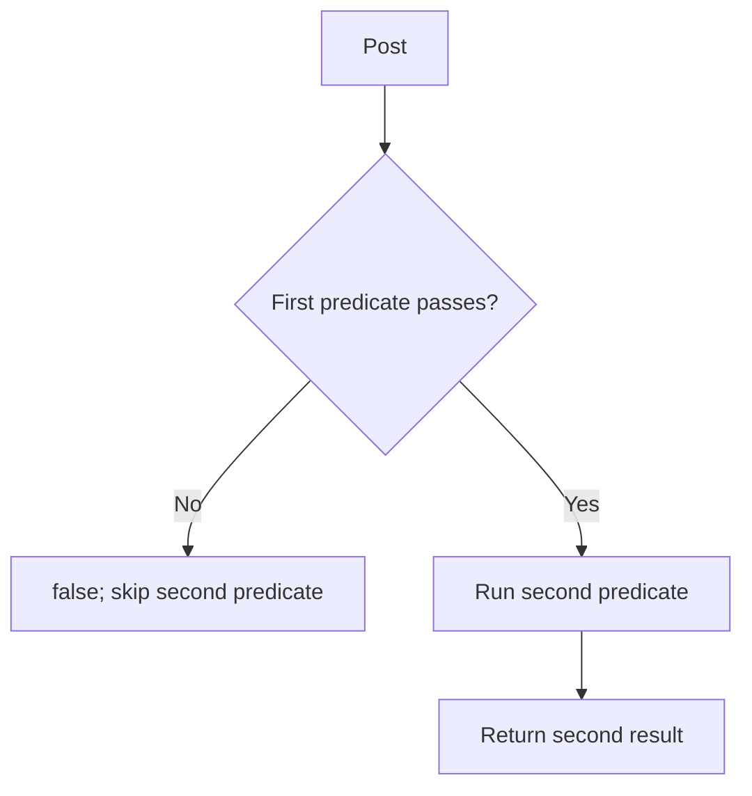

<!-- BUNDLE_SIZE:START -->

> 185 B minified + gzipped

<!-- BUNDLE_SIZE:END -->

## Core Behavior

`Predicate<A>` is a function that accepts an `A` and returns a boolean. `Predicate` provides
operations for combining and adapting those functions.

- `and` and `or` run the input predicate first and skip the second when the result is already known.
- `all` and `any` check a list in order, stopping at the first decisive result.
- A predicate reports a boolean; use `Refinement` when the check should also narrow a TypeScript
  type.

## Example: Moderation Review

A moderation queue needs to select pending posts that have at least three reports. Each condition
can be named separately and combined into one filter.

`and` evaluates the second predicate only when the first returns true:



### Selecting Posts for Review

```ts
import { Predicate, pipe } from "@pplnd/core";

type Post = { id: string; status: "pending" | "reviewed"; reports: number };

const isPending: Predicate<Post> = (post) => post.status === "pending";
const hasEnoughReports: Predicate<number> = (reports) => reports >= 3;
const needsReview = pipe(
  isPending,
  Predicate.and(pipe(hasEnoughReports, Predicate.using((post: Post) => post.reports))),
);

const posts: readonly Post[] = [
  { id: "post-1", status: "pending", reports: 4 },
  { id: "post-2", status: "pending", reports: 1 },
  { id: "post-3", status: "reviewed", reports: 8 },
];
const reviewQueue = posts.filter(needsReview);
// [{ id: "post-1", status: "pending", reports: 4 }]
```

`using` adapts a check on the report count to a check on a whole post. `and` combines it with the
status check.

## Core Operations

### Combining and Adapting

| Signature                               | What it does                                    | Result                            |
| :-------------------------------------- | :---------------------------------------------- | :-------------------------------- |
| `Predicate.not(check)`                  | Negates a check.                                | Predicate.                        |
| `Predicate.and(other)` / `or(other)`    | Combines two checks.                            | Predicate with short-circuiting.  |
| `Predicate.all(checks)` / `any(checks)` | Requires every / at least one check to pass.    | Predicate with short-circuiting.  |
| `Predicate.using(select)`               | Applies a check to a selected part of an input. | Predicate for the larger input.   |
| `Predicate.from.Refinement(check)`      | Uses a type guard as a plain boolean check.     | Predicate without type narrowing. |

### Choosing a Branch

| Signature                             | What it does                                                   | Result                                  |
| :------------------------------------ | :------------------------------------------------------------- | :-------------------------------------- |
| `Predicate.match(branches, fallback)` | Runs the handler for the first passing check, or the fallback. | Function returning the selected result. |

## Failure Behavior and Edge Cases

`Predicate.all([])` returns a predicate that always returns `true`; `Predicate.any([])` returns one
that always returns `false`.

`match` chooses the first matching branch, so order matters when conditions overlap. Put a more
specific condition before a broader one when it should take precedence.
