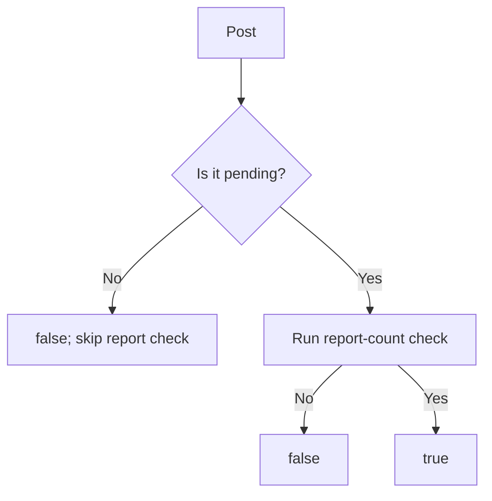

<!-- BUNDLE_SIZE:START -->

> 196 B minified + gzipped

<!-- BUNDLE_SIZE:END -->

A moderation queue tests each post for two conditions: the status must be pending, and the report
count must reach a threshold. Each condition is written inline at one call site, then copied with a
small variation at the next. A later change to the threshold updates one filter and leaves the other
behind.

## Core Behavior

`Predicate<A>` is a function that takes a value of type `A` and returns a boolean. The module
combines those functions without running them until a value arrives.

- `and` and `or` run the piped predicate first; `and` skips the second after a failure, and `or`
  skips it after a pass.
- `all` and `any` check a list in order and stop at the first decisive result; an empty list passes
  `all` and fails `any`.
- `using` adapts a field check to the enclosing value; `match` calls the handler of the first
  passing branch and the fallback only when none pass.
- `from.Refinement` exposes a type guard as a predicate and drops its narrowing without runtime
  work.

Use `Predicate` when a condition stays a boolean. When the check must also narrow the TypeScript
type, [`Refinement`](/guides/refinement/) carries that proof. The
[choosing guide](/basics/choosing/) lists the comparison modules together.

## Example: Moderation Review

A moderation queue selects pending posts that have at least three reports. The status check and the
report-count check are defined once, then combined into one filter used by every queue view.

`and` evaluates the report check only when the status check passes:



### Selecting Posts for Review

```ts
import { Predicate, pipe } from "@pplnd/core";

type Post = { id: string; status: "pending" | "reviewed"; reports: number };

const isPending: Predicate<Post> = (post) => post.status === "pending";
const hasEnoughReports: Predicate<number> = (reports) => reports >= 3;
const reportsAtLeastThree = pipe(
  hasEnoughReports,
  Predicate.using((post: Post) => post.reports),
);
const needsReview = pipe(isPending, Predicate.and(reportsAtLeastThree));

const posts: readonly Post[] = [
  { id: "post-1", status: "pending", reports: 4 },
  { id: "post-2", status: "pending", reports: 1 },
  { id: "post-3", status: "reviewed", reports: 8 },
];

const reviewQueue = posts.filter(needsReview);
// [{ id: "post-1", status: "pending", reports: 4 }]
```

`using` adapts the report check to a whole post, and `and` short-circuits on the status check. The
filter returns the posts that pass both conditions.

### Narrowing the Selected Posts

`needsReview` returns a boolean, so TypeScript still sees every selected post as an ordinary `Post`.
When the queue needs the pending status in the type, the same status check becomes a type guard:

```ts
import { Refinement } from "@pplnd/core";

type PendingPost = Post & { status: "pending" };

const isPendingPost: Refinement<Post, PendingPost> = (post): post is PendingPost => isPending(post);

const pending = posts.filter(isPendingPost);
// PendingPost[]
```

The [Refinement guide](/guides/refinement/) covers composition and conversion into optional or
error-carrying results.

## Core Operations

### Combining Checks

| Signature                     | What it does                                                              | Return type    |
| :---------------------------- | :------------------------------------------------------------------------ | :------------- |
| `not(check)`                  | Negates a check.                                                          | `Predicate<A>` |
| `and(other)` / `or(other)`    | Combines two checks; data-last and short-circuiting.                      | `Predicate<A>` |
| `all(checks)` / `any(checks)` | Requires every check or at least one; stops at the first decisive result. | `Predicate<A>` |

### Adapting Checks

| Signature                | What it does                                    | Return type                        |
| :----------------------- | :---------------------------------------------- | :--------------------------------- |
| `using(select)`          | Applies a check to a selected part of an input. | `Predicate<B>` from `Predicate<A>` |
| `from.Refinement(check)` | Treats a type guard as a boolean check.         | `Predicate<A>` without narrowing.  |

### Choosing a Branch

| Signature                   | What it does                                                  | Return type                                                                           |
| :-------------------------- | :------------------------------------------------------------ | :------------------------------------------------------------------------------------ |
| `match(branches, fallback)` | Runs the handler of the first passing check, or the fallback. | Handler and fallback results unify into one type; divergent returns widen to a union. |

## Failure Behavior and Edge Cases

`Predicate.all([])` returns a predicate that always returns `true`; `Predicate.any([])` returns one
that always returns `false`. A filter built on `all([])` keeps every item.

`and` and `or` call the piped predicate first. An exception thrown by a predicate, a branch handler,
or `match`'s fallback is not caught and propagates to the caller.

`match` evaluates branches in array order and calls only the first matching handler. When conditions
overlap, the earliest branch wins, so put the narrower condition first. The fallback runs only after
every branch predicate has failed.

Complementary branch handlers share one result type, so an empty-literal fallback does not collapse
to `never[]`:

```ts
import { Predicate } from "@pplnd/core";

const label = Predicate.match([[(n: number) => n < 0, () => ["negative"]]], () => []);
label(5).push("positive"); // string[] — ["negative"] and [] unify into one mutable array type
```

Handlers returning genuinely different types widen the result to their union.
