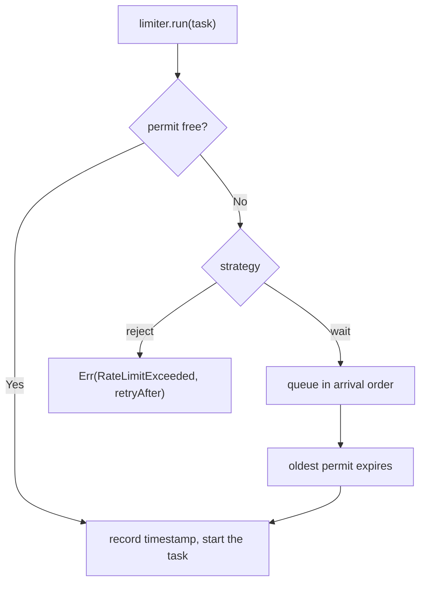

<!-- BUNDLE_SIZE:START -->

> 2.52 kB minified + gzipped

<!-- BUNDLE_SIZE:END -->

A dashboard opens and every panel fetches through one client. The API allows 60 calls a minute, so
the first 60 pass and the remaining 140 come back as 429. Retrying them immediately makes it worse,
because every retry is another call against the same window.

## Core Behavior

`RateLimiter` admits a call while fewer than `limit` calls have started inside the last `window`.
Every admitted call holds a permit until that window has passed.

- `"wait"` (the default) queues the call and starts it when the oldest admitted call expires.
- `"reject"` settles immediately with `RateLimiter.LimitError` carrying `retryAfter`.
- `maxWait` bounds the wait: a call whose estimate exceeds it settles with reason `"max-wait"`.
- A caller's signal removes a queued call without spending a permit.

The window is a sliding log rather than a token bucket, so "60 per minute" is never 120 between two
adjacent windows. Use the limiter when the constraint is an external quota; use
[`CircuitBreaker`](/guides/circuit-breaker/) when the constraint is a dependency that is failing,
and [`RetryPolicy`](/guides/op/) when one call should be repeated. The
[choosing guide](/basics/choosing/) places it next to the other execution modules.

## Example: Dashboard Fan-Out

One client feeds every panel. The limiter lets a burst through while permits remain, then queues the
rest and releases them as the window rolls forward.



### Pacing the Requests

`run` takes the lazy task, so the request does not start until a permit exists:

```ts
import { Duration, RateLimiter, Task } from "@pplnd/core";

type ApiError = { readonly kind: "Unavailable"; readonly status: number; };

const github = RateLimiter.make({
  limit: 60,
  window: Duration.minutes(1),
  strategy: "wait",
  maxWait: Duration.seconds(15),
});

const fetchIssues = (repo: string): Task.Result<ApiError, readonly string[]> =>
  Task.Result.tryCatch(
    async (signal) => {
      const response = await fetch(`https://api.github.com/repos/${repo}/issues`, { signal });
      if (!response.ok) throw new Error(String(response.status));
      const body = (await response.json()) as readonly { title: string; }[];
      return body.map((issue) => issue.title);
    },
    { onError: (): ApiError => ({ kind: "Unavailable", status: 429 }) },
  );

const titles = await github.run(fetchIssues("vercel/next.js"));
// Ok(titles) once a permit is free, or Err({ kind: "RateLimitExceeded", retryAfter })
```

A fan-out of 200 panels now runs 60 immediately and queues the rest, in submission order. A queue
call that waits longer than `maxWait` never starts, and its `retryAfter` is what the caller needs to
schedule its own retry.

### Retrying Under the Quota

A retry is another request, so it needs its own permit. Wrap each attempt instead of the whole
sequence: `run` returns a `Deferred`, and the retry policy needs a task whose body takes a permit.

```ts
import { Duration, RateLimiter, RetryPolicy, Task, pipe } from "@pplnd/core";

const policy = RetryPolicy.constant<ApiError | RateLimiter.LimitError>({
  attempts: 2,
  delay: Duration.seconds(1),
  when: (error) => error.kind !== "RateLimitExceeded",
});

const attempt = (repo: string) => (signal?: AbortSignal) =>
  signal === undefined ? github.run(fetchIssues(repo)) : github.run(fetchIssues(repo), { signal });

const titles = await pipe(attempt("vercel/next.js"), Task.Result.retry(policy))();
```

Each retry takes a new permit, and a call rejected by the quota is not retried into the same window.
The [CircuitBreaker guide](/guides/circuit-breaker/) covers the complementary case, where repeated
failures should stop calls instead of spacing them.

## Core Operations

### Creating and Pacing

| Signature                       | What it does                                  | Result                              |
| :------------------------------ | :-------------------------------------------- | :---------------------------------- |
| `RateLimiter.make(config)`      | Creates a limiter with a quota and a policy.  | A limiter instance                  |
| `limiter.run(task)`             | Starts a task when a permit is free.          | Deferred result, unchanged errors   |
| `limiter.run(task, { signal })` | Runs with cancellation.                       | Adds `Aborted` to the error channel |
| `limiter.available()`           | Counts permits free right now.                | `number` between zero and `limit`   |
| `limiter.reset()`               | Forgets the window and admits queued callers. | `void`                              |

`limit` is the number of calls allowed in one window, and a value below one clamps to one. `window`
is how long each admitted call holds its permit. `strategy` chooses between queueing and rejecting.
`maxWait` applies only to `"wait"`.

### Reading Outcomes

| Signature                     | What it does                    | Result                 |
| :---------------------------- | :------------------------------ | :--------------------- |
| `limiter.run(task).then(...)` | Awaits the task or the refusal. | `Result`               |
| `RateLimiter.LimitError`      | A call that never started.      | `retryAfter`, `reason` |

A refusal is `{ kind: "RateLimitExceeded", retryAfter, reason }`, with `"exhausted"` for the
rejecting strategy and `"max-wait"` for a wait beyond `maxWait`. The task's own errors pass through
unchanged.

## Failure Behavior and Edge Cases

A permit is recorded when a call is admitted, not when its task settles, so slow work does not
inflate the quota. A task that fails still used its permit, because the remote service saw the call.

Aborting a queued call settles it with `Aborted` and releases nothing, because it never held a
permit. Aborting a call that is already waiting removes it from the queue immediately and clears the
shared timer when no caller is left. Aborting before submission settles immediately without
queueing.

Non-finite configuration clamps to the safe minimum: a `limit` below one becomes one, and a
non-finite `window` or `maxWait` becomes zero. A zero window means every permit expires immediately,
so the limiter admits every call; a zero `maxWait` rejects any call that would wait. `reset` is an
explicit override: it admits every queued caller and can therefore let more than `limit` calls start
inside one window.

When the work also needs a deadline, put [`Task.Result.timeout`](/guides/task/) inside the limited
task. When failures should stop calls entirely, wrap the same task in a
[`CircuitBreaker`](/guides/circuit-breaker/) and let the limiter pace the attempts that reach it.
