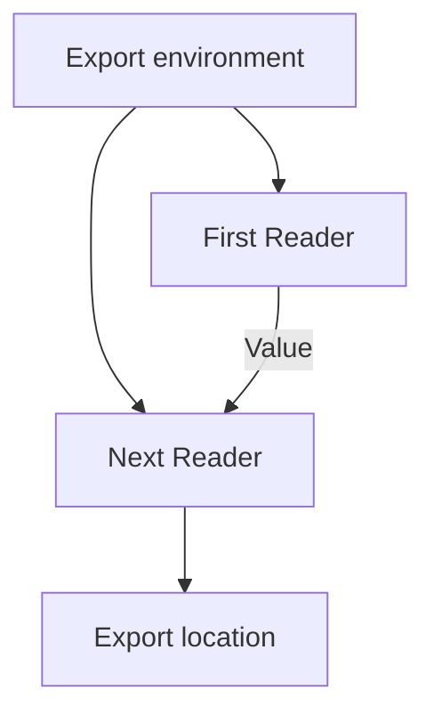

<!-- BUNDLE_SIZE:START -->

> 153 B minified + gzipped

<!-- BUNDLE_SIZE:END -->

A report exporter reads the bucket name from its settings at every call. The name travels through
four signatures, and one call site captures a settings object from a different environment. The
generated URL points at the wrong bucket, and nothing in the signature notices.

## Core Behavior

`Reader<R, A>` is a function from an environment `R` to a value `A`.

- `map` transforms the produced value; `chain` passes it to a computation that reads the same
  environment.
- `chain`, `apply`, and `assign` intersect their environment requirements, so the caller supplies
  one object containing every field the pipeline uses.
- `local` adapts a Reader that needs a narrower environment to a wider one by selecting the narrower
  part first.
- The pipeline does not run until the environment is supplied with `Reader.run(environment)` or by
  calling the Reader directly.

Reach for `Reader` when the computation depends on context that is fixed for the run and supplied
once at the edge. When the computation must also produce an updated value for later steps,
[`State`](/guides/state/) carries that changing state through the same pipeline. The
[choosing guide](/basics/choosing/) places both under pure context and state threading.

## Example: Export Locations

An export service builds a storage key and a download URL from a bucket, a path prefix, and an
origin. Development and production use the same pipeline with different settings.

`chain` sends the first Reader's result to a function that creates the next Reader. Both Readers
receive the environment supplied at the end:



### Building an Export Location

The key builder needs only the storage settings. `local` adapts it to the full environment. The
following step reads the origin and adds the finished URL:

```ts
import { pipe, Reader } from "@pplnd/core";

type StorageSettings = { bucket: string; prefix: string };
type ExportEnvironment = { storage: StorageSettings; origin: string };
type ExportLocation = { key: string; url: string };

const objectKey = (fileName: string): Reader<StorageSettings, string> =>
  (storage) => `${storage.prefix}/${fileName}`;

const exportLocation = (fileName: string): Reader<ExportEnvironment, ExportLocation> =>
  pipe(
    objectKey(fileName),
    Reader.local((env: ExportEnvironment) => env.storage),
    Reader.assignTo("key"),
    Reader.assign("url", ({ key }) =>
      pipe(
        Reader.ask<ExportEnvironment>(),
        Reader.map((env) =>
          new URL(`/exports/${env.storage.bucket}/${encodeURIComponent(key)}`, env.origin).toString()
        ),
      )
    ),
  );

const location = pipe(
  exportLocation("report.csv"),
  Reader.run({
    storage: { bucket: "daily", prefix: "reports" },
    origin: "https://files.example.com",
  }),
);
// { key: "reports/report.csv", url: "https://files.example.com/exports/daily/reports%2Freport.csv" }
```

`exportLocation` only builds the Reader. The settings are read when `Reader.run` supplies the
environment, so the same definition can serve both deployments.

### Recording the export sequence

The reader supplies the fixed settings, but the exporter also needs a sequence number that advances
with each location. That counter belongs in [`State`](/guides/state/), which threads the updated
value to the next run:

```ts
import { pipe, State } from "@pplnd/core";

type SequencedExport = ExportLocation & { sequence: number };

const numbered = (location: ExportLocation): State<number, SequencedExport> =>
  pipe(
    State.get<number>(),
    State.chain((sequence) =>
      pipe(
        State.modify<number>((next) => next + 1),
        State.map(() => ({ ...location, sequence })),
      )
    ),
  );
```

`Reader.run` fixes the environment once; `State.run` would start each numbering run from the
supplied counter. The two compose when a batch needs both settings and a carried counter.

## Core Operations

### Creating and Adapting

| Signature              | What it does                                   | Return type    |
| :--------------------- | :--------------------------------------------- | :------------- |
| `Reader.make(value)`   | Creates a Reader that ignores its environment. | `Reader<R, A>` |
| `Reader.ask<R>()`      | Returns the supplied environment as the value. | `Reader<R, R>` |
| `Reader.local(select)` | Adapts a Reader to another environment.        | A new Reader.  |

A plain function `(environment: R) => A` is also a Reader.

### Combining and Transforming

| Signature                                  | What it does                                           | Behavior                             |
| :----------------------------------------- | :----------------------------------------------------- | :----------------------------------- |
| `Reader.map(transform)`                    | Transforms the produced value.                         | Keeps the environment requirement.   |
| `Reader.chain(transform)`                  | Runs the next Reader with the previous value.          | Intersects environment requirements. |
| `Reader.apply(argument)`                   | Applies a Reader's function to another Reader's value. | Both receive the same environment.   |
| `Reader.assignTo(key)` / `assign(key, fn)` | Starts a record / adds a Reader's result to it.        | Later steps can use earlier values.  |
| `Reader.tap(sideEffect)`                   | Observes the produced value when run.                  | Returns the original result.         |

### Running

| Signature                         | What it does                      | Return type |
| :-------------------------------- | :-------------------------------- | :---------- |
| `reader(environment)`             | Calls the Reader directly.        | `A`         |
| `Reader.run(environment)(reader)` | Runs it at the end of a pipeline. | `A`         |

## Failure Behavior and Edge Cases

`Reader` adds no error channel. An exception thrown by a step or a callback escapes to the caller of
`Reader.run`; return a [`Result`](/guides/result/) or `Task.Result` from the Reader when the failure
needs a typed channel.

`Reader.ask` returns the environment object itself, not a copy. A step that mutates it changes the
value seen by later steps and by the caller. Treat the environment as readonly.

Chains execute as nested function calls. Extremely deep synchronous chains can exceed the JavaScript
call stack; split unusually large pipelines into smaller stages.
