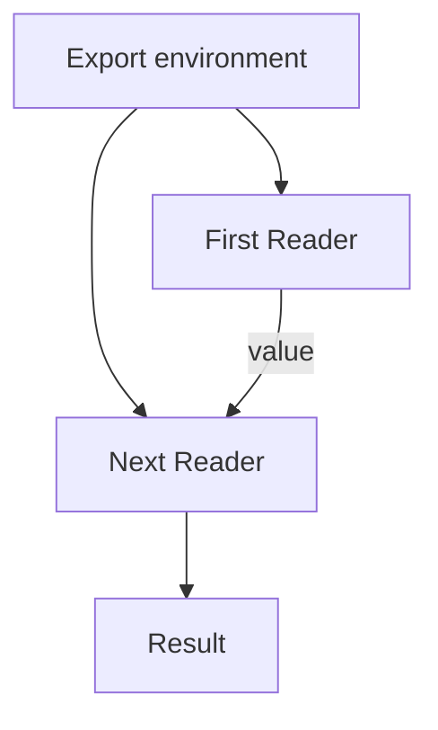

<!-- BUNDLE_SIZE:START -->

> 153 B minified + gzipped

<!-- BUNDLE_SIZE:END -->

## Core Behavior

`Reader<R, A>` is a function that takes an environment `R` and returns a value `A`.

- `map` transforms the value; `chain` passes it to another Reader. Both steps receive the same
  environment when the pipeline runs.
- Combining Readers joins their environment requirements, so the caller supplies an environment
  containing what each step needs.
- Run a Reader by calling it with an environment or using `Reader.run(environment)` in a pipeline.

## Example: Export Locations

An export service builds locations from a storage bucket, a path prefix, and an origin. The same
location-building pipeline can run with development or production settings.

`chain` sends the first Reader's result to a function that creates the next Reader. Both Readers
receive the environment supplied at the end:



### Building an Export Location

The path helper needs only the storage settings. `local` adapts it to the full environment; the
following step reads the origin and adds the finished URL:

```ts
import { pipe, Reader } from "@pplnd/core";

type StorageSettings = { bucket: string; prefix: string };
type ExportEnvironment = { storage: StorageSettings; origin: string };

const objectKey = (fileName: string): Reader<StorageSettings, string> =>
  (storage) => `${storage.prefix}/${fileName}`;

const exportLocation = (fileName: string): Reader<ExportEnvironment, { key: string; url: string }> =>
  pipe(
    objectKey(fileName),
    Reader.local((env: ExportEnvironment) => env.storage),
    Reader.assignTo("key"),
    Reader.assign("url", ({ key }) =>
      pipe(
        Reader.ask<ExportEnvironment>(),
        Reader.map((env) =>
          new URL(`/exports/${env.storage.bucket}/${encodeURIComponent(key)}`, env.origin).toString()
        ),
      )
    ),
  );

const location = pipe(
  exportLocation("report.csv"),
  Reader.run({
    storage: { bucket: "daily", prefix: "reports" },
    origin: "https://files.example.com",
  }),
);
// { key: "reports/report.csv", url: "https://files.example.com/exports/daily/reports%2Freport.csv" }
```

Calling `exportLocation` creates the Reader. The settings are read when `Reader.run` supplies the
environment.

## Core Operations

### Creating and Adapting

| Signature              | What it does                                   | Return type    |
| :--------------------- | :--------------------------------------------- | :------------- |
| `Reader.make(value)`   | Creates a Reader that ignores its environment. | `Reader<R, A>` |
| `Reader.ask<R>()`      | Returns the supplied environment as the value. | `Reader<R, R>` |
| `Reader.local(select)` | Adapts a Reader to another environment.        | A new Reader.  |

A plain function `(environment: R) => A` is also a Reader.

### Combining and Transforming

| Signature                                  | What it does                                           | Behavior                            |
| :----------------------------------------- | :----------------------------------------------------- | :---------------------------------- |
| `Reader.map(fn)`                           | Transforms the result.                                 | Keeps the environment requirement.  |
| `Reader.chain(fn)`                         | Runs the next Reader with the previous value.          | Combines environment requirements.  |
| `Reader.apply(argument)`                   | Applies a Reader's function to another Reader's value. | Both receive the same environment.  |
| `Reader.assignTo(key)` / `assign(key, fn)` | Starts a record / adds a Reader's result to it.        | Later steps can use earlier values. |
| `Reader.tap(fn)`                           | Observes the result when run.                          | Returns the original result.        |

### Running

| Signature                         | What it does                      | Return type |
| :-------------------------------- | :-------------------------------- | :---------- |
| `reader(environment)`             | Calls the Reader directly.        | `A`         |
| `Reader.run(environment)(reader)` | Runs it at the end of a pipeline. | `A`         |

## Failure Behavior and Edge Cases

`Reader` does not add an error channel. If a dependency can fail and the caller needs the error,
return a `Result` or `Task.Result` from the Reader and handle that result at the boundary.

Chains execute as nested function calls. Extremely deep synchronous chains can exceed the JavaScript
call stack; split unusually large pipelines into smaller stages.
