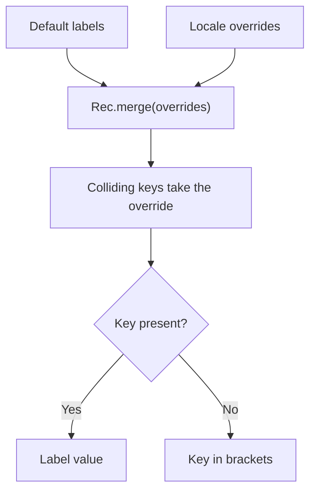

<!-- BUNDLE_SIZE:START -->

> 2.52 kB minified + gzipped

<!-- BUNDLE_SIZE:END -->

A product ships with default interface labels, and each locale overrides a handful of them. The
renderer reads one label per key, and a key that exists in neither place reaches the screen as the
text `undefined`. The defaults must also stay unchanged, because the next locale merges against the
same set.

## Core Behavior

`Rec` operates on plain string-keyed objects. No operation modifies the input object.

- `lookup` returns `Some` for an own key, including one whose value is `undefined`; an inherited key
  returns `None`.
- `merge` is shallow and gives the supplied object precedence; `mergeWith` combines colliding values
  with a callback.
- `traverse` and `sequence` combine `Maybe` or `Result` values across own enumerable keys and stop
  at the first `None` or `Err`.
- `map`, `filter`, and `size` read `Object.keys`, so only own enumerable string keys are included.

Reach for `Rec` when keys are strings and the value is a plain object. [`Dict`](/guides/dict/) keeps
keys that are not strings, or that must be compared by identity. The
[choosing guide](/basics/choosing/) compares the collections.

## Example: Locale Labels

An application keeps default labels and lets each locale override a few of them. Rendering needs one
label per key, with a visible placeholder when neither the locale file nor the defaults define it.

`merge` gives the override object precedence; `lookup` then reports whether a key survived:



### Resolving Labels

```ts
import { Maybe, Rec, pipe } from "@pplnd/core";

const defaults: Readonly<Record<string, string>> = {
  save: "Save",
  cancel: "Cancel",
  delete: "Delete",
};

const overrides: Readonly<Record<string, string>> = {
  save: "Enregistrer",
  delete: "Supprimer",
};

const labels = pipe(defaults, Rec.merge(overrides));

const labelFor = (key: string): string =>
  pipe(labels, Rec.lookup(key), Maybe.getOrElse(() => `[${key}]`));

labelFor("save"); // "Enregistrer"
labelFor("cancel"); // "Cancel"
labelFor("missing"); // "[missing]"
Rec.size(labels); // 3
```

`merge` copies both objects into a new one; the defaults and the overrides remain intact. `lookup`
reads `cancel` from the defaults and finds no entry for `missing`, which is why the fallback runs.

### Handoff: Labels Keyed by a Locale Object

A renderer that serves several locales caches the merged labels per locale. When the cache key is a
parsed locale descriptor rather than its tag, two descriptors with the same fields are still
different keys:

```ts
import { Dict, pipe } from "@pplnd/core";

type Locale = { language: string; region: string };

const canadianFrench: Locale = { language: "fr", region: "CA" };
const catalogs = Dict.singleton(canadianFrench, labels);

pipe(catalogs, Dict.lookup(canadianFrench)); // Some(labels)
pipe(catalogs, Dict.lookup({ language: "fr", region: "CA" })); // None
```

[`Dict`](/guides/dict/) stores arbitrary keys and compares them by identity, which is what a cache
keyed by a parsed descriptor needs.

## Core Operations

### Creating and Reading

| Signature                                              | What it does                                                | Result                                                   |
| :----------------------------------------------------- | :---------------------------------------------------------- | :------------------------------------------------------- |
| `Rec.lookup(key)`                                      | Reads an own key.                                           | `Maybe`; `Some(undefined)` for a present undefined value |
| `Rec.keys` / `Rec.values` / `Rec.entries` / `Rec.size` | Reads own enumerable string keys, values, or the key count. | Arrays or a count                                        |
| `Rec.is.empty` / `Rec.is.nonEmpty`                     | Tests for own enumerable keys.                              | Boolean; `is.nonEmpty` narrows                           |
| `Rec.from.entries(pairs)`                              | Builds an object from key-value pairs.                      | `Record<string, A>`                                      |
| `Rec.to.Dict(record)`                                  | Converts to a `ReadonlyMap`.                                | `ReadonlyMap`                                            |
| `Rec.NonEmpty.from.record(record)`                     | Checks for at least one key.                                | `Maybe<Rec.NonEmpty<...>>`                               |

### Transforming

| Signature                                                                                                     | What it does                                               | Result                                  |
| :------------------------------------------------------------------------------------------------------------ | :--------------------------------------------------------- | :-------------------------------------- |
| `Rec.map(transform)` / `Rec.mapWithKey(transform)`                                                            | Transforms values; the keyed form receives `(key, value)`. | A new object                            |
| `Rec.filter(predicate)` / `Rec.filterWithKey(predicate)` / `Rec.filterMap(transform)` / `Rec.compact(record)` | Selects values or unwraps `Some`.                          | A new object                            |
| `Rec.mapKeys(transform)` / `Rec.mapEntries(transform)`                                                        | Transforms keys / entries.                                 | A new object; later collisions win      |
| `Rec.pick(...keys)` / `Rec.omit(...keys)`                                                                     | Retains or removes keys.                                   | A new object                            |
| `Rec.updateIn(path, transform)`                                                                               | Replaces a value at a nested path.                         | A new object with copies along the path |

### Combining and Running

| Signature                              | What it does                            | Result                                                  |
| :------------------------------------- | :-------------------------------------- | :------------------------------------------------------ |
| `Rec.merge(other)`                     | Shallow merge; `other` wins collisions. | A new object                                            |
| `Rec.mergeWith(combine)`               | Merges with a collision callback.       | Curried or uncurried; the callback receives both values |
| `Rec.groupBy(keySelector)`             | Groups array items under string keys.   | `Record<string, readonly A[]>`                          |
| `Rec.traverse.Maybe/Result(transform)` | Maps each value into a container.       | Stops at the first `None` or `Err`                      |
| `Rec.sequence.Maybe/Result(record)`    | Combines already-created containers.    | The container around an object                          |

### Working with Non-Empty Records

| Signature                                                            | What it does                        | Result          |
| :------------------------------------------------------------------- | :---------------------------------- | :-------------- |
| `Rec.NonEmpty.singleton(key, value)`                                 | Creates a one-key object.           | `Rec.NonEmpty`  |
| `Rec.NonEmpty.keys` / `values` / `entries`                           | Reads contents as non-empty arrays. | `Arr.NonEmpty`  |
| `Rec.NonEmpty.map(transform)` / `Rec.NonEmpty.mapWithKey(transform)` | Transforms values.                  | `Rec.NonEmpty`  |
| `Rec.NonEmpty.reduce(reducer)`                                       | Folds from the first value.         | The final value |

## Failure Behavior and Edge Cases

`lookup` checks own properties, so an inherited property is absent. A present key whose value is
`undefined` is `Some(undefined)`, which differs from a missing key:

```ts
import { Rec } from "@pplnd/core";

Rec.lookup("present")({ present: undefined }); // Some(undefined)
Rec.lookup("missing")({ present: undefined }); // None
```

`merge` is a shallow spread. A nested object is shared with the source, and `mergeWith` receives
only the two colliding values. `mapKeys` and `mapEntries` keep the later entry when two keys
collide, in enumeration order.

`map`, `filter`, `keys`, and `size` use `Object.keys` and `Object.values`, so non-enumerable,
inherited, and symbol-keyed fields are ignored. An object whose only fields are symbol keys is empty
for these operations, and `Rec.is.nonEmpty` returns false.

`updateIn` copies each object along the path and copies an array with `slice`. The callback receives
`undefined` when the leaf key is absent, including on a path that does not exist yet.

`traverse.Maybe` returns `Some({})` for an empty object, and `traverse.Result` returns `Ok({})`;
there is no missing value to stop on. `sequence` combines values that were already created. For a
keyed collection that must keep at least one entry, [Non-Empty Collections](/guides/nonempty/)
covers the guards that `Rec` provides.
