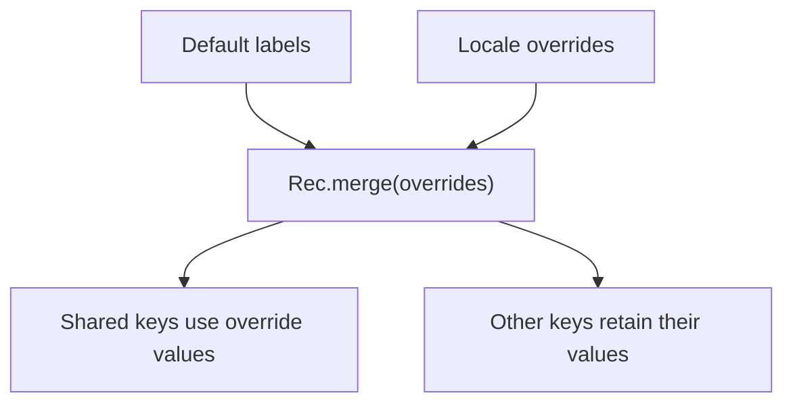

<!-- BUNDLE_SIZE:START -->

> 2.50 kB minified + gzipped

<!-- BUNDLE_SIZE:END -->

## Core Behavior

`Rec` operates on plain string-keyed records. Its transformations return records without changing
the input.

- `lookup` returns `Some` for an own key, including a key whose value is `undefined`.
- `merge` gives the supplied record precedence when both records contain the same key.
- `traverse` and `sequence` combine `Maybe` or `Result` values across a record.

## Example: Interface Translations

An application uses default labels and allows a locale to override selected labels. It can merge the
records once and look up each label when rendering.

For a collision, `merge` keeps the value from the record passed to it:



### Resolving Labels

```ts
import { Maybe, Rec, pipe } from "@pplnd/core";

const defaults: Readonly<Record<string, string>> = { save: "Save", cancel: "Cancel" };
const overrides: Readonly<Record<string, string>> = { save: "Enregistrer" };
const labels = pipe(defaults, Rec.merge(overrides));

const labelFor = (key: string): string =>
  pipe(labels, Rec.lookup(key), Maybe.getOrElse(() => `[${key}]`));

labelFor("save");    // "Enregistrer"
labelFor("cancel");  // "Cancel"
labelFor("missing"); // "[missing]"
```

## Core Operations

### Reading and Converting

| Signature                                         | What it does                            | Result                          |
| :------------------------------------------------ | :-------------------------------------- | :------------------------------ |
| `Rec.lookup(key)`                                 | Looks up an own key.                    | `Maybe` of its value.           |
| `Rec.keys` / `values` / `entries` / `size`        | Reads a record's contents or size.      | Arrays or a count.              |
| `Rec.is.empty` / `is.nonEmpty`                    | Checks for own enumerable keys.         | `is.nonEmpty` narrows the type. |
| `Rec.from.entries(pairs)` / `Rec.to.Dict(record)` | Builds a record / converts it to a map. | Record / `ReadonlyMap`.         |
| `Rec.NonEmpty.from.record(record)`                | Checks whether a record is non-empty.   | `Maybe<Rec.NonEmpty<...>>`.     |

### Transforming and Combining

| Signature                                                            | What it does                             | Behavior                                        |
| :------------------------------------------------------------------- | :--------------------------------------- | :---------------------------------------------- |
| `Rec.map(fn)` / `mapWithKey(fn)`                                     | Transforms values.                       | `mapWithKey` receives key and value.            |
| `Rec.filter(fn)` / `filterWithKey(fn)` / `filterMap(fn)` / `compact` | Selects values or unwraps `Some` values. | Produces a record.                              |
| `Rec.mapKeys(fn)` / `mapEntries(fn)`                                 | Transforms keys / entries.               | Later entries win on key collisions.            |
| `Rec.pick(...keys)` / `omit(...keys)`                                | Selects or removes keys.                 | Produces a record.                              |
| `Rec.merge(other)` / `mergeWith(combine)(other)`                     | Combines records.                        | `mergeWith` handles collisions with a callback. |
| `Rec.groupBy(fn)`                                                    | Groups array items by a string key.      | Produces a record of arrays.                    |
| `Rec.updateIn(path, fn)`                                             | Updates a nested value.                  | Copies objects along the path.                  |
| `Rec.traverse.Maybe/Result(fn)` / `sequence.Maybe/Result`            | Combines wrapped field values.           | Stops on the first missing value or error.      |
| `Rec.NonEmpty.keys/values/entries/map/reduce`                        | Works with a known non-empty record.     | Non-empty results where applicable.             |

## Failure Behavior and Edge Cases

`lookup` checks own properties, so an inherited property is absent. A present key containing
`undefined` is `Some(undefined)`, which differs from a missing key.

`merge` is shallow: an overriding nested object replaces the earlier object. `updateIn` calls its
callback with the value at the path, including `undefined` if the path is absent; account for that
in the callback when the record's shape is not known.
