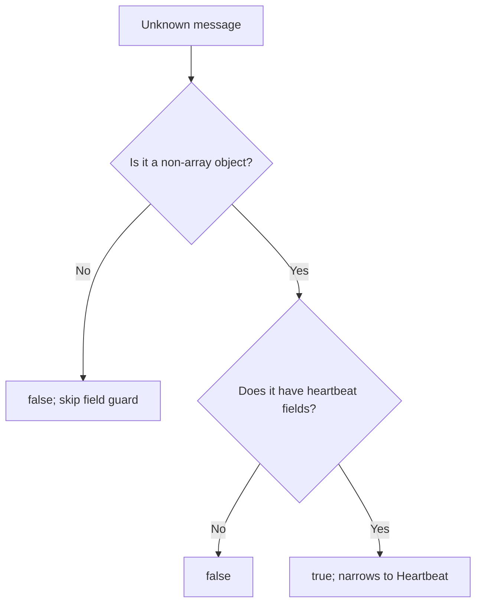

<!-- BUNDLE_SIZE:START -->

> 1.58 kB minified + gzipped

<!-- BUNDLE_SIZE:END -->

A service receives decoded messages as raw values. Before it reads a service name, it checks that
the value is an object and that the object has the expected fields. When the two checks live in
separate functions, a later edit can drop the object check; the field access then throws at runtime
while the return type still claims the message is valid.

## Core Behavior

`Refinement<A, B>` is a type guard: a function that takes an `A` and returns `value is B`, so a
passing check narrows the value at compile time.

- `compose` runs a second guard only after the first passes and feeds the narrowed type into the
  second; `and` and `or` combine guards with short-circuiting.
- `from.Predicate` turns a boolean function into a guard without checking the claim; the caller owns
  the proof.
- `to.Maybe` wraps a passing value in `Some` and returns `None` on failure; `to.Result` produces
  `Err(onFail(value))` on failure.
- `to.Predicate` drops the narrowing signature for use where only a boolean is required.

`Refinement` is the narrowing form of a boolean check. When no type information is needed,
[`Predicate`](/guides/predicate/) is the smaller type. The [choosing guide](/basics/choosing/) lists
the comparison modules together.

## Example: Heartbeat Messages

A service receives decoded messages as `unknown`. A heartbeat is an object with `kind` set to
`"heartbeat"` and a string `service` field; other message kinds must be ignored without throwing.

`compose` runs the object guard first. If that guard fails, the field guard never runs:



### Checking Messages

```ts
import { Refinement, pipe } from "@pplnd/core";

type Heartbeat = { kind: "heartbeat"; service: string };

const isRecord = (value: unknown): value is Record<string, unknown> =>
  typeof value === "object" && value !== null && !Array.isArray(value);

const isHeartbeatRecord = (value: Record<string, unknown>): value is Heartbeat =>
  value.kind === "heartbeat" && typeof value.service === "string";

const isHeartbeat = pipe(isRecord, Refinement.compose(isHeartbeatRecord));

const messages: readonly unknown[] = [
  { kind: "heartbeat", service: "billing" },
  { kind: "heartbeat", service: 7 },
  { kind: "metrics", service: "billing" },
];

const heartbeatServices = messages.filter(isHeartbeat).map((heartbeat) => heartbeat.service);
// ["billing"]
```

`compose` runs `isRecord` first and passes only an object to the field guard. The filtered array is
`Heartbeat[]`, so `service` is readable without a cast.

### Reporting a Rejected Message

Filtering drops a malformed message without a reason. A caller that must log the rejection needs a
value that carries the cause, and the same guard can produce it:

```ts
import { Result } from "@pplnd/core";

const parseHeartbeat = Result.from.Predicate(isHeartbeat, () => "NOT_A_HEARTBEAT" as const);

const parsed = parseHeartbeat(messages[1]);
// Err("NOT_A_HEARTBEAT")
```

See [`Result`](/guides/result/) for mapping, chaining, and recovering from that typed error.

## Core Operations

### Creating Guards

| Signature               | What it does                                                               | Return type        |
| :---------------------- | :------------------------------------------------------------------------- | :----------------- |
| `from.Predicate(check)` | Treats a boolean function as a guard; the caller supplies the target type. | `Refinement<A, B>` |

### Combining Guards

| Signature       | What it does                                              | Return type                  |
| :-------------- | :-------------------------------------------------------- | :--------------------------- |
| `compose(next)` | Runs `next` against the type narrowed by the piped guard. | Guard for the narrower type. |
| `and(other)`    | Requires both guards to pass; stops at the first failure. | Guard for the intersection.  |
| `or(other)`     | Accepts either guard; stops at the first success.         | Guard for the union.         |

### Converting Guards

| Signature                  | What it does                                      | Return type                  |
| :------------------------- | :------------------------------------------------ | :--------------------------- |
| `to.Maybe(guard)`          | Wraps a passing value; returns `None` on failure. | `(value: A) => Maybe<B>`     |
| `to.Result(guard, onFail)` | Returns `Ok(value)` or `Err(onFail(value))`.      | `(value: A) => Result<E, B>` |
| `to.Predicate(guard)`      | Uses a guard as a boolean check.                  | `Predicate<A>`               |

## Failure Behavior and Edge Cases

`Refinement.from.Predicate` is an unsafe cast. It cannot verify that the predicate proves the target
type, so a check that accepts the wrong shape leaves TypeScript believing the narrowed type while
runtime reads fields that are absent. Build new guards with `compose`, `and`, or `or` when a proof
already exists.

`compose` stops after the first guard fails; `and` evaluates the piped guard first and skips the
second on failure; `or` skips the second on success.

`to.Result` calls `onFail` with the original `A` value only when the guard fails. An exception
thrown by `onFail` escapes the conversion, so construct the error inside a function that does not
throw. [`Result`](/guides/result/) describes that error boundary.

`to.Maybe` returns the original value in `Some`; it does not copy or revalidate it.
