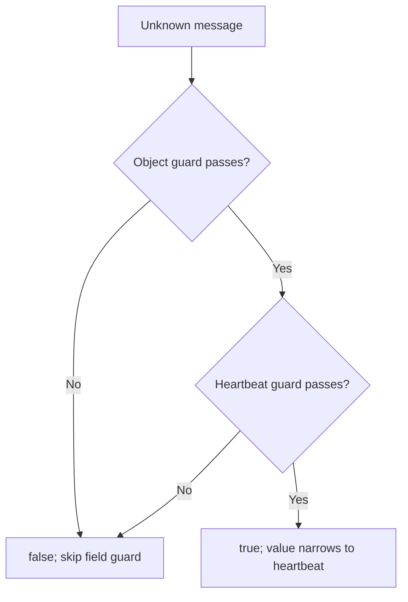

{/* BUNDLE_SIZE:START */}

> 1.58 kB minified + gzipped

{/* BUNDLE_SIZE:END */}

## Core Behavior

`Refinement<A, B>` is a type guard: a function that checks an `A` and tells TypeScript when it is a
narrower `B`.

- `compose` runs a second guard only after the first guard passes, using the first guard's narrowed
  type as the second guard's input.
- `and` requires both guards to pass; `or` accepts either. Both short-circuit.
- `to.Maybe` and `to.Result` convert a check into a function that returns a narrowed value or a
  failure.

## Example: Heartbeat Messages

A service receives decoded messages as `unknown`. Before reading the service name, it checks that
the value is an object and that it has the fields of a heartbeat message.

`compose` runs the object check first. If that check fails, it skips the field check:



### Checking a Message

```ts
import { Refinement, Result, pipe } from "@pplnd/core";

type Heartbeat = { kind: "heartbeat"; service: string };

const isRecord = (value: unknown): value is Record<string, unknown> =>
  typeof value === "object" && value !== null && !Array.isArray(value);

const isHeartbeatRecord = (value: Record<string, unknown>): value is Heartbeat =>
  value.kind === "heartbeat" && typeof value.service === "string";

const isHeartbeat = pipe(isRecord, Refinement.compose(isHeartbeatRecord));

const describeMessage = (message: unknown): string =>
  pipe(
    message,
    Refinement.to.Result(isHeartbeat, () => "Invalid heartbeat"),
    Result.match({
      ok: (heartbeat) => `Heartbeat from ${heartbeat.service}`,
      err: (error) => error,
    }),
  );

describeMessage({ kind: "heartbeat", service: "billing" }); // "Heartbeat from billing"
describeMessage({ kind: "heartbeat", service: 7 });         // "Invalid heartbeat"
```

## Core Operations

### Creating and Combining

| Signature | What it does | Result |
| :-------- | :----------- | :----- |
| `Refinement.from.Predicate(check)` | Treats a boolean function as a type guard. | A guard whose target type is supplied by the caller. |
| `Refinement.compose(next)` | Runs a guard against the type narrowed by the first guard. | Guard for the final narrower type. |
| `Refinement.and(other)` / `or(other)` | Requires both / either guard to pass. | Guard for the intersection / union type. |

A normal TypeScript type guard can also be used directly as a `Refinement`.

### Converting

| Signature | What it does | Result |
| :-------- | :----------- | :----- |
| `Refinement.to.Maybe(guard)` | Wraps a passing value. | `Some(value)` or `None`. |
| `Refinement.to.Result(guard, onFail)` | Wraps a passing value or creates an error. | `Ok(value)` or `Err(onFail(value))`. |
| `Refinement.to.Predicate(guard)` | Uses a guard as a boolean predicate. | Predicate without a narrowing signature. |

## Failure Behavior and Edge Cases

`Refinement.from.Predicate` asserts that a boolean function proves the target type; it cannot check
whether that assertion is correct. Supply a check that verifies the target type's requirements, or
use an existing TypeScript type guard as in the example. An incorrect check can make TypeScript
accept a value that does not have the promised shape.
