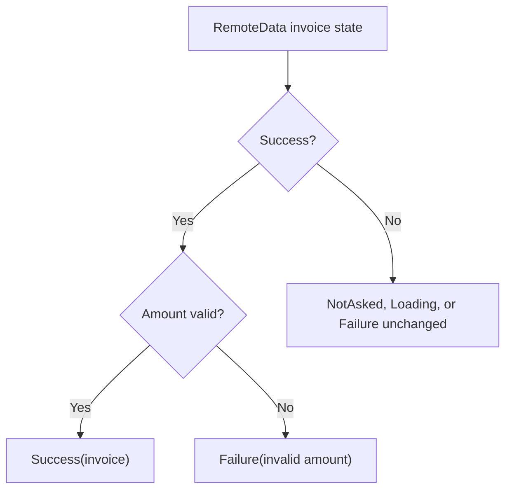

<!-- BUNDLE_SIZE:START -->

> 1.94 kB minified + gzipped

<!-- BUNDLE_SIZE:END -->

A screen shows a spinner, an error banner, and the last loaded invoice. They are three separate
fields, and a failed refresh can leave the old invoice visible under the spinner or clear the error
while the retry is still running. The request has one phase, but the fields can contradict each
other.

## Core Behavior

`RemoteData<E, A>` represents one request as one of four states: `NotAsked`, `Loading`,
`Failure<E>`, or `Success<A>`.

- `Success` carries a value and `Failure` carries an error; `Loading` and `NotAsked` carry neither.
- `map`, `chain`, and `filter` act only on `Success` and pass every other state through. `apply`
  combines two states, preferring a failure, then `Loading`, then `NotAsked`.
- `match` requires a handler for every state. The application creates the states and decides when a
  request starts.

Use `RemoteData` when a view renders one request lifecycle and the state itself must name the
current phase. [`Result`](/guides/result/) records only a settled outcome, so it cannot represent
not-started or in-flight work. The [choosing guide](/basics/choosing/) compares the containers side
by side.

## Example: Invoice Loading

With separate loading, error, and invoice fields, a failed refresh can leave a loading flag or an
old invoice on screen by accident. `RemoteData.make.loading()` represents the loading state on its
own; there is no invoice or error in that variant.

`filter` inspects a successful invoice and can turn it into a failure. For the other three states,
it leaves the state unchanged:



`map` and `chain` also act only on `Success`. The application sets request states; `RemoteData` does
not start requests or enforce their ordering.

### Loading and Displaying an Invoice

One request can set `Loading` before it starts and `Success` or `Failure` when it finishes. With
repeated requests, an older response can arrive after a newer one and overwrite it. This loader uses
a sequence number to ignore an older response and renders every state explicitly:

```ts
import { pipe, RemoteData } from "@pplnd/core";

interface Invoice {
  id: string;
  amountCents: number;
}

type InvoiceState = RemoteData<string, Invoice>;
let invoiceState: InvoiceState = RemoteData.make.notAsked();
let latestRequest = 0;

const renderInvoice = (state: InvoiceState): string =>
  pipe(
    state,
    RemoteData.filter(
      (invoice) => Number.isSafeInteger(invoice.amountCents) && invoice.amountCents >= 0,
      () => "Invoice amount is invalid",
    ),
    RemoteData.map(
      (invoice) => `Invoice ${invoice.id}: ${(invoice.amountCents / 100).toFixed(2)} USD`,
    ),
    RemoteData.match({
      notAsked: () => "Select an invoice",
      loading: () => "Loading invoice...",
      failure: (error) => `Unable to display invoice: ${error}`,
      success: (summary) => summary,
    }),
  );

const publish = (state: InvoiceState): void => {
  invoiceState = state;
  console.log(renderInvoice(invoiceState));
};

const loadInvoice = async (id: string): Promise<void> => {
  const request = ++latestRequest;
  publish(RemoteData.make.loading());
  try {
    const response = await fetch(`/api/invoices/${encodeURIComponent(id)}`);
    if (!response.ok) throw new Error(`HTTP ${response.status}`);
    const data: unknown = await response.json();
    if (
      typeof data !== "object" || data === null ||
      !("id" in data) || typeof data.id !== "string" ||
      !("amountCents" in data) || typeof data.amountCents !== "number"
    ) {
      throw new Error("Invalid invoice response");
    }
    if (request === latestRequest) {
      publish(RemoteData.make.success({ id: data.id, amountCents: data.amountCents }));
    }
  } catch (error) {
    if (request === latestRequest) {
      publish(RemoteData.make.failure(String(error)));
    }
  }
};

console.log(renderInvoice(invoiceState)); // Select an invoice
void loadInvoice("inv-42");
```

The sequence number prevents stale responses from updating this state, but the older request still
runs. To stop it, pass an `AbortSignal` to `fetch` and manage its controller;
[`Aborted`](/guides/aborted/) covers how the library's cancellable engines report a run that stopped
for the same reason. The amount check is part of rendering here; move it into the loading boundary
if every consumer must receive only validated invoices.

### Deriving the State from an Op Manager

When the request lifecycle moves into an [`Op`](/guides/op/) manager, the sequence counter and the
manual `Loading` call disappear. Subscribe to the manager and publish
`RemoteData.from.OpState(state)` for each notification, for example
`manager.subscribe((state) => publish(RemoteData.from.OpState(state)))`.

The manager decides whether a newer call replaces, queues, or drops the previous one. Its in-flight
states become `Loading`, `OpOk` becomes `Success`, and `OpErr` becomes `Failure`. A settled `OpNil`
carries a cancellation reason rather than a value or an error, so it becomes `NotAsked`. The
rendering pipeline above stays unchanged.

## Core Operations

### Creating Values

| Signature                                                | What it does                                             | Return type                 |
| :------------------------------------------------------- | :------------------------------------------------------- | :-------------------------- |
| `RemoteData.make.notAsked()` / `make.loading()`          | Creates an idle or loading state.                        | `NotAsked` / `Loading`      |
| `RemoteData.make.failure(error)` / `make.success(value)` | Stores an error or a value.                              | `Failure<E>` / `Success<A>` |
| `RemoteData.from.Result(result)`                         | Converts `Ok` to `Success` and `Err` to `Failure`.       | `RemoteData<E, A>`          |
| `RemoteData.from.Maybe(onNone)`                          | Converts `Some` to `Success`; calls `onNone` for `None`. | `RemoteData<E, A>`          |
| `RemoteData.from.OpState(state)`                         | Converts an `Op` manager state to the matching UI state. | `RemoteData<E, A>`          |

### Combining and Transforming Values

| Signature                               | What it does                                      | Guarantee                                                                             |
| :-------------------------------------- | :------------------------------------------------ | :------------------------------------------------------------------------------------ |
| `RemoteData.apply(argument)`            | Applies a wrapped function to a wrapped argument. | Failure takes precedence, then Loading, then NotAsked; both must be Success to apply. |
| `RemoteData.struct(fields)`             | Combines a record of states into one state.       | Same precedence as `apply`: Failure, then Loading, then NotAsked.                     |
| `RemoteData.map(fn)` / `mapError(fn)`   | Transforms a success value or failure error.      | Other states pass through.                                                            |
| `RemoteData.chain(fn)`                  | Calls a state-producing function for `Success`.   | Other states pass through.                                                            |
| `RemoteData.filter(predicate, onFalse)` | Checks a success value.                           | A failed check becomes `Failure(onFalse(value))`.                                     |
| `RemoteData.recover(fn)`                | Replaces `Failure` with the callback's state.     | Other states pass through.                                                            |
| `RemoteData.tap(fn)` / `tapError(fn)`   | Runs a callback for `Success` / `Failure`.        | Returns the original state.                                                           |

### Reading and Converting

| Signature                                                                                         | What it does                                                          | Return type                   |
| :------------------------------------------------------------------------------------------------ | :-------------------------------------------------------------------- | :---------------------------- |
| `RemoteData.match(cases)`                                                                         | Handles all four states.                                              | The selected callback result. |
| `RemoteData.is.notAsked(value)` / `is.loading(value)` / `is.failure(value)` / `is.success(value)` | Checks a state.                                                       | Type guard.                   |
| `RemoteData.getOrElse(fn)`                                                                        | Reads a success value or calls a fallback for every other state.      | Value or fallback result.     |
| `RemoteData.to.Maybe(value)`                                                                      | Keeps only a success value.                                           | `Some(value)` or `None`.      |
| `RemoteData.to.Result(onNotReady)`                                                                | Converts success and failure; calls the fallback for idle or loading. | `Ok(value)` or `Err(error)`.  |

## Failure Behavior and Edge Cases

`recover` handles an existing `Failure`; it does not catch a rejected request. Convert request
errors to `Failure` at the loading boundary if they should be rendered.

`from.OpState` maps a manager state from `Op`: `Idle` becomes `NotAsked`, the in-flight states
`Pending`, `Queued`, and `Retrying` become `Loading`, `OpOk` becomes `Success`, and `OpErr` becomes
`Failure`. A settled `OpNil` carries a cancellation reason rather than a value or an error, so it
becomes `NotAsked`; the manager keeps that reason in its own state if the UI needs to display it.

If both inputs to `apply` are failures, it returns the failure from the function's state:

```ts
import { pipe, RemoteData } from "@pplnd/core";

const formatterState = RemoteData.make.failure("Invoice formatter unavailable");
const invoiceState = RemoteData.make.failure("Invoice unavailable");

pipe(formatterState, RemoteData.apply(invoiceState));
// Failure("Invoice formatter unavailable")
```

In a sequence of applications, an earlier failure is retained. Loading and NotAsked carry no
previous value, so preserving stale data during refresh requires a separate application model.

`from.Maybe` converts `None` to `Failure`, not `NotAsked`: a missing payload is treated as a failed
load. If absence is not an error, keep the value outside `RemoteData` or use a success value that
represents the empty result.
