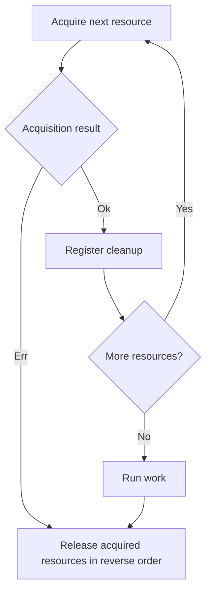

<!-- BUNDLE_SIZE:START -->

> 2.10 kB minified + gzipped

<!-- BUNDLE_SIZE:END -->

## Core Behavior

`Resource<E, A>` describes how to acquire a value and release it after use.

- `Resource.use` starts acquisition and returns a deferred result after cleanup.
- `chain`, `combine`, and `all` acquire resources in sequence. If a later acquisition returns an
  error, previously acquired values are released in reverse order.
- After successful acquisition, `use` runs cleanup after the work completes, including when the work
  returns an error.

## Example: Reading Rotated Logs

A log inspector needs to open the current and previous log files and close both after reading them.
If opening the second file fails, the first handle still needs to close.

Successful acquisitions register cleanup. A later acquisition error skips the work and releases
previously acquired resources in reverse order:



### Opening and Closing Files

This example creates two temporary log files, reads them through resources, and closes their handles
in reverse order. The temporary directory is removed after the work finishes:

```ts
import { mkdtemp, open, rm, writeFile } from "node:fs/promises";
import { tmpdir } from "node:os";
import { join } from "node:path";
import { Resource, Task } from "@pplnd/core";

const directory = await mkdtemp(join(tmpdir(), "log-inspector-"));
try {
  const currentPath = join(directory, "current.log");
  const previousPath = join(directory, "previous.log");
  await writeFile(currentPath, "started\n");
  await writeFile(previousPath, "finished\n");

  const openLog = (path: string) => Resource.make(
    Task.Result.tryCatch(() => open(path, "r"), { onError: (error) => String(error) }),
    (handle) => Task.tryCatch(
      () => handle.close(),
      { onError: (error) => console.error(`Could not close ${path}: ${String(error)}`) },
    ),
  );

  const logs = Resource.all({ current: openLog(currentPath), previous: openLog(previousPath) });
  const result = await Resource.use(logs, {
    run: ({ current, previous }) => Task.Result.tryCatch(
      async () => ({
        current: await current.readFile("utf8"),
        previous: await previous.readFile("utf8"),
      }),
      { onError: (error) => String(error) },
    ),
  });

  if (result.kind === "Ok") console.log(result.value);
  else console.error(result.error);
} finally {
  await rm(directory, { recursive: true, force: true });
}
```

## Core Operations

### Creating and Combining

| Signature                         | What it does                                      | Behavior                                   |
| :-------------------------------- | :------------------------------------------------ | :----------------------------------------- |
| `Resource.make(acquire, release)` | Pairs a fallible acquisition with a release task. | Release receives the acquired value.       |
| `Resource.map(fn)`                | Transforms an acquired value.                     | Retains cleanup for the original resource. |
| `Resource.chain(fn)`              | Acquires a resource using a previous value.       | The new resource is released first.        |
| `Resource.combine(first, second)` | Acquires two resources.                           | Produces a pair.                           |
| `Resource.all(resources)`         | Acquires a tuple or record of resources in order. | Produces matching values.                  |
| `Resource.use(resource, { run })` | Acquires, runs a `Task.Result`, then releases.    | Returns a deferred work result.            |

For infallible acquisition, pass `Task.Result.from.Task(acquire)` to `Resource.make`.

## Failure Behavior and Edge Cases

Only successful acquisitions register a release. A failed acquisition returns its error and the work
callback is skipped. Release runs in reverse acquisition order.

Acquisition and work use `Task.Result` to report expected errors. Release is an infallible `Task`;
handle any expected release failure inside that task. Resource callbacks and tasks must not throw or
reject. A contract violation can prevent cleanup or leave the returned deferred result unsettled.

Tasks supplied to a resource must honor the `Task` contract and not reject. The signal passed to
`use` is also passed to acquisition, work, and cleanup; cancellation depends on those tasks' signal
handling.
