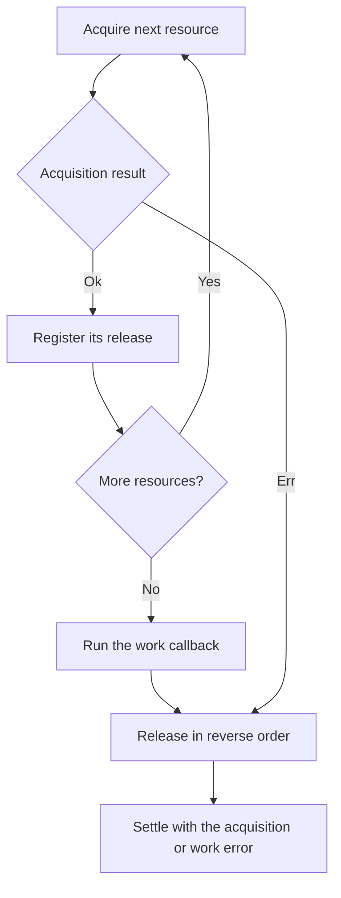

<!-- BUNDLE_SIZE:START -->

> 2.05 kB minified + gzipped

<!-- BUNDLE_SIZE:END -->

An import job opens a database connection and takes a lock on the catalog table. The connection step
fails, the error returns to the caller, and the lock stays held until someone restarts the worker.
Every later run queues behind a lock whose owner is gone.

## Core Behavior

`Resource<E, A>` describes an asynchronous acquisition, the value it produces, and a release that
runs once the value is no longer needed.

- Only a successful acquisition registers its release. If a later acquisition in the same scope
  fails, the releases registered so far run in reverse order before the error returns.
- `use` runs the work after every acquisition succeeds, then releases all acquired values, including
  when the work returns an error.
- Releases run in reverse acquisition order and receive the signal passed to `use`.
- `all` and `combine` acquire sequentially, so a failure stops the remaining acquisitions.

Reach for `Resource` when work needs something opened before it and closed after it. When several
writes must undo completed steps after a failure, [`Transaction`](/guides/transaction/) runs the
compensations. The [type model](/basics/types/) groups a resource with the other definitions that
describe work, and the [choosing guide](/basics/choosing/) compares the execution shapes.

## Example: Catalog Import

A nightly import takes a lock so two workers cannot write the catalog at once, connects to the
catalog database, and adds the batch. The lock has to be released before the worker exits, including
on the path where the connection never opens.

Successful acquisitions register their release. A failed acquisition skips the work and releases
what was already acquired:



### Opening the Import Session

`Resource.all` acquires the record in key order, so the lock is taken first. The work callback
receives both values, and the releases run in reverse: the connection closes before the lock is
released.

```ts
import { Resource, Task } from "@pplnd/core";

type CatalogClient = { readonly name: string; readonly items: Set<string> };
type ImportSession = { readonly lock: string; readonly catalog: CatalogClient };

const events: string[] = [];
const locks = new Set<string>();
const catalog = new Set<string>();

const describeError = (error: unknown): string =>
  error instanceof Error ? error.message : String(error);

const takeLock = (name: string): Task.Result<string, string> =>
  Task.Result.tryCatch(
    async () => {
      if (locks.has(name)) throw new Error(`${name} is already held`);
      locks.add(name);
      events.push("locked");
      return name;
    },
    { onError: (error) => `Lock failed: ${describeError(error)}` },
  );

const releaseLock = (name: string): Task<unknown> =>
  Task.tryCatch(
    async () => {
      locks.delete(name);
      events.push("unlocked");
    },
    { onError: (error) => console.error(`Unlock failed: ${describeError(error)}`) },
  );

const connectCatalog = (online: boolean): Task.Result<string, CatalogClient> =>
  Task.Result.tryCatch(
    async () => {
      if (!online) throw new Error("catalog-primary is offline");
      events.push("connected");
      return { name: "catalog-primary", items: catalog };
    },
    { onError: (error) => `Connection failed: ${describeError(error)}` },
  );

const disconnectCatalog = (client: CatalogClient): Task<unknown> =>
  Task.tryCatch(
    async () => {
      events.push(`disconnected ${client.name}`);
    },
    { onError: (error) => console.error(`Disconnect failed: ${describeError(error)}`) },
  );

const importItems = ["trowel", "level", "wheelbarrow"];

const openImport = (online: boolean): Resource<string, ImportSession> =>
  Resource.all({
    lock: Resource.make(takeLock("catalog-import"), releaseLock),
    catalog: Resource.make(connectCatalog(online), disconnectCatalog),
  });

const importCatalog = (online: boolean) =>
  Resource.use(openImport(online), {
    run: ({ catalog, lock }: ImportSession) =>
      Task.Result.tryCatch(
        async () => {
          for (const id of importItems) catalog.items.add(id);
          events.push(`imported ${importItems.length} items`);
          return { lock, imported: importItems.length };
        },
        { onError: (error) => `Import failed: ${describeError(error)}` },
      ),
  });

console.log(await importCatalog(true));
// { kind: "Ok", value: { lock: "catalog-import", imported: 3 } }
console.log(events);
// ["locked", "connected", "imported 3 items", "disconnected catalog-primary", "unlocked"]

events.length = 0;
console.log(await importCatalog(false));
// { kind: "Err", error: "Connection failed: catalog-primary is offline" }
console.log(events);
// ["locked", "unlocked"]
```

The second run never reaches the work callback. The lock was acquired before the connection failed,
so the scope releases it before returning the error.

### Handing the Session to a Transaction

When the import grows into several writes that must undo completed steps, the transaction receives
the acquired client as its run input. The steps read it from `ctx.input`, and a signal passed to
`use` reaches them:

```ts
import { Transaction } from "@pplnd/core";

const step = Transaction.stepFactory<{ client: CatalogClient; items: readonly string[] }>();
const importBatch = Transaction.make(
  step("import", ({ ctx: { input } }) =>
    Task.Result.tryCatch(
      async () => {
        for (const id of input.items) input.client.items.add(id);
      },
      { onError: (error) => `Import failed: ${describeError(error)}` },
    )),
);

const outcome = await Resource.use(openImport(true), {
  run: ({ catalog }: ImportSession) => (signal: AbortSignal | undefined) =>
    Transaction.run({ client: catalog, items: importItems }, { signal })(importBatch),
});
```

The client is still released after the transaction settles, whatever the transaction's outcome. See
[`Transaction`](/guides/transaction/) for the step and undo surface.

## Core Operations

### Creating Resources

| Signature                         | What it does                                          | Behavior                               |
| :-------------------------------- | :---------------------------------------------------- | :------------------------------------- |
| `Resource.make(acquire, release)` | Pairs a fallible acquisition with an infallible task. | `release` receives the acquired value. |

### Combining Resources

| Signature                         | What it does                                     | Behavior                                                  |
| :-------------------------------- | :----------------------------------------------- | :-------------------------------------------------------- |
| `Resource.chain(transform)`       | Acquires a second resource from the first value. | Releases the second before the first; errors are unioned. |
| `Resource.combine(first, second)` | Acquires two resources in order.                 | Produces a readonly tuple.                                |
| `Resource.all(resources)`         | Acquires a tuple or record in key order.         | Stops at the first acquisition error.                     |

### Transforming Acquired Values

| Signature          | What it does                   | Behavior                               |
| :----------------- | :----------------------------- | :------------------------------------- |
| `Resource.map(fn)` | Transforms the acquired value. | Keeps the original resource's release. |

### Running a Scope

| Signature                                  | What it does                         | Return type                |
| :----------------------------------------- | :----------------------------------- | :------------------------- |
| `Resource.use(resource, { run, signal? })` | Acquires, runs `run`, then releases. | A deferred `Result<E, B>`. |

For an infallible acquisition, convert it first with `Task.Result.from.Task(acquire)`; the resource
then has error type `never`. Annotate the `run` parameter with the acquired type. The resource is
supplied after the options, so TypeScript cannot infer that type from the call. The optional
`signal` is forwarded to acquisition, work, and release. `run` must return a `Task.Result`; a plain
`Task` cannot express the work's error. The result error type is the union of the acquisition and
work errors.

## Failure Behavior and Edge Cases

Only a successful acquisition registers a release. A failed acquisition returns its error, the work
callback is skipped, and the releases already registered run in reverse order. A release that
returns an error is invisible to `use`, because release is a `Task`; handle expected release
failures inside that task.

Acquisition, work, and release must not throw or reject. `Deferred.from.Promise` never settles when
its promise rejects, so a rejected work task stops the scope before cleanup and a rejected release
stops the remaining releases. Either way the returned deferred stays pending. Wrap fallible work in
`Task.Result.tryCatch` and `Task.tryCatch`.

`map` runs its transform inside the acquisition. A transform that throws rejects the containing
promise, so the scope never reaches its releases.

Acquisition is sequential: `combine` acquires left then right, and `all` acquires record keys in
enumeration order. The signal passed to `use` is forwarded to acquisition, work, and release; a task
that ignores it keeps running, and cleanup starts only after the work settles. A task that observes
the signal can report cancellation with the shared [`Aborted`](/guides/aborted/) outcome, but
`Resource` does not add a cancelled variant of its own.
