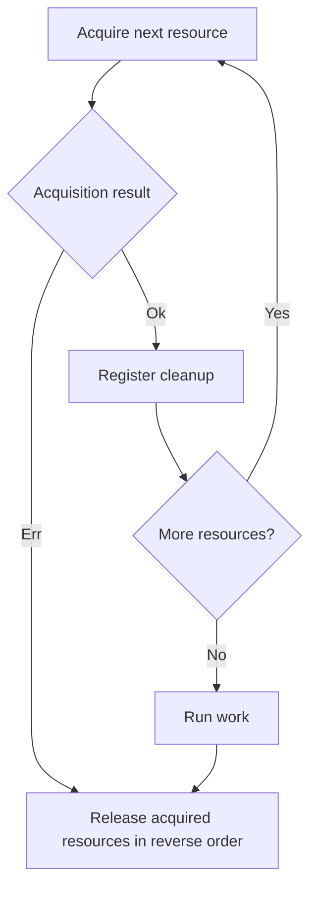

<!-- BUNDLE_SIZE:START -->

> 2.51 kB minified + gzipped

<!-- BUNDLE_SIZE:END -->

## Core Behavior

`Resource<E, A>` describes how to acquire a value and release it after use.

- `Resource.use` returns a task; acquisition and cleanup occur when that task runs.
- `chain`, `combine`, and `all` acquire resources in sequence. If a later acquisition returns an
  error, previously acquired values are released in reverse order.
- After successful acquisition, `use` runs cleanup after the work completes, including when the work
  returns an error.

## Example: Reading Rotated Logs

A log inspector needs to open the current and previous log files and close both after reading them.
If opening the second file fails, the first handle still needs to close.

Successful acquisitions register cleanup. A later acquisition error skips the work and releases
previously acquired resources in reverse order:



### Opening and Closing Files

This example creates two temporary log files, reads them through resources, and closes their handles
in reverse order. The temporary directory is removed after the task finishes:

```ts
import { mkdtemp, open, rm, writeFile } from "node:fs/promises";
import { tmpdir } from "node:os";
import { join } from "node:path";
import { Resource, Task, pipe } from "@pplnd/core";

const directory = await mkdtemp(join(tmpdir(), "log-inspector-"));
try {
  const currentPath = join(directory, "current.log");
  const previousPath = join(directory, "previous.log");
  await writeFile(currentPath, "started\n");
  await writeFile(previousPath, "finished\n");

  const openLog = (path: string) => Resource.make(
    Task.Result.tryCatch(() => open(path, "r"), { onError: (error) => String(error) }),
    (handle) => Task.tryCatch(
      () => handle.close(),
      { onError: (error) => console.error(`Could not close ${path}: ${String(error)}`) },
    ),
  );

  const logs = Resource.all({ current: openLog(currentPath), previous: openLog(previousPath) });
  const result = await pipe(
    logs,
    Resource.use(({ current, previous }) => Task.Result.tryCatch(
      async () => ({
        current: await current.readFile("utf8"),
        previous: await previous.readFile("utf8"),
      }),
      { onError: (error) => String(error) },
    )),
  )();

  if (result.kind === "Ok") console.log(result.value);
  else console.error(result.error);
} finally {
  await rm(directory, { recursive: true, force: true });
}
```

## Core Operations

### Creating and Combining

| Signature                              | What it does                                      | Behavior                                   |
| :------------------------------------- | :------------------------------------------------ | :----------------------------------------- |
| `Resource.make(acquire, release)`      | Pairs a fallible acquisition with a release task. | Release receives the acquired value.       |
| `Resource.from.Task(acquire, release)` | Pairs an infallible task with a release task.     | Acquisition has no typed error.            |
| `Resource.map(fn)`                     | Transforms an acquired value.                     | Retains cleanup for the original resource. |
| `Resource.chain(fn)`                   | Acquires a resource using a previous value.       | The new resource is released first.        |
| `Resource.combine(first, second)`      | Acquires two resources.                           | Produces a pair.                           |
| `Resource.all(resources)`              | Acquires a tuple or record of resources in order. | Produces matching values.                  |
| `Resource.use(fn)`                     | Acquires, runs a `Task.Result`, then releases.    | Returns a task containing the work result. |

## Failure Behavior and Edge Cases

Only successful acquisitions register a release. A failed acquisition returns its error and the work
callback is skipped. Release runs in reverse acquisition order.

`Resource.use` returns an `Unexpected` error when acquisition, work, or a release throws. For
exceptions during acquisition or work, it returns `Unexpected.Execution` where `phase` is
`"acquire"` or `"use"`, and `cause` contains the thrown value. When a release throws, it returns
`Unexpected.Release` where `phase` is `"release"`, containing `cause`, the preceding work `previous`
result (which may itself hold an error or `Unexpected.Execution`), and `additionalErrors` if other
finalizers fail. Cleanup continues even if a release throws.

Tasks supplied to a resource must honor the `Task` contract and not reject. The signal passed to
`use` is also passed to acquisition, work, and cleanup; cancellation depends on those tasks' signal
handling.
