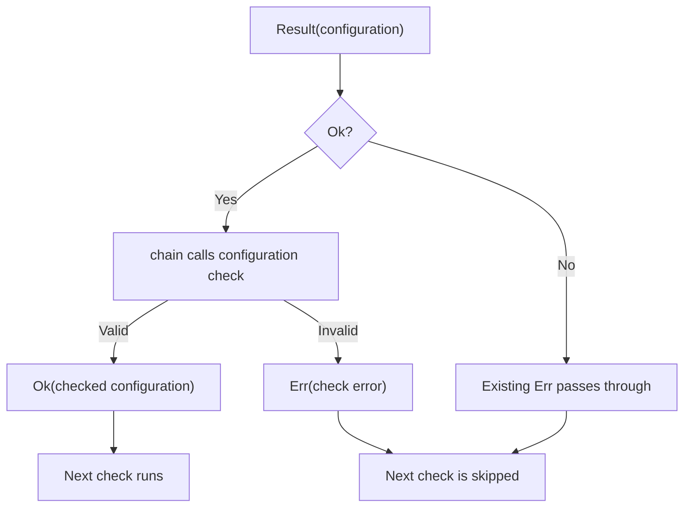

<!-- BUNDLE_SIZE:START -->

> 1.51 kB minified + gzipped

<!-- BUNDLE_SIZE:END -->

A function throws, and nothing in its signature says it can. The failure travels up the call stack
until something catches it, usually far from the call that caused it, and the caller's type says
nothing about what went wrong.

## Core Behavior

`Result<E, A>` represents a synchronous operation as either `Ok` with a value or `Err` with an
error.

- `map`, `chain`, and `ensure` skip their callbacks when they receive an `Err`.
- `chain` runs a dependent operation after success and includes its error type in the result.
- `match` handles both cases; `is.ok` and `is.err` narrow the union for ordinary `if` statements.

Reach for `Result` when the first failure ends the operation. When several independent fields must
each report their own error, [`Validation`](/guides/validation/) collects every failure instead of
stopping at the first. The [choosing guide](/basics/choosing/) compares the error containers side by
side.

## Example: Server Configuration

A server reads its configuration from JSON and checks the host and port before it starts. Each check
depends on the previous one succeeding.

`chain` passes an `Ok` value to the next check. An existing `Err` bypasses the check, while the
check can return its own `Err`:



The first returned error stops dependent checks. `match` can then report that error or use the
successful value.

### Parsing Server Configuration

A direct parser can throw before the caller checks the port. Its return type also does not describe
that failure:

```ts
function readPort(raw: string): number {
  const config = JSON.parse(raw);
  return config.port;
}
```

Start by converting the parsing exception to a named error. `JSON.parse` only checks syntax, so its
output still needs validation.

```ts
import { Result } from "@pplnd/core";

const parsed = Result.tryCatch((): unknown => JSON.parse('{"port":8080}'), {
  onError: () => "INVALID_JSON",
});
// Ok with an unknown value, or Err("INVALID_JSON")
```

A server configuration also needs a host, a valid port, and a cross-field rule: a public host must
not use a privileged port. The pipeline checks these in order. Later checks need the parsed object,
so they cannot run when parsing fails.

```ts
import { pipe, Result } from "@pplnd/core";

interface ServerConfig {
  host: string;
  port: number;
}

type ConfigError = "INVALID_JSON" | "INVALID_CONFIG" | "INVALID_PORT" | "PUBLIC_PRIVILEGED_PORT";
type ConfigResponse = { status: number; body: string };

const isConfig = (value: unknown): value is ServerConfig => {
  if (typeof value !== "object" || value === null || Array.isArray(value)) return false;
  const fields = value as Record<string, unknown>;
  return typeof fields.host === "string" && fields.host.trim().length > 0 &&
    typeof fields.port === "number";
};

const loadConfig = (raw: string): Result<ConfigError, ServerConfig> =>
  pipe(
    Result.tryCatch((): unknown => JSON.parse(raw), {
      onError: () => "INVALID_JSON" as const,
    }),
    Result.ensure(isConfig, () => "INVALID_CONFIG" as const),
    Result.map((config) => ({ ...config, host: config.host.trim().toLowerCase() })),
    Result.ensure(
      (config) => Number.isInteger(config.port) && config.port >= 1 && config.port <= 65535,
      () => "INVALID_PORT" as const,
    ),
    Result.chain((config): Result<ConfigError, ServerConfig> =>
      config.host !== "localhost" && config.port < 1024
        ? Result.make.err("PUBLIC_PRIVILEGED_PORT")
        : Result.make.ok(config)
    ),
  );

const configResponse = (raw: string): ConfigResponse =>
  pipe(
    loadConfig(raw),
    Result.match({
      ok: (config) => ({ status: 200, body: JSON.stringify(config) }),
      err: (error) => ({ status: 400, body: error }),
    }),
  );

console.log(configResponse('{"host":"localhost","port":8080}'));
// { status: 200, body: '{"host":"localhost","port":8080}' }
console.log(configResponse('{"host":"example.com","port":80}'));
// { status: 400, body: "PUBLIC_PRIVILEGED_PORT" }
```

The error constructors and error-producing callbacks preserve inline literal types. Inline object
errors can infer readonly literal properties; choose an explicit wider type if the error must be
mutable:

```ts
import { Result } from "@pplnd/core";

const failure = Result.make.err<{ code: string }>({ code: "INVALID_PORT" });
failure.error.code = "INVALID_JSON";
```

This affects inference, not runtime freezing. TypeScript 5.5 can widen primitive literals returned
by callbacks; the full example uses `as const` to retain its exact error union on that version.

### When the configuration arrives over the network

The same parser works when the text comes from a config service instead of a file. Only the source
of the string changes; `loadConfig` stays intact and runs inside the asynchronous task:

```ts
import { pipe, Task } from "@pplnd/core";

const loadRemoteConfig = (url: string): Task.Result<ConfigError, ServerConfig> =>
  pipe(
    Task.Result.tryCatch(
      (signal) => fetch(url, { signal }).then((response) => response.text()),
      { onError: () => "INVALID_JSON" as const },
    ),
    Task.Result.chain((text: string) => Task.make(loadConfig(text))),
  );

const response = await loadRemoteConfig("/etc/server.json")();
// Ok(config) or Err("PUBLIC_PRIVILEGED_PORT")
```

[`Task.Result`](/guides/task/) keeps the error channel and threads an `AbortSignal` —
[Aborted](/guides/aborted/) covers what that signal does — so the same typed errors cross the
network boundary. When the request needs retries, timeouts, or overlapping calls, wrap the task in
[`Op`](/guides/op/).

## Core Operations

### Creating Values

| Operation                                      | What it does                                           | Error or return type |
| :--------------------------------------------- | :----------------------------------------------------- | :------------------- |
| `make.ok(value)` / `make.err(error)`           | Wrap a success or an error.                            | `Ok<A>` / `Err<E>`   |
| `tryCatch(operation, { onError })`             | Run synchronous code and map a thrown value.           | `Result<E, A>`       |
| `from.Predicate(predicate, onFalse)`           | Check a value; a type guard also narrows it.           | `Result<E, A>`       |
| `from.nullable(onNull)` / `from.Maybe(onNone)` | Replace a missing value with an error.                 | `Result<E, A>`       |
| `from.Validation(combineErrors)`               | Convert a validation, combining its errors on failure. | `Result<E, A>`       |

### Combining Values

| Operation                             | What it does                                         | Guarantee                                             |
| :------------------------------------ | :--------------------------------------------------- | :---------------------------------------------------- |
| `chain(next)`                         | Run a `Result`-returning operation on an `Ok` value. | Preserves the first error; unions error types.        |
| `assignTo(key)` / `assign(key, next)` | Start a record / add a dependent result to it.       | `assign` skips `next` on an error.                    |
| `struct(fields)`                      | Combine a record of already-created results.         | Returns the first error in own-key enumeration order. |
| `apply(argument)`                     | Apply a wrapped function to a wrapped argument.      | Prefers the function result's error if both failed.   |

### Transforming Values

| Operation                                                  | What it does                                                    | Guarantee                                               |
| :--------------------------------------------------------- | :-------------------------------------------------------------- | :------------------------------------------------------ |
| `map(transform)` / `mapError(transform)`                   | Transform the success / error value.                            | The other case passes through.                          |
| `mapBoth(onErr, onOk)`                                     | Transform either case.                                          | Only the matching callback runs.                        |
| `ensure(predicate, onFail)`                                | Check an `Ok` value, optionally narrowing it with a type guard. | Existing errors pass through.                           |
| `tap(effect)` / `tapError(effect)`                         | Inspect success / error without replacing the result.           | Returns the original result when the callback returns.  |
| `recover(fallback)` / `recoverUnless(isBlocked, fallback)` | Replace an error with a fallback result.                        | `recoverUnless` keeps errors selected by the predicate. |

### Running Code and Leaving Result

| Operation                                    | What it does                                         | Return type                                                  |
| :------------------------------------------- | :--------------------------------------------------- | :----------------------------------------------------------- |
| `match({ ok, err })`                         | Handle both cases.                                   | The selected handler's return value.                         |
| `getOrElse(fallback)`                        | Extract success or call a no-argument fallback.      | Success or fallback value.                                   |
| `is.ok(result)` / `is.err(result)`           | Test and narrow the variant.                         | Boolean type guard.                                          |
| `to.Maybe(result)` / `to.Validation(result)` | Convert the outcome.                                 | `Maybe` discards the error; `Validation` wraps it in a list. |
| `sequence.Maybe(result)`                     | Swap `Result<E, Maybe<A>>` to `Maybe<Result<E, A>>`. | An `Err` becomes `Some(Err)`; `Ok(None)` becomes `None`.     |

## Failure Behavior and Edge Cases

`tryCatch` catches synchronous throws from its operation, including a `JSON.parse` syntax error. It
also calls `onError` inside the catch path; if that callback throws, the exception escapes. Other
callbacks, including predicates, transformations, recovery, and logging, are not wrapped in a catch.
Wrap a throwing operation explicitly where it enters the pipeline.

`struct` receives results that have already been created: JavaScript evaluates object property
expressions before `struct` sees them. Its first-error behavior does not prevent those expressions
from running. Use `chain` or `assign` to defer a dependent operation until the previous step passes.

For example, both checks below run, even though `struct` returns the host error:

```ts
import { Result } from "@pplnd/core";

const checkHost = () => Result.make.err("HOST_REQUIRED");
const checkPort = () => {
  console.log("Checking port");
  return Result.make.err("PORT_INVALID");
};

const config = Result.struct({ host: checkHost(), port: checkPort() });
// Logs "Checking port" and returns Err("HOST_REQUIRED")
```

A promise returned from `tryCatch` is an `Ok` containing that promise; a later rejection is not
caught. Use [`Task.Result`](/guides/task/) or [`Op`](/guides/op/) for asynchronous work.
