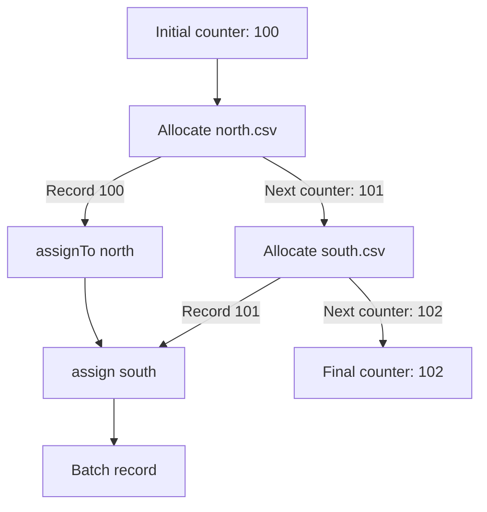

<!-- BUNDLE_SIZE:START -->

> 229 B minified + gzipped

<!-- BUNDLE_SIZE:END -->

An importer stamps each record with the next sequence number and hands the updated counter to the
following batch. A module-level counter survives a failed validation: the numbers are burned, and a
rerun starts higher than the audit log expects. Returning the counter from every function works
until one early return skips the update.

## Core Behavior

`State<S, A>` is a function from a state `S` to a pair of the produced value `A` and the next state
`S`.

- `chain` passes the produced value to the next computation and feeds it the updated state; `map`
  changes only the produced value.
- `get` reads the state, `put` replaces it, and `modify` transforms it; `put` and `modify` produce
  `undefined`.
- `run` returns `[value, finalState]`; `evaluate` and `execute` each run the pipeline again and
  discard one part.
- `assignTo` and `assign` accumulate results into a record while the state passes through every
  step.

Use `State` when each step must hand an updated value to the next and the final state matters. When
the value comes from context supplied once at the edge and does not change during the run,
[`Reader`](/guides/reader/) removes the state threading entirely. The
[choosing guide](/basics/choosing/) groups both under pure context and state threading.

## Example: Allocating Sequence Numbers

An importer assigns sequence numbers to records. Each allocation needs the next available number,
and the caller needs the updated counter for the next batch.

`chain` feeds the next state from one allocation into the next. `assignTo` and `assign` keep each
allocation's record while the updated counter moves on:



### Allocating a Batch

A single allocation reads the counter, increments it, and returns a labeled record. `assign` keeps
both records while passing the updated counter between allocations:

```ts
import { pipe, State } from "@pplnd/core";

type ImportedRecord = { sequence: number; source: string };

const allocate = (source: string): State<number, ImportedRecord> =>
  pipe(
    State.get<number>(),
    State.chain((sequence) =>
      pipe(
        State.modify<number>((next) => next + 1),
        State.map(() => ({ sequence, source })),
      )
    ),
  );

const batch = pipe(
  allocate("north.csv"),
  State.assignTo("north"),
  State.assign("south", () => allocate("south.csv")),
);

const [records, nextSequence] = pipe(batch, State.run(100));
// records: { north: { sequence: 100, source: "north.csv" },
//            south: { sequence: 101, source: "south.csv" } }
// nextSequence: 102
```

Running the same batch with another initial counter starts a separate sequence. To continue this
one, pass `nextSequence` to the next batch.

### Pulling the starting number from settings

Running the batch with `100` fixes the starting number in the source. When that number comes from
deployment settings that stay fixed for the run, [`Reader`](/guides/reader/) supplies it once at the
edge and leaves the state transitions unchanged:

```ts
import { pipe, Reader, State } from "@pplnd/core";

const runBatch = (start: number) => pipe(batch, State.run(start));

const batchFromSettings = pipe(
  Reader.ask<{ firstSequence: number }>(),
  Reader.map((settings) => runBatch(settings.firstSequence)),
);
```

The batch no longer chooses its starting point. The reader supplies configuration, and the state
still owns the counter that changes between records.

## Core Operations

### Creating State Computations

| Signature           | What it does                                    | Produced value |
| :------------------ | :---------------------------------------------- | :------------- |
| `State.make(value)` | Returns a value without changing the state.     | `A`            |
| `State.get<S>()`    | Reads the current state.                        | `S`            |
| `State.put(next)`   | Replaces the current state.                     | `undefined`    |
| `State.modify(fn)`  | Calculates the next state from the current one. | `undefined`    |

A function `(state: S) => readonly [A, S]` can also be used directly.

### Combining and Transforming

| Signature                                 | What it does                                         | Behavior                                   |
| :---------------------------------------- | :--------------------------------------------------- | :----------------------------------------- |
| `State.map(fn)` / `chain(fn)`             | Transforms the value / runs a dependent computation. | `chain` passes along the updated state.    |
| `State.apply(argument)`                   | Applies a stateful function to a stateful argument.  | Function computation runs before argument. |
| `State.assignTo(key)` / `assign(key, fn)` | Starts a record / adds a later result.               | State passes between the steps.            |
| `State.focus(lens)`                       | Runs a computation against part of a larger state.   | Replaces that part with its next state.    |
| `State.tap(sideEffect)`                   | Observes the produced value.                         | Keeps the value and next state.            |

### Running

| Signature                 | Returns               |
| :------------------------ | :-------------------- |
| `State.run(initial)`      | `[value, finalState]` |
| `State.evaluate(initial)` | The value.            |
| `State.execute(initial)`  | The final state.      |

## Failure Behavior and Edge Cases

`evaluate` and `execute` each run the computation. Calling both separately repeats every step; use
`run` when both the value and the final state are needed.

`apply` runs the function computation first, then the argument computation with the state the first
one produced. `assign` evaluates the attached computation after the accumulator, so a later step
sees the state left by the earlier one.

`State` passes state values between functions; it does not prevent a callback from mutating an
object supplied as state. Return an updated object when the original must remain unchanged.

`State` has no error channel. A callback that throws ends the run and the exception escapes to the
caller of `State.run`; return a [`Result`](/guides/result/) as the produced value when a step can
fail.

Chains execute as nested function calls. Extremely deep synchronous chains can exceed the JavaScript
call stack; split unusually large pipelines into smaller stages.
