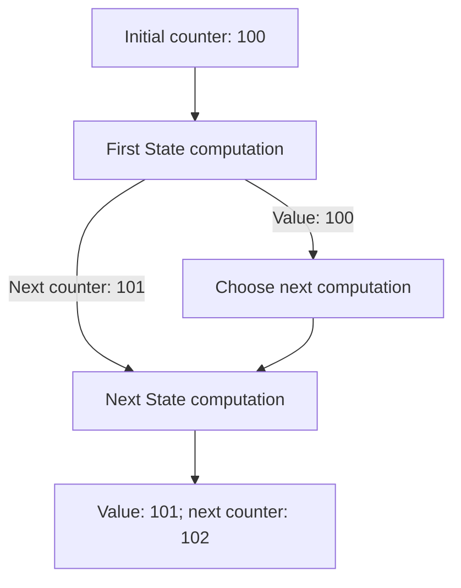

<!-- BUNDLE_SIZE:START -->

> 229 B minified + gzipped

<!-- BUNDLE_SIZE:END -->

## Core Behavior

`State<S, A>` is a function that takes a state `S` and returns a pair: the produced value `A` and
its next state `S`.

- `chain` passes the first value to the next computation and uses the first step's next state as its
  input.
- `map` changes the produced value while retaining the next state.
- `run` returns both parts. `evaluate` returns only the value; `execute` returns only the final
  state.

## Example: Allocating Sequence Numbers

An importer assigns sequence numbers to records. Each allocation needs the next available number,
and the caller needs the updated counter for the next batch.

`chain` feeds the next state from one allocation into the next. The first allocation's value can be
used to choose the second computation:



### Allocating a Batch

A single allocation reads the counter, increments it, and returns a labeled record. `assign` keeps
both records while passing the updated counter between allocations:

```ts
import { pipe, State } from "@pplnd/core";

type ImportedRecord = { sequence: number; source: string };

const allocate = (source: string): State<number, ImportedRecord> =>
  pipe(
    State.get<number>(),
    State.chain((sequence) =>
      pipe(
        State.modify<number>((next) => next + 1),
        State.map(() => ({ sequence, source })),
      )
    ),
  );

const batch = pipe(
  allocate("north.csv"),
  State.assignTo("north"),
  State.assign("south", () => allocate("south.csv")),
);

const [records, nextSequence] = pipe(batch, State.run(100));
// records: { north: { sequence: 100, source: "north.csv" },
//            south: { sequence: 101, source: "south.csv" } }
// nextSequence: 102
```

Running the same batch with another initial counter starts a separate sequence. To continue this
one, pass `nextSequence` to the next batch.

## Core Operations

### Creating State Computations

| Signature           | What it does                                    | Produced value |
| :------------------ | :---------------------------------------------- | :------------- |
| `State.make(value)` | Returns a value without changing the state.     | `A`            |
| `State.get<S>()`    | Reads the current state.                        | `S`            |
| `State.put(next)`   | Replaces the current state.                     | `undefined`    |
| `State.modify(fn)`  | Calculates the next state from the current one. | `undefined`    |

A function `(state: S) => readonly [A, S]` can also be used directly.

### Combining and Transforming

| Signature                                 | What it does                                         | Behavior                                   |
| :---------------------------------------- | :--------------------------------------------------- | :----------------------------------------- |
| `State.map(fn)` / `chain(fn)`             | Transforms the value / runs a dependent computation. | `chain` passes along the updated state.    |
| `State.apply(argument)`                   | Applies a stateful function to a stateful argument.  | Function computation runs before argument. |
| `State.assignTo(key)` / `assign(key, fn)` | Starts a record / adds a later result.               | State passes between the steps.            |
| `State.focus(lens)`                       | Runs a computation against part of a larger state.   | Replaces that part with its next state.    |
| `State.tap(fn)`                           | Observes the produced value.                         | Keeps the value and next state.            |

### Running

| Signature                 | Returns               |
| :------------------------ | :-------------------- |
| `State.run(initial)`      | `[value, finalState]` |
| `State.evaluate(initial)` | The value.            |
| `State.execute(initial)`  | The final state.      |

## Failure Behavior and Edge Cases

`evaluate` and `execute` each run the computation. Calling both separately repeats every step; use
`run` when both the value and the final state are needed.

`State` passes state values between functions; it does not prevent a callback from mutating an
object supplied as state. Return an updated object when the original must remain unchanged.
