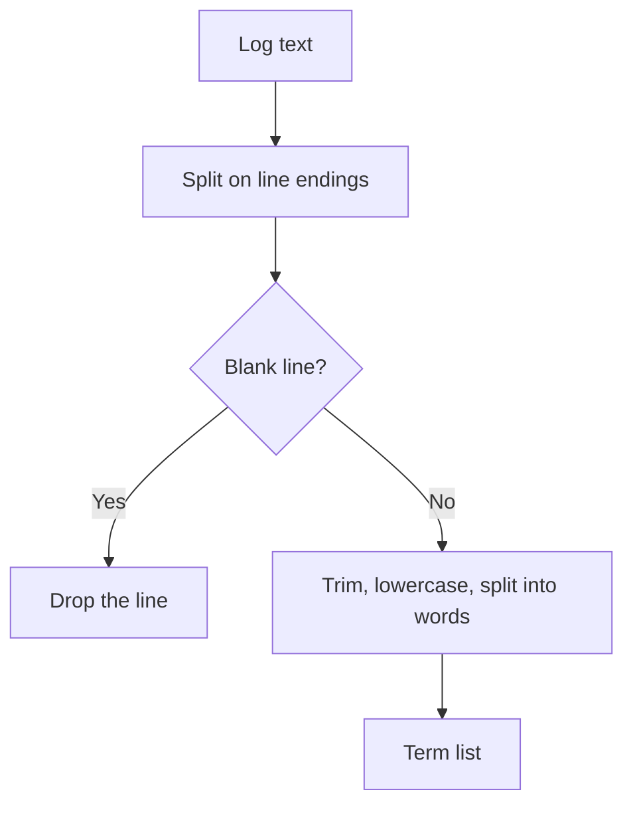

<!-- BUNDLE_SIZE:START -->

> 2.30 kB minified + gzipped

<!-- BUNDLE_SIZE:END -->

A log line arrives with a trailing carriage return. The splitter treats it as a separator and yields
an empty token, which becomes an empty field in the report. The same text then feeds an identifier
column where a trace code and an account code are both plain strings.

## Core Behavior

`Str` provides data-last string functions for checks, transformations, splitting, and padding.

- `is.empty` checks length, `is.blank` also treats whitespace-only text as blank, and `is.nonEmpty`
  narrows to `Str.NonEmpty`.
- `lines` normalizes `\r\n` and `\r` endings; `words` trims and drops empty segments.
- `match` and `test` clone a global or sticky pattern, so the caller's `lastIndex` is never changed.

Use `Str` while the value is text and the operation stays local. When the text represents a number
that needs bounds, clamping, or aggregation, [`Num`](/guides/num/) owns those rules. The
[choosing guide](/basics/choosing/) lists the primitives side by side.

## Example: Normalizing Log Lines

A log processor receives a multiline message with irregular padding. It normalizes each line, drops
the blank rows, and keeps the words for indexing.

`lines` and `words` split the text, while `is.blank` decides which segments to discard:



### Extracting Log Terms

```ts
import { Arr, Str, pipe } from "@pplnd/core";

interface LogSummary {
  readonly terms: readonly string[];
  readonly longestTerm: number;
}

const summarizeMessage = (raw: string): LogSummary => {
  const terms = pipe(
    raw,
    Str.lines,
    Arr.filter((line) => !Str.is.blank(line)),
    Arr.flatMap((line) => pipe(line, Str.toLowerCase, Str.words)),
  );

  return {
    terms,
    longestTerm: terms.reduce((longest, term) => Math.max(longest, Str.size(term)), 0),
  };
};

const summary = summarizeMessage("  Cache   MISS  \n \n  Retry   queued  ");
// { terms: ["cache", "miss", "retry", "queued"], longestTerm: 5 }
```

`Str.lines` and `Str.words` discard the padding, while `Str.is.blank` drops rows that contain only
whitespace.

### Handing a Request Code to Brand

The same message can carry a request code. After a pattern check establishes the format,
`Brand.wrap` records that check in the type, so a request code cannot be passed where an account
code is expected:

```ts
import { Brand, Maybe, Str, pipe } from "@pplnd/core";

type RequestId = Brand<"RequestId", string>;
const wrapRequestId = Brand.wrap<"RequestId", string>();

const requestIdFrom = (line: string): Maybe<RequestId> =>
  pipe(
    line,
    Str.match(/\breq_[a-z0-9]+\b/),
    Maybe.map((match) => wrapRequestId(match[0])),
  );

requestIdFrom("req_7f3a cache miss"); // Some("req_7f3a")
```

The [Brand guide](/guides/brand/) covers the type-level distinction and where validation belongs.

## Core Operations

### Reading and Parsing

| Signature                                                             | What it does                                                  | Result                                            |
| :-------------------------------------------------------------------- | :------------------------------------------------------------ | :------------------------------------------------ |
| `Str.is.empty` / `is.nonEmpty` / `is.blank`                           | Checks length, non-emptiness, or whitespace-only text.        | Boolean; `is.nonEmpty` narrows to `Str.NonEmpty`. |
| `Str.includes(substring)` / `startsWith(prefix)` / `endsWith(suffix)` | Checks for a substring anywhere, at the start, or at the end. | Boolean.                                          |
| `Str.match(pattern)` / `test(pattern)`                                | Extracts match groups or tests a regular expression.          | `Maybe<RegExpMatchArray>` / Boolean.              |
| `Str.size(text)` / `graphemeSize(text)`                               | Counts UTF-16 code units or grapheme clusters.                | Number.                                           |
| `Str.NonEmpty.from.string(text)`                                      | Creates a string with at least one code unit.                 | `Maybe<Str.NonEmpty>`.                            |

### Transforming and Splitting

| Signature                                                                      | What it does                                        | Result                 |
| :----------------------------------------------------------------------------- | :-------------------------------------------------- | :--------------------- |
| `Str.trim` / `toLowerCase` / `toUpperCase`                                     | Cleans whitespace or changes case.                  | String.                |
| `Str.capitalize` / `uncapitalize`                                              | Changes the first character's case.                 | String.                |
| `Str.replace(pattern, replacement)` / `replaceAll(pattern, replacement)`       | Replaces the first or every occurrence.             | String.                |
| `Str.slice(start, end?)` / `padStart(length, fill?)` / `padEnd(length, fill?)` | Selects or pads text.                               | String.                |
| `Str.truncate({ length, suffix? })`                                            | Shortens text and appends a suffix.                 | String.                |
| `Str.split(separator)` / `lines` / `words`                                     | Splits on a separator, line endings, or whitespace. | Readonly string array. |

## Failure Behavior and Edge Cases

`Str.lines("")` returns `[""]`, not an empty array; filtering with `Str.is.blank` removes the empty
entry. `Str.words("   ")` returns `[]`. `Str.match` and `Str.test` clone a pattern that carries the
global or sticky flag, so the caller's `lastIndex` is neither read nor modified; a pattern without
those flags is used directly.

`graphemeSize` counts ASCII by code-unit length and requires `Intl.Segmenter` for other text. When
the runtime lacks the segmenter, the call throws a `TypeError`. `size` counts UTF-16 code units, so
a character outside the Basic Multilingual Plane counts as two.

`truncate` floors a fractional length, clamps it to the text length, and returns an empty string
when the target is zero; its cut point avoids splitting a surrogate pair. `padStart` and `padEnd`
floor fractional targets and leave the text unchanged for negative, `NaN`, or infinite targets.
