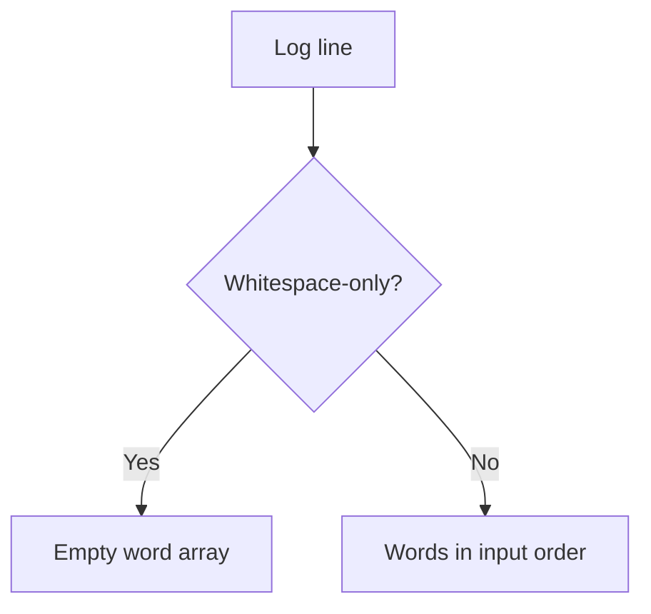

<!-- BUNDLE_SIZE:START -->

> 2.18 kB minified + gzipped

<!-- BUNDLE_SIZE:END -->

## Core Behavior

`Str` provides data-last string operations for pipelines, including checks, transformations,
segmentation, and numeric parsing.

- `is.empty` checks length; `is.blank` also treats whitespace-only text as blank.
- `parse.int` and `parse.float` return `Maybe` and follow JavaScript's prefix-parsing rules.
- `size` counts UTF-16 code units; `graphemeSize` counts user-perceived characters.

## Example: Normalizing Log Lines

A log processor receives a multiline message with inconsistent whitespace. It can normalize each
line, remove empty lines, and retain the resulting words for indexing.

`Str.words` trims the input, splits on whitespace, and removes empty segments:



### Preparing Log Terms

```ts
import { Arr, Str, pipe } from "@pplnd/core";

const log = "  Cache   MISS  \n \n  Retry   queued  ";
const terms = pipe(
  log,
  Str.lines,
  Arr.map(Str.trim),
  Arr.filter((line) => !Str.is.blank(line)),
  Arr.flatMap((line) => pipe(line, Str.toLowerCase, Str.words)),
);
// ["cache", "miss", "retry", "queued"]
```

## Core Operations

### Inspecting and Parsing

| Signature                                                    | What it does                           | Result                          |
| :----------------------------------------------------------- | :------------------------------------- | :------------------------------ |
| `Str.is.empty` / `is.nonEmpty` / `is.blank`                  | Checks text length or whitespace.      | `is.nonEmpty` narrows the type. |
| `Str.includes(text)` / `startsWith(text)` / `endsWith(text)` | Checks for a substring.                | Boolean.                        |
| `Str.match(pattern)` / `test(pattern)`                       | Matches or tests a regular expression. | `Maybe` of a match / boolean.   |
| `Str.parse.int(text)` / `parse.float(text)`                  | Parses a numeric prefix.               | `Maybe<number>`.                |
| `Str.size` / `graphemeSize`                                  | Counts code units / grapheme clusters. | Number.                         |
| `Str.NonEmpty.from.string(text)`                             | Checks for at least one code unit.     | `Maybe<Str.NonEmpty>`.          |

### Transforming and Splitting

| Signature                                                                             | What it does                        | Result                   |
| :------------------------------------------------------------------------------------ | :---------------------------------- | :----------------------- |
| `Str.trim` / `toLowerCase` / `toUpperCase`                                            | Cleans whitespace or changes case.  | String.                  |
| `Str.capitalize` / `uncapitalize`                                                     | Changes the first character's case. | String.                  |
| `Str.replace(pattern, replacement)` / `replaceAll(pattern, replacement)`              | Replaces text.                      | String.                  |
| `Str.slice(start, end)` / `padStart(length)` / `padEnd(length)` / `truncate(options)` | Selects or pads text.               | String.                  |
| `Str.split(separator)` / `lines` / `words`                                            | Splits text into parts.             | A readonly string array. |

## Failure Behavior and Edge Cases

Prefix parsing can accept trailing text. For example:

```ts
import { Num, Str } from "@pplnd/core";

Str.parse.int("42ms");   // Some(42)
Num.from.string("42ms"); // None
```

Use a whole-input check when partial numbers are unsuitable. `Str.match` and `Str.test` reset the
regular expression's `lastIndex` before use. `graphemeSize` requires `Intl.Segmenter` for non-ASCII
text.
