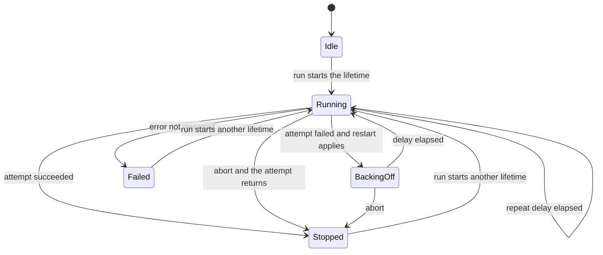

<!-- BUNDLE_SIZE:START -->

> 2.75 kB minified + gzipped

<!-- BUNDLE_SIZE:END -->

A worker that drains an outbox runs in a loop for as long as the process lives. One failed iteration
ends it: a reset connection makes the attempt return an error, the loop stops, and the process keeps
serving traffic with an outbox that nothing is draining. The failure leaves one log line, so the
backlog is the first thing anyone notices.

## Core Behavior

`Supervisor` runs one long-running task for the life of a process and restarts it when it fails.

- One execution of the task is one attempt. `Ok` ends the lifetime as `Stopped("completed")` —
  unless a `repeat` policy keeps it open.
- `Err` matching `restart.when` is restarted after `restart.getDelay(attempt)`, while attempts
  remain. Any other error ends the lifetime with that error and state `Failed`.
- With a `repeat` policy, a successful attempt schedules the next one after the policy's delay
  instead of ending the lifetime, and the restart counter resets after each success.
- `abort()` stops the lifetime; it cancels a pending backoff or repeat delay immediately and waits
  for a running attempt to settle before reporting `Stopped("aborted")`.
- State is observable while the process runs, so a health endpoint can report it.

The restart policy is a [`RetryPolicy`](/guides/policies/), reused unchanged: `attempts`, backoff,
jitter, `when`, and `onRetry` mean what they mean for a single call. Its nearest sibling is
[`CircuitBreaker`](/guides/circuit-breaker/): both are live engines with `run`, `state`, and
`subscribe`, but a breaker stops calling a dependency while a supervisor keeps the work alive. The
[choosing guide](/basics/choosing/) places it next to the other execution modules, and
[Reading the Types](/basics/types/) covers why both are instances from creation.

## Example: Outbox Worker

The worker drains an outbox in a loop and returns when its signal aborts. The supervisor restarts it
when it crashes, waits between attempts, and reports `Running`, `BackingOff`, `Stopped`, or `Failed`
to the health endpoint.



### Starting the Lifetime

```ts
import { Duration, RetryPolicy, Supervisor, Task } from "@pplnd/core";

type OutboxError = { readonly kind: "OutboxFailed"; readonly message: string; };

const toOutboxError = (error: unknown): OutboxError => ({ kind: "OutboxFailed", message: String(error) });

const drainOutbox = (signal?: AbortSignal): Task.Result<OutboxError, void> =>
  Task.Result.tryCatch(
    async (innerSignal) => {
      while (!innerSignal?.aborted) {
        const batch = await claimBatch(innerSignal);
        if (batch.length > 0) {
          await deliver(batch);
        }
      }
    },
    { onError: toOutboxError },
  );

const outbox = Supervisor.make(drainOutbox, {
  restart: RetryPolicy.exponential({
    attempts: 5,
    initial: Duration.seconds(1),
    jitter: true,
    maxDelay: Duration.seconds(30),
  }),
});

outbox.subscribe((state) => health.report(state.kind));

const lifetime = outbox.run();
process.on("SIGTERM", () => outbox.abort());

const outcome = await lifetime;
// Ok({ kind: "SupervisorStopped", reason: "aborted" }) after shutdown
// Err(OutboxError) after five failed attempts
```

`run` returns one deferred for the whole lifetime, and a second call while it is active returns that
same deferred. `abort` does not settle it immediately: the running attempt receives an aborted
signal, and the lifetime ends when that attempt returns, so `await lifetime` is the shutdown wait.

### Repeating on a Cadence

The loop above keeps running even when the outbox is empty. A bounded task — drain one batch, then
return — lets the supervisor own the loop instead:

```ts
import { Duration, RepeatPolicy, Supervisor, Task } from "@pplnd/core";

const drainOneBatch = (signal?: AbortSignal): Task.Result<OutboxError, void> =>
  Task.Result.tryCatch(async (innerSignal) => {
    const batch = await claimBatch(innerSignal);
    if (batch.length > 0) {
      await deliver(batch);
    }
  }, { onError: toOutboxError });

const outbox = Supervisor.make(drainOneBatch, {
  restart: RetryPolicy.exponential({ attempts: 5, initial: Duration.seconds(1), jitter: true }),
  repeat: RepeatPolicy.spacing({ every: Duration.seconds(30), jitter: true }),
});
```

A successful attempt now schedules the next one 30 seconds later, and the restart counter resets
after each success, so an occasional failure does not exhaust the policy over a long lifetime.
`abort()` clears the armed delay and shuts down after the in-flight batch, and `Running` reports
`completed`, the number of successful attempts so far. `RepeatPolicy.cadence` is the alternative
cadence: it aligns attempt starts to fixed multiples of `every` from the lifetime's start, and a
tick missed during a long attempt fires once immediately instead of catching up in a burst.
Hand-rolling this loop with `setInterval` and a busy flag re-solves overlap, drift, and timer
cleanup at every call site; cooperative cancellation inside one attempt stays with
[Aborted](/guides/aborted/).

### Reading the State

```ts
import { Supervisor } from "@pplnd/core";

const state = outbox.state();
if (state.kind === "SupervisorBackingOff") {
  // the next attempt starts in state.delay, after state.error
}

const unsubscribe = outbox.subscribe((next) => {
  if (next.kind === "SupervisorFailed") {
    console.error("outbox stopped after", next.attempts, "attempts:", next.error);
  }
});
```

Subscribers run as the state changes, and the final one runs after the lifetime settles. A listener
may call `run()` or `abort()` synchronously; when that call changes the state during the
notification, the listeners after it receive the newer state, and the superseded one is not
delivered again. Listeners must not throw, and `subscribe` returns an unsubscribe function.
[`EventBus`](/guides/event-bus/) is the right tool for broadcasting events to many consumers; this
listener exists for lifecycle telemetry only.

### Pacing the Deliveries

The provider allows 60 deliveries a minute, and the loop above does not know that. The limiter is
created once, outside the task, so a restart does not reset the recorded window:

```ts
import { Duration, RateLimiter, Result, Task } from "@pplnd/core";

const deliveries = RateLimiter.make({
  limit: 60,
  window: Duration.minutes(1),
  maxWait: Duration.seconds(10),
});

const deliverBatch = (batch: readonly Message[]) =>
  deliveries.run(Task.Result.tryCatch(() => deliver(batch), { onError: toOutboxError }));

// in drainOutbox, replacing the direct deliver call
const receipt = await deliverBatch(batch);
if (Result.is.err(receipt)) {
  throw receipt.error;
}
```

A refusal is an `Err`, so the attempt fails and the supervisor restarts it after its own backoff.
The [RateLimiter guide](/guides/rate-limiter/) covers the queueing and rejection strategies; the
seam here is that pacing lives beside the task, not inside one attempt, so a restart continues the
same window.

## Core Operations

### Creating and Running

| Signature                                     | What it does                                     | Result                                  |
| :-------------------------------------------- | :----------------------------------------------- | :-------------------------------------- |
| `Supervisor.make(task, { restart, repeat? })` | Creates a supervisor around a long-running task. | A supervisor instance                   |
| `supervisor.run()`                            | Starts the lifetime.                             | `Deferred` that settles when it ends    |
| `supervisor.run({ signal })`                  | Starts it with caller cancellation.              | Same deferred, aborted by the signal    |
| `supervisor.abort()`                          | Stops the lifetime.                              | `void`; await the lifetime for shutdown |

`restart` is a `RetryPolicy`: `attempts` counts every run, `getDelay` spaces them, `when` filters
restarted errors, and `onRetry` observes each scheduled restart. A non-positive-integer `attempts`
means one attempt, matching the rest of the library. `repeat` is a
[`RepeatPolicy`](/guides/policies/): `spacing` waits `every` after each settled attempt, `cadence`
aligns to fixed grid multiples, and both accept `jitter`.

### Reading State

| Signature                        | What it does               | Result                                                  |
| :------------------------------- | :------------------------- | :------------------------------------------------------ |
| `supervisor.state()`             | Reads the lifecycle state. | `Idle`, `Running`, `BackingOff`, `Stopped`, or `Failed` |
| `supervisor.subscribe(listener)` | Observes transitions.      | An unsubscribe function                                 |

`Running` carries `restarts`, the attempts that failed since the last success, and `completed`, the
successful attempts since the lifetime started. `BackingOff` carries the failed `attempt`, the
`delay` before the next one, and its `error`. `Stopped` carries the `reason`, either `"completed"`
or `"aborted"`. `Failed` carries `attempts` and the final error.

## Failure Behavior and Edge Cases

An attempt that returns `Ok` ends the lifetime, so a task that swallows its failures will look
healthy and stop the supervisor from restarting it. Report expected failures as `Err`. Under a
`repeat` policy the lifetime does not end on success at all — it ends on `abort()`, or as `Failed`
when the restart policy is exhausted; `Stopped("completed")` is only reachable without `repeat`.

An attempt that fails under `repeat` still routes into the restart policy, and a success resets the
restart counter — an occasional failure never exhausts `attempts` over a long lifetime.

Aborting during a backoff settles the lifetime immediately and clears the timer, and this includes
aborting from a subscriber reacting to the `BackingOff` notification: the lifetime ends on the spot,
and no further attempt runs after it. Aborting from inside `onRetry` behaves the same way — the
lifetime settles as `Stopped("aborted")`, and `BackingOff` is never published after `Stopped`.
Aborting during an attempt signals that attempt and waits: a task that ignores its signal delays
shutdown, because [cancellation](/guides/aborted/) is cooperative and the supervisor will not report
a clean stop while work continues. Aborting with no lifetime active is a no-op, and a second abort
while stopping is ignored.

After a lifetime ends, `run()` starts a new one, which lets a health probe or an operator re-arm a
stopped worker. The previous state remains readable until that call.

[`Task.Result.timeout`](/guides/task/) does not belong inside the task, because a per-attempt
deadline would turn a healthy long-running loop into repeated restarts; bound individual operations
instead.
