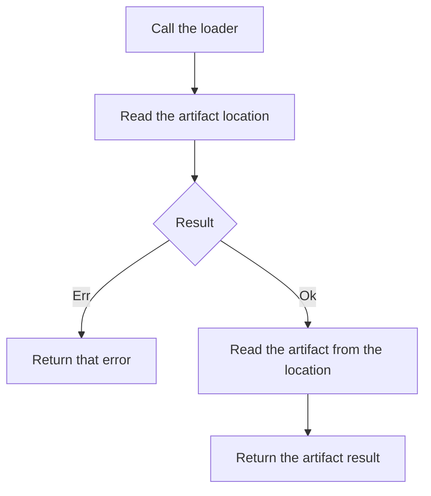

<!-- BUNDLE_SIZE:START -->

> 4.47 kB minified + gzipped

<!-- BUNDLE_SIZE:END -->

A build service prepares two requests: one for the location of a finished artifact and one for the
artifact itself. When both start while the chain is still being assembled, a retried render
downloads the artifact twice and the two results can disagree. When nothing starts the chain, the
screen stays empty and no error explains why.

## Core Behavior

`Task<A>` describes asynchronous work as a function that takes an optional `AbortSignal` and returns
an awaitable value; creating or combining tasks starts nothing.

- Calling the task runs the work. Calling it again runs the work again unless `Task.memoize` has
  captured the first result.
- `Task.Result<E, A>` carries failure in the type, `Task.Maybe<A>` carries absence, and
  `Task.Validation<E, A>` collects errors from independent checks.
- The signal passed at the call site reaches the work. Work that ignores the signal keeps running
  after the caller has stopped waiting.
- A base task assumes its body does not throw or reject. `Task.Result.tryCatch` is the boundary
  where a throw becomes a typed error.

Reach for `Task` when one lazy piece of work has to be described before it runs. When calls can
overlap and a policy must decide which one wins, [`Op`](/guides/op/) wraps the same task in a
manager. [Reading the Types](/basics/types/) separates definitions from running instances, and the
[choosing guide](/basics/choosing/) maps lazy work to the modules that run it.

## Example: Build Artifact

The build service reads an artifact location, then reads the artifact from that location. The second
request needs the value from the first, so it must not start when the first fails.

`Task.Result.chain` passes an `Ok` value to the next request. An existing `Err` skips the next
request and leaves the error untouched:



### Loading a Build Artifact

The loader maps each request failure to a string, so the pipeline has one error type. `Task.run()`
is the line that starts the requests:

```ts
import { pipe, Task } from "@pplnd/core";

const readText = (url: string): Task.Result<string, string> =>
  Task.Result.tryCatch(
    async (signal) => {
      const response = await fetch(url, { signal });
      if (!response.ok) throw new Error(`HTTP ${response.status}`);
      return response.text();
    },
    { onError: (error) => `Request failed: ${String(error)}` },
  );

const loadArtifact = (buildId: string): Task.Result<string, string> =>
  pipe(
    readText(`/api/builds/${encodeURIComponent(buildId)}/location`),
    Task.Result.chain((location) =>
      pipe(
        readText(location),
        Task.Result.map((artifact) => `Build ${buildId}: ${artifact.length} characters`),
      )
    ),
  );

const message = await pipe(
  loadArtifact("build-42"),
  Task.Result.match({
    ok: (summary) => summary,
    err: (error) => `Artifact unavailable: ${error}`,
  }),
  Task.run(),
);

console.log(message);
```

`loadArtifact("build-42")` returns a description of two requests. The chain inside it runs only when
`Task.run()` starts the pipeline, and a second `Task.run()` would send both requests again.

### Running the Same Loader Under a Policy

A build page can request several builds as the user moves between rows. `Op.make` takes the loader
factory unchanged, and the manager decides what a second call does to the first:

```ts
import { Op } from "@pplnd/core";

const artifactManager = Op.interpret(Op.make(loadArtifact), { strategy: "restartable" });

const outcome = await artifactManager.run("build-42");
// OpOk(summary), OpErr(error), or OpNil("replaced") when a newer call starts first
```

With `restartable`, the earlier caller settles as `OpNil("replaced")` while the newer call owns the
manager state. The [Op guide](/guides/op/) covers the other strategies and the retry and timeout
options.

## Core Operations

### Creating Tasks

| Signature                                   | What it does                                                                   | Return type                         |
| :------------------------------------------ | :----------------------------------------------------------------------------- | :---------------------------------- |
| `Task.make(value)`                          | Returns the value on every call.                                               | `Task<A>`                           |
| `Task.from.sync(fn)`                        | Runs a synchronous function on every call.                                     | `Task<A>`                           |
| `Task.tryCatch(fn, { onError })`            | Runs promise-returning work and maps a throw or rejection to a fallback value. | `Task` of the value or the fallback |
| `Task.Result.tryCatch(fn, { onError })`     | Maps a throw or rejection to a typed error.                                    | `Task.Result<E, A>`                 |
| `Task.Maybe.tryCatch(fn)`                   | Maps a throw or rejection to `None`.                                           | `Task.Maybe<A>`                     |
| `Task.Validation.tryCatch(fn, { onError })` | Maps a throw or rejection to a failed validation.                              | `Task.Validation<E, A>`             |

### Wrapping Existing Values

| Signature                                                                        | What it does                                                                    | Return type             |
| :------------------------------------------------------------------------------- | :------------------------------------------------------------------------------ | :---------------------- |
| `Task.Result.make.ok(value)` / `make.err(error)`                                 | Wraps a success or an error.                                                    | `Task.Result<E, A>`     |
| `Task.Result.from.Result` / `from.Maybe` / `from.nullable` / `from.Task`         | Lifts a container, a nullable, or an infallible task into the fallible channel. | `Task.Result<E, A>`     |
| `Task.Maybe.make.some` / `make.none`; `Task.Maybe.from.*`                        | Wraps or lifts an optional value.                                               | `Task.Maybe<A>`         |
| `Task.Validation.make.passed` / `failed` / `failedAll`; `Task.Validation.from.*` | Wraps or lifts a validation.                                                    | `Task.Validation<E, A>` |

### Transforming Values

| Signature                                              | What it does                                       | Behavior                                       |
| :----------------------------------------------------- | :------------------------------------------------- | :--------------------------------------------- |
| `Task.map(transform)`                                  | Transforms the resolved value.                     | Returns `Task` of the new value.               |
| `Task.chain(next)`                                     | Runs a task built from the resolved value.         | The next task starts after the first succeeds. |
| `Task.Result.map` / `Task.Result.mapError`             | Transforms the success or the error value.         | The other channel passes through.              |
| `Task.Result.chain(next)`                              | Runs fallible work built from an `Ok` value.       | An `Err` skips `next`; error types union.      |
| `Task.tap(sideEffect)`; `Task.Result.tap` / `tapError` | Observes a value or an error without replacing it. | Returns the original task.                     |
| `Task.assignTo(key)` / `Task.assign(key, next)`        | Starts a record and adds dependent results to it.  | `assign` runs `next` with the accumulator.     |

### Combining Tasks

| Signature                                 | What it does                                             | Behavior                                                                      |
| :---------------------------------------- | :------------------------------------------------------- | :---------------------------------------------------------------------------- |
| `Task.all(tasks, { concurrency })`        | Runs tasks in parallel and collects a tuple.             | Nonpositive or non-integer `concurrency` clamps to 1; omitted runs unbounded. |
| `Task.sequential(tasks)`                  | Runs tasks one at a time in order.                       | Preserves input order.                                                        |
| `Task.race(tasks)`                        | Settles with the first task to resolve.                  | Aborts the other tasks' signals.                                              |
| `Task.apply(argument)`                    | Applies a task-wrapped function to a task-wrapped value. | Both tasks run in parallel.                                                   |
| `Task.Result.all(tasks, { concurrency })` | Runs fallible tasks in parallel.                         | The first `Err` cancels active work; a caller abort settles as `Aborted`.     |
| `Task.Result.sequential(tasks)`           | Runs fallible tasks one at a time.                       | Same rules as `all` with concurrency 1.                                       |
| `Task.Result.struct(fields)`              | Combines a record of fallible tasks.                     | Waits for every field; the first error in key order wins.                     |
| `Task.Maybe.struct(fields)`               | Combines a record of optional tasks.                     | `None` when any field is missing.                                             |
| `Task.Validation.struct(fields)`          | Combines a record of validations.                        | Collects every error in key order.                                            |
| `Task.Result.allSettled(tasks)`           | Collects each outcome.                                   | Keeps successes and errors per position.                                      |

### Running and Controlling

| Signature                                                    | What it does                                          | Behavior                                                   |
| :----------------------------------------------------------- | :---------------------------------------------------- | :--------------------------------------------------------- |
| `task(signal)` / `Task.run(signal)`                          | Runs a task directly or at the end of a pipe.         | Returns `Deferred<A>`.                                     |
| `Task.Result.run` / `Task.Maybe.run` / `Task.Validation.run` | Runs a specialized task.                              | Returns the deferred container.                            |
| `Task.delay(duration)`                                       | Waits before running the task.                        | Aborting the wait starts the task with the aborted signal. |
| `Task.timeout({ duration, onTimeout })`                      | Adds a deadline to an infallible task.                | Returns a `Task.Result`; `onTimeout` supplies the error.   |
| `Task.Result.timeout({ duration, onTimeout })`               | Adds a deadline to a fallible task.                   | Appends the timeout error to the error union.              |
| `Task.repeat({ times, delay })`                              | Runs the task a fixed number of times.                | Returns `Task` of a result array.                          |
| `Task.poll({ until, delay, attempts })`                      | Runs the task until a predicate passes.               | Returns the last value at the attempt limit.               |
| `Task.memoize(task)`                                         | Shares the first execution and its result.            | Later calls reuse the same deferred value.                 |
| `Task.abortable(factory)`                                    | Creates a task with an abort handle.                  | A new call aborts the previous one.                        |
| `Task.withProgress(onProgress)`                              | Reports `0` before the work and `1` after it settles. | Returns a task that reports progress.                      |
| `Task.withLabel(label)`                                      | Attaches a read-only label.                           | Returns a labeled task.                                    |
| `Task.Result.retry(policy)`                                  | Repeats failed work according to a `RetryPolicy`.     | Stops on success, a filtered error, or exhausted attempts. |

## Failure Behavior and Edge Cases

`Task.Result.struct` starts every field and waits for all of them, even when one returns `Err`
early. If several fields fail, the first error in field order wins, regardless of completion order:

```ts
import { Duration, Task, pipe } from "@pplnd/core";

const result = await Task.Result.struct({
  manifest: pipe(Task.Result.make.err("manifest unavailable"), Task.delay(Duration.milliseconds(10))),
  buildLog: Task.Result.make.err("build log unavailable"),
})();
// Err("manifest unavailable")
```

`Task.Result.allSettled` keeps every outcome, and `Task.Validation.struct` collects every error
instead of returning one. `Task.Result.all` is stricter: it cancels the tasks that are still running
and settles with the first `Err`, and aborting its caller settles as `Aborted` (see
[Aborted](/guides/aborted/)).

`Task.race([])` never resolves. `Task.memoize` shares the first invocation, including the signal
that invocation received; later callers do not start new work and cannot change the signal.
`Task.all` forwards the call-site signal to every task, including tasks that start later.

`Task.all` clamps a nonpositive or non-integer `concurrency` to 1. `Task.repeat` floors a finite
`times` and returns an empty array for a non-finite or nonpositive count; aborting it returns the
results collected so far. `Task.poll` uses one attempt for a non-finite or sub-one `attempts`, and
omitting `attempts` polls without a limit. Aborting either loop stops it before the next run, while
the in-flight run still finishes.

`Task.delay` starts the wrapped task as soon as the wait is aborted, passing the aborted signal, so
the task sees a cancelled signal immediately.

A base `Task` assumes its work and callbacks do not throw or reject; a throw escapes the deferred
value. Put fallible work behind `Task.Result.tryCatch`. Cancellation is cooperative: `abortable`,
`race`, `timeout`, and `delay` signal the underlying work, and work that ignores the signal keeps
running. `abortable` does not convert a rejection caused by an abort into a typed result.

`Task.timeout` and `Task.Result.timeout` call `onTimeout` inside a timer. A throw from that callback
surfaces as an uncaught exception and no timeout error reaches the caller, so handle expected
failures before constructing the timeout error.
