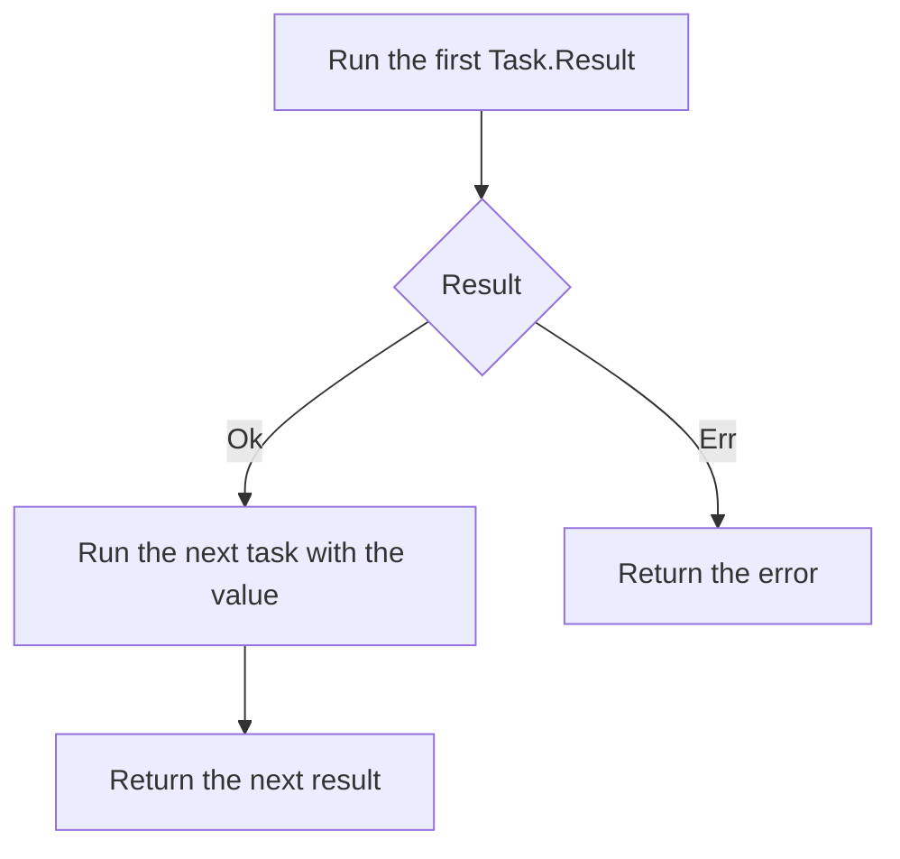

{/* BUNDLE_SIZE:START */}

> 4.37 kB minified + gzipped

{/* BUNDLE_SIZE:END */}

## Core Behavior

`Task<A>` describes asynchronous work as a function. Creating or composing a task does not run it;
calling the task returns a `Deferred<A>` that can be awaited.

- Each call starts the work again unless the task is memoized.
- Use `Task.Result<E, A>` for work that can fail, `Task.Maybe<A>` for a possibly missing value,
  and `Task.Validation<E, A>` for independent checks that accumulate errors.
- An optional `AbortSignal` is passed to the underlying work. The work must respond to the signal
  for cancellation to stop it.

## Example: Build Artifact

A build service returns an artifact location for a completed build. Downloading the artifact depends
on the first request, so it must not run if the location cannot be loaded.

`Task.Result.chain` waits for the first task. It starts the next task only when the first returns
`Ok`; an `Err` passes through:



### Loading a Build Artifact

The pipeline reads text responses to keep the request boundary visible:

```ts
import { pipe, Task } from "@pplnd/core";

const readText = (url: string): Task.Result<string, string> =>
  Task.Result.tryCatch(
    async (signal) => {
      const response = await fetch(url, { signal });
      if (!response.ok) throw new Error(`HTTP ${response.status}`);
      return response.text();
    },
    { onError: (error) => `Request failed: ${String(error)}` },
  );

const loadBuildArtifact = (id: string): Task.Result<string, string> =>
  pipe(
    readText(`/api/builds/${encodeURIComponent(id)}/artifact-location`),
    Task.Result.chain((location) =>
      pipe(
        readText(location),
        Task.Result.map((artifact) => `Build ${id}: ${artifact}`),
      )
    ),
  );

const message = await pipe(
  loadBuildArtifact("build-42"),
  Task.Result.match({
    ok: (summary) => summary,
    err: (error) => `Could not load build artifact: ${error}`,
  }),
  Task.run(),
);
console.log(message);
```

Constructing `loadBuildArtifact("build-42")` makes no request. `Task.run()` starts the pipeline; calling
it again would make the requests again. For an independent set of requests, use `struct` or
`allSettled` instead of `chain`.

## Core Operations

### Creating Tasks

| Signature                              | What it does                                                   | Return type              |
| :------------------------------------- | :------------------------------------------------------------- | :----------------------- |
| `Task.make(value)`                     | Returns the supplied value when run.                           | `Task<A>`                |
| `Task.from.sync(fn)`                   | Runs a synchronous function on invocation.                     | `Task<A>`                |
| `Task.tryCatch(fn, { onError })`       | Runs a promise factory and maps failure to a fallback value.  | `Task<A \| B>`           |
| `Task.Result.tryCatch(fn, { onError })`| Maps a throw or rejection to a typed error.                    | `Task.Result<E, A>`      |
| `Task.Maybe.tryCatch(fn)`              | Maps a throw or rejection to `None`.                           | `Task.Maybe<A>`          |
| `Task.Validation.tryCatch(fn, options)`| Maps a throw or rejection to a validation error.               | `Task.Validation<E, A>`  |

The specialized namespaces also provide constructors and converters from `Result`, `Maybe`, and
other values. Their contained values follow the rules in the [Result](/guides/result/),
[Maybe](/guides/maybe/), and [Validation](/guides/validation/) guides.

### Combining and Transforming

| Signature                                  | What it does                                                        | Behavior                                    |
| :----------------------------------------- | :------------------------------------------------------------------ | :------------------------------------------ |
| `Task.map(fn)` / `chain(fn)`               | Transforms a value / runs a task based on it.                       | `chain` runs the tasks in sequence.         |
| `Task.apply(argument)`                     | Applies a task containing a function to an argument task.           | Runs both tasks in parallel.                |
| `Task.all(tasks, options)`                 | Collects independent task results.                                  | Parallel; `concurrency` can limit workers.  |
| `Task.sequential(tasks)`                   | Collects task results in order.                                     | Starts one task at a time.                  |
| `Task.race(tasks)`                         | Returns the first result.                                           | Signals the other tasks to abort.           |
| `Task.Result.struct(fields)`               | Combines independent result tasks into a record.                    | Waits for all; returns first error by key order. |
| `Task.Result.allSettled(tasks)`            | Collects each task's `Result`.                                      | Retains all successes and errors.           |
| `Task.Maybe.struct(fields)`                | Combines independent optional tasks into a record.                  | Returns `None` if any field is missing.     |
| `Task.Validation.struct(fields)`           | Combines independent validation tasks into a record.                | Collects all errors in field order.         |
| `Task.tap(fn)` / `assignTo(key)` / `assign(key, fn)` | Observes a value or builds a record from task results.    | Returns a new task.                         |

### Running and Controlling

| Signature                              | What it does                                                   | Behavior                                  |
| :------------------------------------- | :------------------------------------------------------------- | :---------------------------------------- |
| `task(signal)` / `Task.run(signal)`    | Runs a task directly or at the end of a pipeline.              | Returns `Deferred<A>`.                    |
| `Task.delay(duration)`                 | Waits before running the task.                                 | Aborting the wait starts the task with the aborted signal. |
| `Task.timeout(options)`                | Adds a deadline and an error value.                            | Returns a `Task.Result`.                  |
| `Task.repeat(options)` / `poll(options)` | Runs repeatedly a set number of times / until a condition.   | `poll` returns the last value at its attempt limit. |
| `Task.memoize(task)`                   | Shares the first execution and its result.                     | Later calls reuse the same `Deferred`.    |
| `Task.abortable(factory)`              | Creates a task and an abort handle.                            | A new call signals the previous one to abort. |
| `Task.withProgress(fn)` / `withLabel(label)` | Reports start and completion / attaches a label.        | Progress reports `0` and `1`.            |
| `Task.Result.retry(policy)`            | Repeats failed work according to a retry policy.               | Stops on success or when retries end.     |

## Failure Behavior and Edge Cases

`Task.Result.struct` starts every field and waits for all of them, even if one returns `Err` early.
If multiple fields fail, the first error in field order wins, regardless of completion order:

```ts
import { Duration, Task, pipe } from "@pplnd/core";

const result = await Task.Result.struct({
  manifest: pipe(Task.Result.make.err("manifest unavailable"), Task.delay(Duration.milliseconds(10))),
  buildLog: Task.Result.make.err("build log unavailable"),
})();
// Err("manifest unavailable")
```

Use `Task.Result.allSettled` to retain every outcome or `Task.Validation.struct` to collect all
errors. `Task.race([])` never resolves. `memoize` shares the first invocation, including the signal
used by that invocation; later callers do not start new work with their own signals.

`Task.all` treats a non-integer or nonpositive `concurrency` as unbounded.
`Task.repeat` rounds finite `times` down to an integer and returns an empty array for a non-finite
or nonpositive count. `Task.poll` rounds finite `attempts` down and uses one attempt for values
below one or non-finite values; omitting `attempts` leaves polling unlimited.

A base `Task` assumes its work and callbacks do not throw or reject. Use `Task.Result.tryCatch`
at a fallible boundary. Cancellation is cooperative: `abortable`, `race`, and `timeout` signal the
underlying work, which must handle the signal. In particular, `abortable` does not turn a rejection
caused by abort into a typed result.

`Task.all` and `Task.sequential` return all completed results directly as a tuple. Cancellation
forwards the abort signal to every task, including tasks scheduled after the signal aborts. For
fallible async workflows where cancellation must prevent queued work from starting and short-circuit
on the first error, use `Task.Result.all` or `Task.Result.sequential`.

Timeout callbacks must not throw. Handle expected failures before constructing a timeout error.
