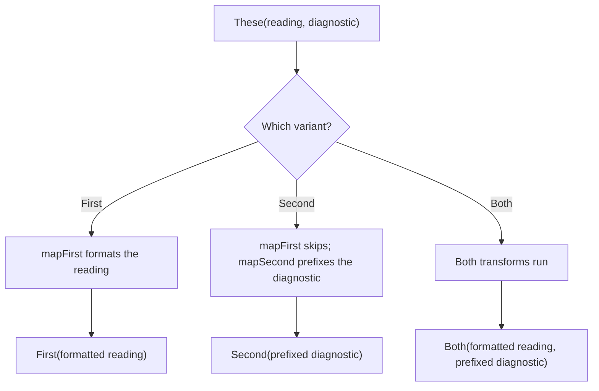

<!-- BUNDLE_SIZE:START -->

> 1.93 kB minified + gzipped

<!-- BUNDLE_SIZE:END -->

A temperature sensor can return a usable reading together with a note that it drifted outside its
calibrated range. A service that treats every response as either valid or failed must discard one of
the two facts: either the measurement or the maintenance signal. Neither loss is visible in the
response.

## Core Behavior

`These<A, B>` represents a value that is first, second, or both, with no built-in success or failure
meaning.

- `First` holds only the first value, `Second` only the second, and `Both` holds both. There is no
  empty variant.
- `mapFirst` and `mapSecond` call their transform only when that side exists and preserve the other
  side. `mapBoth` transforms each side that exists.
- `chainFirst` on `Both` returns the callback's `These` and drops the existing second value;
  `Second` passes through untouched. `chainSecond` mirrors this behavior.
- `match` handles all three variants; `to.Pair` produces a pair only for `Both`.

Choose `These` when both pieces are data the caller needs, not when one is an error list.
[`Result`](/guides/result/) keeps one success value or one error, so it cannot return a usable
reading with a warning. The [choosing guide](/basics/choosing/) compares the containers side by
side.

## Example: Sensor Readings

A temperature reading may be valid but outside the sensor's expected range, or it may be invalid and
unusable. `These.make.both(reading, warning)` carries a usable reading and its warning together.

When a reading and a warning are both present, `mapFirst` changes the reading and keeps the warning,
while `mapSecond` changes the warning and keeps the reading. The example formats both:



If the input is `Second`, `mapFirst` skips its callback and `mapSecond` transforms the diagnostic.
`chainFirst` returns the callback's entire `These`, replacing the original reading and its warning
on `Both`; `chainSecond` behaves symmetrically, replacing a coexisting first value with its
callback's result.

### Parsing and Displaying Readings

This parser returns a diagnostic for invalid input and adds a warning to high but valid readings:

```ts
import { pipe, These } from "@pplnd/core";

interface Reading {
  celsius: number;
}

interface Diagnostic {
  message: string;
}

const parseReading = (raw: string): These<Reading, Diagnostic> => {
  const input = raw.trim();
  const celsius = Number(input);
  if (input === "" || !Number.isFinite(celsius)) {
    return These.make.second({ message: "Temperature must be a finite number" });
  }
  if (celsius > 45) {
    return These.make.both({ celsius }, { message: "Temperature exceeds 45 °C" });
  }
  return These.make.first({ celsius });
};

const describeReading = (raw: string): string =>
  pipe(
    parseReading(raw),
    These.mapFirst((reading) => `${reading.celsius.toFixed(1)} °C`),
    These.mapSecond((diagnostic) => ({ message: `Sensor: ${diagnostic.message}` })),
    These.match({
      first: (temperature) => `Reading: ${temperature}`,
      second: (diagnostic) => `Invalid reading: ${diagnostic.message}`,
      both: (temperature, diagnostic) => `Reading: ${temperature}; ${diagnostic.message}`,
    }),
  );

console.log(describeReading("48"));
// Reading: 48.0 °C; Sensor: Temperature exceeds 45 °C
console.log(describeReading("21"));
// Reading: 21.0 °C
```

The parser chooses the variant from the value. The transformations then act on whichever sides
exist, and `match` is the only place that has to handle all three shapes.

### Sending the Reading and Its Note Together

Downstream telemetry expects one payload containing both facts. `to.Pair` extracts a pair only from
`Both`; `Pair.merge` gives the two values names:

```ts
import { Maybe, Pair, pipe, These } from "@pplnd/core";

interface TelemetryPayload {
  temperature: string;
  note: string;
}

const toTelemetry = (raw: string): Maybe<TelemetryPayload> =>
  pipe(
    parseReading(raw),
    These.mapFirst((reading) => `${reading.celsius.toFixed(1)} °C`),
    These.mapSecond((diagnostic) => `Sensor: ${diagnostic.message}`),
    These.to.Pair,
    Maybe.map(Pair.merge((temperature, note) => ({ temperature, note }))),
  );

toTelemetry("48");
// Some({ temperature: "48.0 °C", note: "Sensor: Temperature exceeds 45 °C" })
```

A reading with no note, or a note with no reading, becomes `None` here because the downstream
payload requires both. [`Pair`](/guides/pair/) supplies the named conversion; it carries no success
or failure semantics of its own.

## Core Operations

### Creating and Combining Values

| Signature                                        | What it does                  | Return type              |
| :----------------------------------------------- | :---------------------------- | :----------------------- |
| `These.make.first(value)` / `make.second(value)` | Creates a single-sided value. | `First<A>` / `Second<B>` |
| `These.make.both(first, second)`                 | Keeps both values.            | `Both<A, B>`             |
| `These.from.Pair(pair)`                          | Converts a pair into `Both`.  | `Both<A, B>`             |

### Transforming Values

| Signature                                              | What it does                                                                      | Guarantee                                                                                      |
| :----------------------------------------------------- | :-------------------------------------------------------------------------------- | :--------------------------------------------------------------------------------------------- |
| `These.mapFirst(fn)` / `mapSecond(fn)`                 | Transforms the selected side when present.                                        | Preserves the other side.                                                                      |
| `These.mapBoth(onFirst, onSecond)`                     | Transforms each present side.                                                     | Keeps the same variant.                                                                        |
| `These.chainFirst(fn)` / `chainSecond(fn)`             | Replaces the value with the callback's `These` when the selected side is present. | A coexisting opposite side is discarded; an input with only that opposite side passes through. |
| `These.swap(value)`                                    | Exchanges first and second.                                                       | `Both` stays `Both`.                                                                           |
| `These.tapFirst(fn)` / `tapSecond(fn)` / `tapBoth(fn)` | Runs a callback when the requested side or sides are present.                     | Returns the original value.                                                                    |

### Reading and Converting

| Signature                                                       | What it does                                  | Return type                                |
| :-------------------------------------------------------------- | :-------------------------------------------- | :----------------------------------------- |
| `These.match(cases)`                                            | Handles `first`, `second`, and `both`.        | The selected callback result.              |
| `These.is.first(value)` / `is.second(value)` / `is.both(value)` | Checks the exact variant.                     | Type guard.                                |
| `These.hasFirst(value)` / `hasSecond(value)`                    | Checks for a side, including `Both`.          | Type guard.                                |
| `These.getFirstOrElse(fn)` / `getSecondOrElse(fn)`              | Reads a side or calls a fallback when absent. | Value or fallback result.                  |
| `These.to.Pair(value)`                                          | Extracts both values when present.            | `Some(pair)` for `Both`, otherwise `None`. |

## Failure Behavior and Edge Cases

If both a reading and a diagnostic can be absent, represent that outside `These`, for example with
`Maybe<These<Reading, Diagnostic>>`. `These` has no empty variant and no way to attach an error to a
missing side.

`chainFirst` on `Both` returns the callback's result and drops the existing second value. For
example, the warning is lost when the callback returns only a formatted reading:

```ts
import { pipe, These } from "@pplnd/core";

const reading = These.make.both(48, "Temperature exceeds 45 °C");

pipe(reading, These.chainFirst((celsius) => These.make.first(`${celsius.toFixed(1)} °C`)));
// First("48.0 °C")

pipe(reading, These.mapFirst((celsius) => `${celsius.toFixed(1)} °C`));
// Both("48.0 °C", "Temperature exceeds 45 °C")
```

`chainSecond` similarly replaces a coexisting first value. Use mapping when both sides must survive.
`tapBoth` runs only for `Both`, while `tapFirst` and `tapSecond` also run for the single-sided
variants that contain their side.
