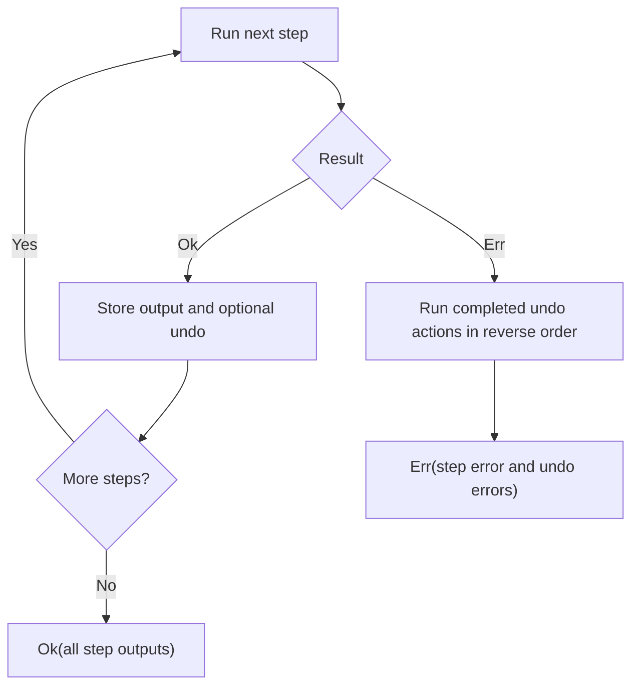

<!-- BUNDLE_SIZE:START -->

> 2.49 kB minified + gzipped

<!-- BUNDLE_SIZE:END -->

## Core Behavior

When publishing a document involves several services, a later failure can leave an upload or catalog
entry behind. `Transaction` runs a sequence of `Task.Result` steps and can undo completed work if a
later step fails. A step declares which earlier outputs it needs, and each run can supply its own
input.

- A step can provide an `undo` action. If a later step fails, completed steps with undo actions are
  compensated in reverse order.
- The failure includes the failing step ID, its error, and any errors from undo actions. A failed
  undo does not prevent earlier undo actions from running.
- `Transaction.run` starts the steps and returns a deferred result.

## Example: Publishing a Document

A publisher uploads a document, adds it to a catalog, and sends a notification. If notification
fails, the publisher needs to remove the catalog entry and uploaded document.

Only successful steps register undo actions. When a step returns an error, the transaction runs the
registered actions in reverse order and retains the original error:



### Publishing and Rolling Back

This runnable example uses in-memory sets to represent the storage and catalog services. The
notification fails, so the first two steps are undone:

```ts
import { Task, Transaction } from "@pplnd/core";

const storage = new Set<string>();
const catalog = new Set<string>();
const events: string[] = [];

const upload = (name: string): Task.Result<string, string> => Task.Result.tryCatch(
  async () => { storage.add(name); events.push("uploaded"); return name; },
  { onError: String },
);
const removeUpload = (name: string): Task.Result<string, void> => Task.Result.tryCatch(
  async () => { storage.delete(name); events.push("deleted upload"); },
  { onError: String },
);
const index = (name: string): Task.Result<string, string> => Task.Result.tryCatch(
  async () => { catalog.add(name); events.push("indexed"); return name; },
  { onError: String },
);
const removeIndex = (name: string): Task.Result<string, void> => Task.Result.tryCatch(
  async () => { catalog.delete(name); events.push("removed index"); },
  { onError: String },
);

const step = Transaction.stepFactory<string>();
const uploadStep = step("upload", {
  run: ({ ctx }) => upload(ctx.input),
  undo: ({ ctx }) => removeUpload(ctx.output),
});
const indexStep = step("index", {
  deps: { upload: uploadStep },
  run: ({ deps }) => index(deps.upload),
  undo: ({ ctx }) => removeIndex(ctx.output),
});
const notifyStep = Transaction.step("notify", {
  run: () => Task.Result.make.err("Notification unavailable"),
});
const publish = Transaction.make(uploadStep, indexStep, notifyStep);

const result = await Transaction.run(publish, "report.pdf");
// Err: stepId "notify", error "Notification unavailable", undoErrors []
// events: ["uploaded", "indexed", "removed index", "deleted upload"]
```

The failed `notify` step has no completed output to undo. Undo actions run without the transaction's
abort signal so they can attempt cleanup after cancellation.

## Core Operations

| Signature                                       | What it does                                      | Result or behavior                             |
| :---------------------------------------------- | :------------------------------------------------ | :--------------------------------------------- |
| `Transaction.stepFactory<Input>()`              | Creates a step constructor sharing an input type. | Infers each step’s dependencies and result.    |
| `Transaction.step(id, config)`                  | Defines a step and its named dependencies.        | A reusable step definition.                    |
| `Transaction.make(...steps)`                    | Assembles steps in execution order.               | Rejects duplicate IDs and invalid ordering.    |
| `Transaction.run(transaction, input, options?)` | Starts the steps with input and hooks.            | Deferred result of outputs or failure details. |

A typed step factory lets multiple independently reusable steps share an input contract without
repeating its type. Use `Transaction.step` directly for a step that does not need the contract.

A step's `run` receives per-run input as `ctx.input` and dependency outputs under `deps`. When
neither is used, write `run: () => task`. A transaction whose steps require input must receive it as
`Transaction.run(transaction, input)`. If no steps require input, call
`Transaction.run(transaction)`. Pass per-run controls as a third argument, for example
`Transaction.run(transaction, input, { signal })`; use `undefined` for input when the transaction
needs no input but the run needs options.

An `undo` callback receives the completed step's output as `ctx.output`, the run input as
`ctx.input`, and dependency outputs under `deps`. Apply `Task.Result.retry(policy)` or
`Task.Result.timeout(options)` to the returned task when the work needs retries or a deadline. Run
options accept an `AbortSignal` and `onStepSuccess`, `onStepFailure`, and `onUndo` callbacks. Use
the signal passed to the task for cancellable work; task wrappers can provide a more specific signal
than the transaction's run signal.

`make` checks that step IDs are unique and that each dependency is the same step object supplied
earlier in the sequence. The same earlier step can appear under multiple dependency names. Literal
step IDs catch many ordering errors in TypeScript; dynamic or broadly typed references are checked
when the transaction is constructed. Undefined dependency entries are treated as absent; their
corresponding values are `undefined` in the step callback.

## Failure Behavior and Edge Cases

A failed step is not added to the undo stack. If that step has already made an external change
before returning an error, its own implementation must handle that partial work. Failed undo actions
are listed in `undoErrors`; the original forward error remains in `error`.

Cancellation is checked before each step and the signal is passed to active work. In-flight work
must respond to the signal; cancellation does not forcibly interrupt an operation that ignores it.
When cancellation prevents a step from starting, `error` is `Transaction.Aborted` with the signal's
reason. If the final step succeeds after the signal is aborted, the transaction succeeds because
there is no next step at which to observe cancellation. Step and undo tasks report expected failures
through `Task.Result`. Step factories, timeout handlers, and telemetry callbacks must not throw.
Step IDs must be nonempty, unique, and cannot be `initial`.
