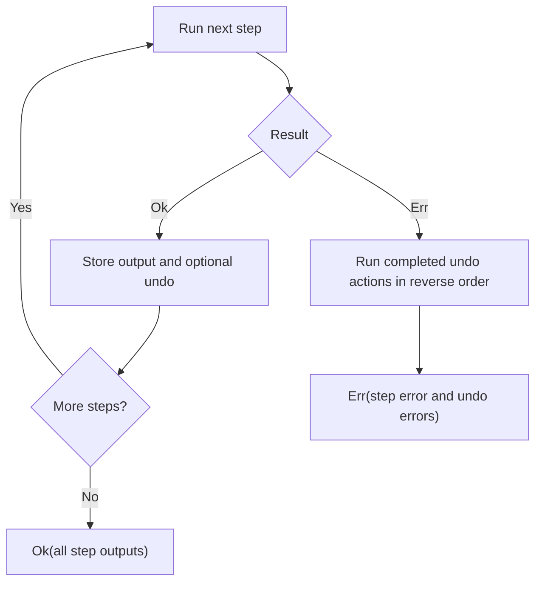

<!-- BUNDLE_SIZE:START -->

> 2.55 kB minified + gzipped

<!-- BUNDLE_SIZE:END -->

A publisher writes a document to object storage, adds it to the search index, and sends a
notification. The notification service returns an error, and the document is now public while search
has no record of it. The caller sees only the notification error and cannot tell which earlier
writes survived.

## Core Behavior

`Transaction<In, Acc, E, EUndo>` is an ordered sequence of asynchronous steps, each with an optional
action that reverses its work.

- Steps run in declaration order. A step reads the run input from `ctx.input` and the outputs of the
  steps it names from `deps`.
- When a step returns an error, completed steps that declared an undo are compensated in reverse
  order. A failed undo is collected and the remaining undos still run.
- Cancellation is checked before each step, and the run signal is passed to the active step.

Reach for `Transaction` when several asynchronous writes must run in order and completed ones must
be undone after a failure. For steps with dependencies that can run in parallel,
[`Graph`](/guides/graph/) schedules them. The [type model](/basics/types/) covers how definitions
are run, and the [choosing guide](/basics/choosing/) compares the execution shapes.

## Example: Publishing a Document

A publisher uploads a document, adds it to a catalog, and sends a notification. If notification
fails, the publisher needs to remove the catalog entry and the uploaded document.

Only successful steps register undo actions. When a step returns an error, the transaction runs the
registered actions in reverse order and retains the original error:



### Publishing and Rolling Back

This runnable example uses in-memory sets to represent the storage and catalog services. The
notification fails, so the first two steps are undone:

```ts
import { Task, Transaction } from "@pplnd/core";

const storage = new Set<string>();
const catalog = new Set<string>();
const events: string[] = [];

const upload = (name: string): Task.Result<string, string> =>
  Task.Result.tryCatch(
    async () => {
      storage.add(name);
      events.push("uploaded");
      return name;
    },
    { onError: (error) => String(error) },
  );

const removeUpload = (name: string): Task.Result<string, void> =>
  Task.Result.tryCatch(
    async () => {
      storage.delete(name);
      events.push("removed upload");
    },
    { onError: (error) => String(error) },
  );

const index = (name: string): Task.Result<string, string> =>
  Task.Result.tryCatch(
    async () => {
      catalog.add(name);
      events.push("indexed");
      return name;
    },
    { onError: (error) => String(error) },
  );

const removeIndex = (name: string): Task.Result<string, void> =>
  Task.Result.tryCatch(
    async () => {
      catalog.delete(name);
      events.push("removed index");
    },
    { onError: (error) => String(error) },
  );

const step = Transaction.stepFactory<string>();

const uploadStep = step(
  "upload",
  ({ ctx }) => upload(ctx.input),
  ({ ctx }) => removeUpload(ctx.output),
);

const indexStep = step(
  "index",
  { upload: uploadStep },
  ({ deps }) => index(deps.upload),
  ({ ctx }) => removeIndex(ctx.output),
);

const notifyStep = Transaction.step(
  "notify",
  () => Task.Result.make.err("Notification unavailable"),
);

const publish = Transaction.make(uploadStep, indexStep, notifyStep);
const outcome = await Transaction.run("report.pdf")(publish);

// Err({
//   kind: "TransactionFailure",
//   stepId: "notify",
//   error: "Notification unavailable",
//   undoErrors: [],
// });
// events: ["uploaded", "indexed", "removed index", "removed upload"]
```

The failed `notify` step has no completed output to undo. Undo actions run without the transaction's
abort signal, so they can still clean up after cancellation.

### Releasing Handles Inside a Step

A step that streams through an upload session can open it as a resource and hand the step's signal
to `use`. `uploadSession` opens a signed session and releases it; `sendThrough` streams the document
through that session. The session closes when the step task settles, before the next step starts,
and the undo still receives the completed output:

```ts
import { Resource } from "@pplnd/core";

type UploadSession = { readonly close: () => Promise<void> };

declare const uploadSession: Resource<string, UploadSession>;
declare const sendThrough: (session: UploadSession, name: string) => Task.Result<string, string>;

const streamingUpload = step(
  "upload",
  ({ ctx }) => (signal: AbortSignal | undefined) =>
    Resource.use({
      run: (session: UploadSession) => sendThrough(session, ctx.input),
      signal,
    })(uploadSession),
  ({ ctx }) => removeUpload(ctx.output),
);
```

The step still returns a `Task.Result`, and the session is released before the transaction decides
which step runs next. See [`Resource`](/guides/resource/) for the acquisition and release surface.

## Core Operations

### Defining Steps

| Signature                                | What it does                                             | Behavior                                                                 |
| :--------------------------------------- | :------------------------------------------------------- | :----------------------------------------------------------------------- |
| `Transaction.stepFactory<Input>()`       | Creates a step constructor with a shared input contract. | Infers each step's dependencies, output, and undo error.                 |
| `Transaction.step(id, run, undo?)`       | Defines a step with no dependencies.                     | `run` receives `ctx`; `undo` receives `ctx` with `output`.               |
| `Transaction.step(id, deps, run, undo?)` | Defines a step with named dependencies.                  | Both callbacks receive `ctx` and `deps`.                                 |
| `Transaction.make(...steps)`             | Assembles steps in execution order.                      | Throws on a duplicate id or a dependency that does not precede the step. |

### Running and Reading Failures

| Signature                                       | What it does                              | Return type or field                                                         |
| :---------------------------------------------- | :---------------------------------------- | :--------------------------------------------------------------------------- |
| `Transaction.run(input, options?)(transaction)` | Runs the steps with a per-run input.      | Data-last; deferred `Result<Transaction.Failure<E \| Aborted, EUndo>, Acc>`. |
| `failure.stepId`                                | Identifies the step that stopped the run. | The first step's id when input was already aborted.                          |
| `failure.error`                                 | Carries the step's error.                 | A step error, or `Aborted` when cancellation was observed.                   |
| `failure.undoErrors`                            | Lists failed undo actions.                | `readonly { stepId, error }[]`; empty when every undo succeeded.             |

A step's `run` receives per-run input as `ctx.input` and dependency outputs under `deps`. When
neither is used, pass a zero-argument callback. The `undo` callback is the trailing argument after
`run`; it receives the completed step's output as `ctx.output`, the run input, and the same
dependency outputs.

A transaction whose steps require input must receive it: `Transaction.run(input)(transaction)`. If
no step requires input, call `Transaction.run()(transaction)`. When the transaction needs run
options but no input, pass `undefined` in the input position:
`Transaction.run(undefined, { signal })(transaction)`.

Run options accept an `AbortSignal` and three telemetry callbacks. `onStepSuccess` receives
`{ stepId, output }`, `onStepFailure` receives `{ stepId, error }` before rollback starts, and
`onUndo` receives `{ stepId }` plus `error` when the undo failed.

`make` checks that step IDs are unique and that each dependency is the same step object supplied
earlier in the sequence. The same earlier step can appear under multiple dependency names. Literal
step IDs catch ordering errors in TypeScript; dynamic or broadly typed references are checked when
the transaction is constructed. An `undefined` dependency entry is treated as absent, and its value
is `undefined` in the step callback. Apply `Task.Result.retry(policy)` or
`Task.Result.timeout({ duration, onTimeout })` to the task a step returns when the work needs
retries or a deadline; a wrapper such as `Task.Result.timeout` can pass a derived signal to the
work.

## Failure Behavior and Edge Cases

A failed step is not added to the undo stack. If it changed something before returning its error,
that partial work is the step's own responsibility. Failed undo actions are listed in `undoErrors`;
the original forward error stays in `error`, and earlier undo actions still run.

Cancellation is checked before each step, and the run signal is passed to active work. In-flight
work must respond to the signal; cancellation does not interrupt an operation that ignores it. When
cancellation prevents a step from starting, the failure's `error` is `Aborted`, the shared
cancellation type from `@pplnd/core`, carrying the signal's reason. Use `Aborted.is(failure.error)`
to distinguish it from a step error. Undo tasks are called with `undefined` instead of the run
signal, so cleanup is not skipped after a cancellation. If the final step succeeds after the signal
is aborted, the transaction succeeds, because there is no next step at which to observe
cancellation. See [`Aborted`](/guides/aborted/) for the shared outcome shape.

Step and undo tasks must not throw or reject. A rejected step task leaves the run pending, and no
rollback starts. Telemetry callbacks must not throw either; an exception from `onStepFailure`
prevents the rollback that would otherwise follow. Use `Task.Result` for expected step failures and
handle logging errors inside the callbacks.

Step IDs must be nonempty, unique, and cannot be `initial`. `Transaction.step` throws a `TypeError`
for an empty or reserved id, and `Transaction.make` throws for duplicate ids and for a dependency
that was not supplied earlier.
