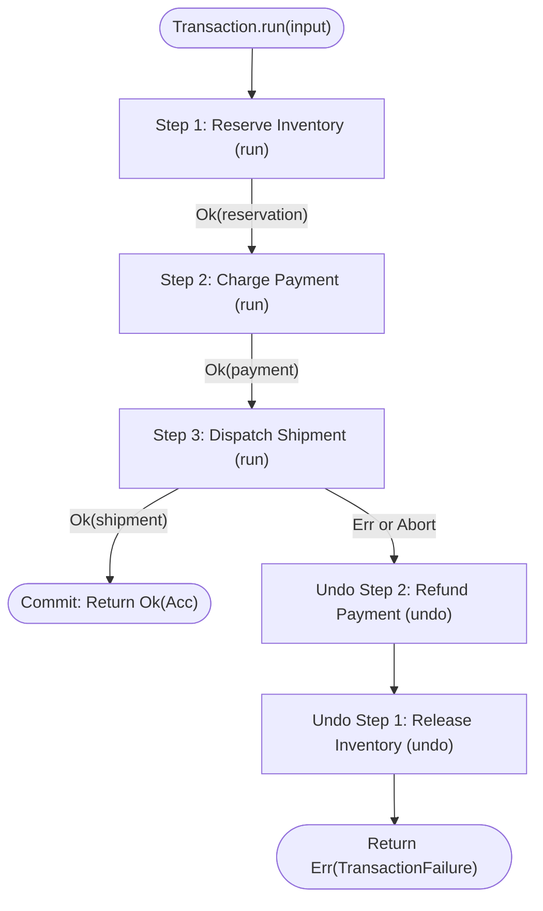

<!-- BUNDLE_SIZE:START -->

> 5.24 kB minified + gzipped

<!-- BUNDLE_SIZE:END -->

Business mutations often span multiple external services — such as reserving inventory, charging a
credit card, and creating a shipping manifest. Because these operations cross network boundaries,
they cannot run inside a single database transaction.

When a later step fails, developers must manually undo all preceding operations:

```ts
// Manual rollback tracking with mutable state
let reservation: Reservation | undefined;
let payment: Payment | undefined;

try {
  reservation = await inventoryApi.reserve(order.sku, order.qty);
  payment = await stripeApi.charge(order.customerId, reservation.totalCents);
  await shippingApi.dispatch(order.address, reservation.id, payment.chargeId);
} catch (error) {
  // Manual reverse cleanup
  if (payment) {
    try {
      await stripeApi.refund(payment.chargeId);
    } catch (refundError) {
      console.error("Refund failed, manual intervention needed:", refundError);
    }
  }
  if (reservation) {
    try {
      await inventoryApi.release(reservation.id);
    } catch (releaseError) {
      console.error("Release failed:", releaseError);
    }
  }
  throw error;
}
```

This manual approach introduces three failure modes:

1. **Context Drift**: Intermediate values (like `reservation` and `payment`) must be declared as
   `let ... | undefined` in an outer scope, forcing non-null assertions (`!`) throughout the
   workflow.
2. **Rollback Fault Masking**: If a rollback step throws an exception or network error, it can crash
   the cleanup loop early, leaving earlier resources permanently orphaned.
3. **Cancellation Leaks**: If the client aborts their HTTP connection midway via an `AbortSignal`,
   already-completed steps are often abandoned without running their compensating actions.

`Transaction` solves this by turning multi-step workflows into immutable execution plans with
accumulated context and guaranteed Last-In, First-Out (LIFO) rollback.



---

## Type Structure & Mental Model

A `Transaction` tracks four generic channels across its compiled pipeline:

```ts
export type Transaction<
  In = void,
  Acc extends Record<string, unknown> = Record<never, never>,
  E = never,
  EUndo = never,
> = { /* ... */ };
```

- **`In`**: The initial payload passed to `Transaction.run(input)`. If no input is required,
  defaults to `void`.
- **`Acc`**: The accumulated dictionary of completed step outputs. Every successful step adds its
  declared `id` as a typed key to this dictionary.
- **`E`**: The union of forward execution errors across all registered steps.
- **`EUndo`**: The union of errors that can occur during compensating `undo` actions.

When executed, a transaction returns a lazy task resolving to either a successful accumulator record
or a structured failure:

```ts
export type Failure<E, EUndo = never> = {
  readonly kind: "TransactionFailure";
  readonly stepId: string;
  readonly error: E;
  readonly undoErrors: readonly UndoFailure<EUndo>[];
};

export type UndoFailure<EUndo = unknown> = {
  readonly stepId: string;
  readonly error: EUndo;
};
```

---

## Defining Steps & Context Accumulation

A transaction is created with `Transaction.make()` and populated with sequential steps via
`Transaction.step`.

Each step declares a unique `id`, a forward `run` function, and an optional compensating `undo`
function. Every step receives an accumulated context containing the initial payload and all outputs
from preceding steps:

```ts
import { pipe } from "@pplnd/composition";
import { Transaction } from "@pplnd/core";

type OnboardingInput = {
  readonly organizationSlug: string;
  readonly adminEmail: string;
  readonly region: string;
};

const provisionOrganization = pipe(
  Transaction.make<OnboardingInput>(),
  Transaction.step({
    id: "tenant",
    run: ({ initial }) => tenantDb.createWorkspace(initial.organizationSlug, initial.region),
    undo: (tenant) => tenantDb.archiveWorkspace(tenant.workspaceId),
  }),
  Transaction.step({
    id: "storage",
    // Directly accesses outputs from the 'tenant' step and 'initial' payload:
    run: ({ initial, tenant }) =>
      cloudStorage.provisionBucket({
        bucketName: `org-${initial.organizationSlug}-${tenant.workspaceId}`,
        region: initial.region,
      }),
    undo: (storage) => cloudStorage.deleteBucket(storage.bucketName),
  }),
  Transaction.step({
    id: "credentials",
    // Directly accesses outputs from both 'tenant' and 'storage':
    run: ({ initial, tenant, storage }) =>
      iamApi.createAdminCredentials({
        email: initial.adminEmail,
        workspaceId: tenant.workspaceId,
        bucketArn: storage.bucketArn,
      }),
    undo: (credentials) => iamApi.revokeCredentials(credentials.accessKeyId),
  }),
);
```

TypeScript verifies context properties statically. If a step attempts to read from a step that has
not run yet, or if a duplicate step identifier is used, the compiler rejects the code at build time.

---

## Executing a Transaction & Handling Outcomes

To execute a transaction, pass the input payload to `Transaction.run`. The returned task evaluates
to a `Task.Result` resolving to `Result.Ok(Acc)` on success or `Result.Err(Transaction.Failure)` on
failure:

```ts
const outcome = await pipe(
  provisionOrganization,
  Transaction.run({
    organizationSlug: "acme-corp",
    adminEmail: "admin@acme.com",
    region: "us-east-1",
  }),
)();

if (outcome.kind === "Ok") {
  // Static access to every step's returned output:
  console.log("Workspace ready:", {
    workspaceId: outcome.value.tenant.workspaceId,
    bucket: outcome.value.storage.bucketName,
    apiKey: outcome.value.credentials.accessKeyId,
  });
} else {
  // Identifies the exact forward step that failed:
  console.error(`Provisioning halted at step '${outcome.error.stepId}':`, outcome.error.error);
}
```

---

## Automatic LIFO Rollback & Best-Effort Drain

When any forward step returns an error, throws an unhandled exception, or aborts:

1. Forward step progression terminates immediately.
2. Completed steps are rolled back in strict reverse chronological order: Step K - 1, then Step K -
   2, down to Step 1.
3. Steps without an `undo` handler are safely skipped during the rollback loop.

### Rollback Resilience (Best-Effort Drain)

In production distributed systems, a network glitch while undoing Step 2 must never prevent Step 1
from being undone. `Transaction` enforces a best-effort drain: if an `undo` action fails or throws,
the error is captured in `undoErrors`, and the rollback loop continues until every completed step
has been processed.

Consider a multi-step media publishing workflow:

```ts
type MediaUploadInput = {
  readonly mediaId: string;
  readonly fileBuffer: Uint8Array;
};

const publishMediaPipeline = pipe(
  Transaction.make<MediaUploadInput>(),
  Transaction.step({
    id: "storage",
    run: ({ initial }) => mediaCdn.upload(initial.mediaId, initial.fileBuffer),
    undo: (storage) => mediaCdn.deleteFile(storage.fileUrl),
  }),
  Transaction.step({
    id: "transcode",
    run: ({ storage }) => transcoderApi.startJob(storage.fileUrl, ["720p", "1080p"]),
    undo: (transcode) => transcoderApi.cancelJob(transcode.jobId),
  }),
  Transaction.step({
    id: "catalog",
    run: ({ initial, transcode }) =>
      searchCatalog.indexDocument({
        id: initial.mediaId,
        variants: transcode.variantUrls,
      }),
  }),
);

const outcome = await pipe(
  publishMediaPipeline,
  Transaction.run({ mediaId: "vid_8821", fileBuffer: rawVideoBytes }),
)();

if (outcome.kind === "Err") {
  const failure = outcome.error;
  console.error(`Forward step '${failure.stepId}' failed:`, failure.error);

  if (failure.undoErrors.length > 0) {
    for (const undoErr of failure.undoErrors) {
      console.warn(`Rollback failed for step '${undoErr.stepId}':`, undoErr.error);
    }
  }
}
```

If `catalog` fails, `transcode` and `storage` are compensated in reverse order. If cancelling the
transcoder job encounters a network error, `mediaCdn.deleteFile` still executes, and the final
failure object attributes the rollback issue to `undoErrors`.

---

## Forward Resilience: Retries & Timeouts

Transient network errors (such as HTTP 429 rate limits or socket resets) should often be retried
before triggering an expensive multi-service rollback. Each step can configure an optional
`RetryPolicy` and execution `timeout`:

```ts
import { Duration, RetryPolicy } from "@pplnd/core";

const verifyPhoneStep = Transaction.step({
  id: "smsVerification",
  retry: RetryPolicy.exponential({
    attempts: 3,
    initial: Duration.milliseconds(100),
    maxDelay: Duration.seconds(2),
  }),
  timeout: {
    duration: Duration.seconds(4),
    onTimeout: () => new Error("SMS provider timed out"),
  },
  run: ({ initial }: { initial: { phone: string } }) => smsGateway.sendVerificationCode(initial.phone),
  undo: (verification) => smsGateway.revokeCode(verification.token),
});
```

The step retries according to the exponential backoff schedule before failing. Only if all retries
are exhausted or the 4-second timeout expires does the step fail and initiate reverse rollback.

---

## Cancellation with AbortSignal

Pass an `AbortSignal` to cancel in-flight transactions when an HTTP request disconnects or a user
navigates away:

```ts
const controller = new AbortController();

const outcome = await pipe(
  provisionOrganization,
  Transaction.run(onboardingData, { signal: controller.signal }),
)();
```

When an abort triggers mid-execution:

1. Forward progress for the active step is aborted immediately.
2. All previously completed steps are rolled back in reverse (LIFO) order.
3. The transaction resolves to `Err(TransactionFailure)` with the abort signal reason.

---

## Execution Telemetry Hooks

`Transaction.run` accepts non-blocking telemetry hooks for audit trails, structured logging, and
metrics:

```ts
const outcome = await pipe(
  provisionOrganization,
  Transaction.run(onboardingData, {
    onStepSuccess: ({ stepId, output }) => {
      metrics.increment("transaction.step.success", { step: stepId });
    },
    onStepFailure: ({ stepId, error }) => {
      logger.error(`[${stepId}] step failed:`, error);
    },
    onUndo: ({ stepId, error }) => {
      if (error) {
        logger.error(`[${stepId}] undo failed:`, error);
      } else {
        logger.info(`[${stepId}] undo completed`);
      }
    },
  }),
)();
```

Telemetry errors are isolated internally — an uncaught error in a logging callback will never
disrupt forward execution or halt rollback compensation.

---

## Problems it solves

- **Inconsistent multi-service state**: When mutations span multiple remote APIs (payment gateways,
  inventory databases, third-party logistics), single-database ACID transactions cannot protect
  them. `Transaction` provides all-or-nothing consistency through automatic reverse rollbacks.
- **Fragile manual rollback stacks**: Hand-rolled cleanup arrays (`const rollbacks = []`) require
  verbose, repetitive `try/catch` boilerplate and are prone to bugs when intermediate errors abort
  the rollback loop prematurely.
- **Context threading boilerplate**: Later steps frequently depend on IDs generated by earlier
  steps. `Transaction` automatically threads step outputs into an accumulated `{ initial } & Acc`
  context with full static type safety.
- **Resource leaks on client abort**: Long-running workflows that accept an `AbortSignal` often drop
  execution without cleaning up acquired locks or reserved inventory. `Transaction` guarantees that
  cancelling an in-flight workflow initiates full LIFO compensation of all completed steps.
- **Unattributed rollback failures**: If an undo action fails in vanilla code, the error is often
  swallowed or overwrites the root cause. `Transaction.Failure` preserves both the forward trigger
  error and every attributed rollback failure in `undoErrors`.
