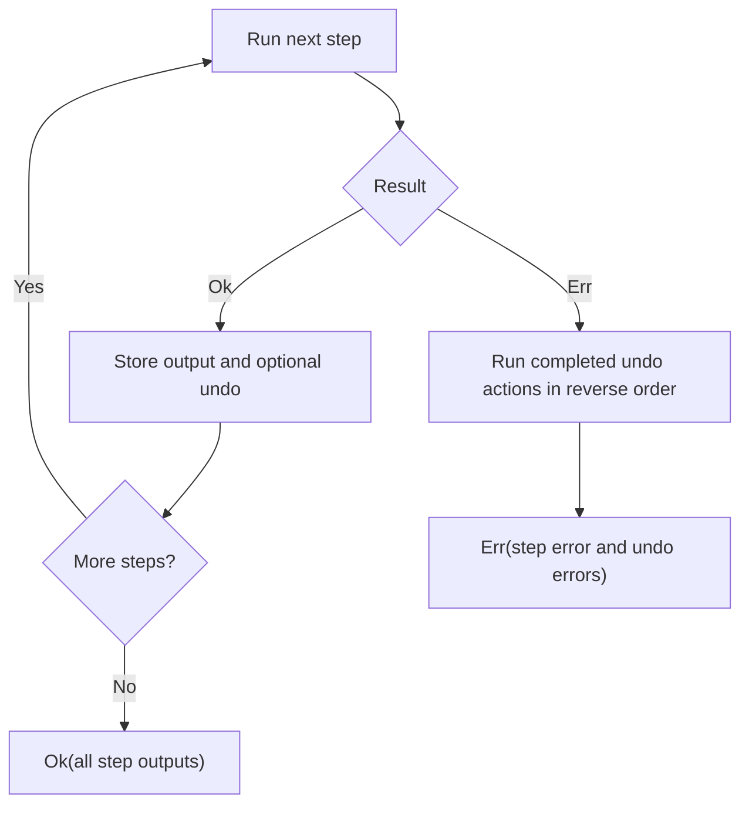

<!-- BUNDLE_SIZE:START -->

> 5.92 kB minified + gzipped

<!-- BUNDLE_SIZE:END -->

## Core Behavior

`Transaction` runs a sequence of `Task.Result` steps. Each successful step adds its output to the
context available to later steps.

- A step can provide an `undo` action. If a later step fails, completed steps with undo actions are
  compensated in reverse order.
- The failure includes the failing step ID, its error, and any errors from undo actions. A failed
  undo does not prevent earlier undo actions from running.
- `Transaction.run` creates a lazy task; the steps start when that task is called.

## Example: Publishing a Document

A publisher uploads a document, adds it to a catalog, and sends a notification. If notification
fails, the publisher needs to remove the catalog entry and uploaded document.

Only successful steps register undo actions. When a step returns an error, the transaction runs the
registered actions in reverse order and retains the original error:



### Publishing and Rolling Back

This runnable example uses in-memory sets to represent the storage and catalog services. The
notification fails, so the first two steps are undone:

```ts
import { Task, Transaction, pipe } from "@pplnd/core";

const storage = new Set<string>();
const catalog = new Set<string>();
const events: string[] = [];

const upload = (name: string): Task.Result<string, string> => Task.Result.tryCatch(
  async () => { storage.add(name); events.push("uploaded"); return name; },
  { onError: String },
);
const removeUpload = (name: string): Task.Result<string, void> => Task.Result.tryCatch(
  async () => { storage.delete(name); events.push("deleted upload"); },
  { onError: String },
);
const index = (name: string): Task.Result<string, string> => Task.Result.tryCatch(
  async () => { catalog.add(name); events.push("indexed"); return name; },
  { onError: String },
);
const removeIndex = (name: string): Task.Result<string, void> => Task.Result.tryCatch(
  async () => { catalog.delete(name); events.push("removed index"); },
  { onError: String },
);

const publish = pipe(
  Transaction.make(),
  Transaction.step({
    id: "upload",
    run: () => upload("report.pdf"),
    undo: (name: string) => removeUpload(name),
  }),
  Transaction.step({
    id: "index",
    run: ({ upload }: { upload: string }) => index(upload),
    undo: (name: string) => removeIndex(name),
  }),
  Transaction.step({
    id: "notify",
    run: (_context: { upload: string; index: string }) =>
      Task.Result.make.err("Notification unavailable"),
  }),
);

const result = await pipe(publish, Transaction.run())();
// Err: stepId "notify", error "Notification unavailable", undoErrors []
// events: ["uploaded", "indexed", "removed index", "deleted upload"]
```

The failed `notify` step has no completed output to undo. Undo actions run without the transaction's
abort signal so they can attempt cleanup after cancellation.

## Core Operations

| Signature                         | What it does                                             | Result or behavior                             |
| :-------------------------------- | :------------------------------------------------------- | :--------------------------------------------- |
| `Transaction.make<Input>()`       | Creates an empty transaction for an optional input type. | A transaction plan.                            |
| `Transaction.step(config)`        | Adds a step with `id`, `run`, and optional `undo`.       | Later steps can read successful outputs by ID. |
| `Transaction.run(input, options)` | Creates a task that executes the steps.                  | `Task.Result` of outputs or failure details.   |

A step can also specify a retry policy and timeout. Run options accept an `AbortSignal` and
`onStepSuccess`, `onStepFailure`, and `onUndo` callbacks.

## Failure Behavior and Edge Cases

A failed step is not added to the undo stack. If that step has already made an external change
before returning an error, its own implementation must handle that partial work. Failed undo actions
are listed in `undoErrors`; the original forward error remains in `error`.

Cancellation is checked before each step and the signal is passed to active work. In-flight work
must respond to the signal; cancellation does not forcibly interrupt an operation that ignores it.
When cancellation prevents a step from starting, `error` is `Transaction.Aborted` with the signal's
reason. A thrown step or undo callback is reported as `Unexpected` with its cause; undo exceptions
appear in `undoErrors`. A thrown timeout handler also produces `Unexpected`. Telemetry callback
errors are ignored so they do not stop execution or rollback. Step IDs must be unique and cannot be
`initial`.
