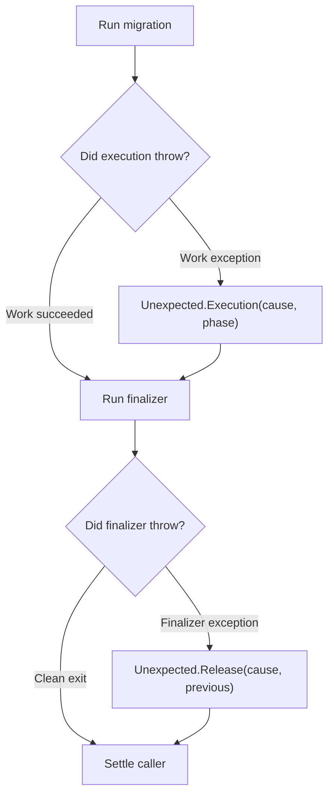

<!-- BUNDLE_SIZE:START -->

> 367 B minified + gzipped

<!-- BUNDLE_SIZE:END -->

## Core Behavior

`Unexpected` captures contract-violating exceptions thrown at execution boundaries — such as thrown
exceptions in tasks, mappers, predicates, or resource finalizers — while ensuring callers settle and
retaining full diagnostic context.

- In execution boundaries, `Unexpected.Execution` captures the originating `source`, the `phase`
  (`"execution"`, `"acquire"`, or `"use"`), the thrown `cause`, and any active `stepId`.
- In resource finalization, `Unexpected.Release` captures the release `cause`, the `previous`
  outcome from acquisition or work, and any `additionalErrors` from secondary finalizers.
- Narrow variants using `Unexpected.is.execution` or `Unexpected.is.release`, or eliminate both
  cases using `Unexpected.match`.

## Example: Schema Migration with Leased Connection

A database migration runner acquires a dedicated connection, executes schema DDL statements within a
transaction, and closes the connection during cleanup.

If a migration step or a connection finalizer throws an unhandled exception, `Unexpected` preserves
both the runtime failure and the cleanup diagnostics:



### Inspecting Boundary Failures

`Unexpected.match` separates execution exceptions from resource cleanup errors. When a cleanup
throws, `previous` retains the migration result so callers can inspect whether the work itself had
failed before cleanup:

```ts
import { Result, Unexpected } from "@pplnd/core";

type MigrationOutcome = Result<string | Unexpected.Execution, number>;

const diagnose = Unexpected.match({
  execution: (error) => {
    return `Execution halted in [${error.source}] during ${error.phase}: ${String(error.cause)}`;
  },
  release: (error: Unexpected.Release<MigrationOutcome>) => {
    const prior = Result.is.err(error.previous)
      ? `preceded by error: ${JSON.stringify(error.previous.error)}`
      : "preceded by successful work";
    const extra = error.additionalErrors.length > 0
      ? ` (${error.additionalErrors.length} additional cleanup failures)`
      : "";
    return `Cleanup failed in [${error.source}]: ${String(error.cause)} (${prior})${extra}`;
  },
});

const report = (failure: Unexpected<MigrationOutcome>): string => diagnose(failure);
```

## Core Operations

| Signature                            | What it does                                          | Behavior                                                                           |
| :----------------------------------- | :---------------------------------------------------- | :--------------------------------------------------------------------------------- |
| `Unexpected.make.execution(options)` | Creates an execution boundary error.                  | Populates `source`, `phase`, `cause`, and optional `stepId`.                       |
| `Unexpected.make.release(options)`   | Creates a finalization release error.                 | Sets `source: "Resource"`, `phase: "release"`, `previous`, and `additionalErrors`. |
| `Unexpected.is.unexpected(value)`    | Checks whether a value is an `Unexpected` error.      | Type guard for `Unexpected<unknown>`.                                              |
| `Unexpected.is.execution(value)`     | Checks whether an error occurred during execution.    | Type guard narrowing to `Unexpected.Execution`.                                    |
| `Unexpected.is.release(value)`       | Checks whether an error occurred during finalization. | Type guard narrowing to `Unexpected.Release<Prev>`.                                |
| `Unexpected.match(cases)`            | Eliminates an `Unexpected` value by variant.          | Calls `cases.execution` or `cases.release` based on `phase`.                       |

When an error comes from an unknown source, `Unexpected.is.unexpected` checks its shape. Its release
variant has an `unknown` previous outcome; validate that value before inspecting it. The example
retains the outcome type from `Resource.use` instead.

## Failure Behavior and Edge Cases

The `phase` property strictly discriminates between variants. When `phase === "release"`, the error
is guaranteed to be `Unexpected.Release<Prev>`, providing typed access to `previous` and
`additionalErrors`. For any other phase (`"execution"`, `"acquire"`, or `"use"`), the error is
`Unexpected.Execution`.

When work throws and the subsequent finalizer also throws, `Resource.use` returns
`Unexpected.Release` where `cause` is the release exception and `previous` contains a `Result.Err`
wrapping the initial `Unexpected.Execution`. This ensures that secondary cleanup exceptions never
overwrite the primary root cause.

If multiple finalizers throw during reverse-order teardown, the first exception becomes `cause` and
all subsequent thrown values are collected into `additionalErrors`.

Throwing non-Error values (such as strings, plain objects, or null) preserves the raw thrown value
directly in `cause` without coercion.
