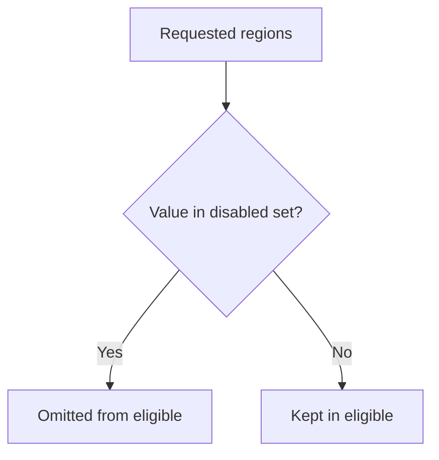

<!-- BUNDLE_SIZE:START -->

> 2.00 kB minified + gzipped

<!-- BUNDLE_SIZE:END -->

Two services compute the regions eligible for a deployment. Each starts from a requested list,
removes the regions under maintenance, and publishes the result. A requested list that repeats a
region survives the subtraction with the duplicate intact, so the two services disagree about how
many regions remain and neither reports an error.

## Core Behavior

`Uniq` wraps `ReadonlySet` and provides data-last operations for membership, transformation, and set
algebra. Membership follows JavaScript equality; object values are compared by reference.

- `from.array` removes duplicates and keeps the first occurrence order; `to.array` reads values in
  insertion order.
- `union`, `intersection`, and `difference` return new sets without changing their inputs;
  `difference` keeps the input values absent from the supplied set.
- `insert` and `remove` return the input set unchanged when membership would not change; `toggle`
  always returns a new set.
- `map` collapses values that transform to the same result.

Reach for `Uniq` when values are unique by definition and the question is membership.
[`Arr`](/guides/arr/) keeps order and duplicates and offers `Arr.uniq` for one-off deduplication.
The [choosing guide](/basics/choosing/) covers the other collection modules.

## Example: Deployment Regions

An operator requests deployment regions, and a maintenance window disables a subset. The eligible
regions are the requested regions that are not disabled, and the same sets answer whether every
disabled region is a recognized one.

`difference` tests each requested value against the disabled set and keeps the values it does not
find:



### Selecting Regions

```ts
import { Uniq, pipe } from "@pplnd/core";

type Region = "central" | "east" | "west";

const requested = Uniq.from.array<Region>(["east", "west", "east", "central"]);
const disabled = Uniq.from.array<Region>(["west"]);
const known = Uniq.from.array<Region>(["central", "east", "west"]);

const eligible = pipe(requested, Uniq.difference(disabled), Uniq.to.array);
const unrecognized = pipe(requested, Uniq.difference(known), Uniq.to.array);
const maintenanceIsKnown = pipe(disabled, Uniq.is.subsetOf(known));

eligible; // ["east", "central"]
unrecognized; // []
maintenanceIsKnown; // true
Uniq.size(requested); // 3
```

`from.array` removed the second `east`, and `difference` removed `west`. The subset check reads as
`disabled` is a subset of `known`, which is the direction `is.subsetOf` takes.

### Handoff: A Non-Empty Result After Set Algebra

Set algebra can empty the set. When a later step cannot accept an empty collection, refine the
result once:

```ts
import { Maybe, Uniq, pipe } from "@pplnd/core";

const eligibleSet = pipe(requested, Uniq.difference(disabled));
const launch = pipe(eligibleSet, Uniq.NonEmpty.from.set); // Maybe<Uniq.NonEmpty<Region>>
const summary = pipe(
  launch,
  Maybe.match({
    some: (regions) => Uniq.NonEmpty.to.array(regions).join(", "),
    none: () => "no region available",
  }),
);

summary; // "east, central"
```

The `Maybe` records the only remaining failure, and `Uniq.NonEmpty.to.array` returns an array whose
type still says it has an element. [Non-Empty Collections](/guides/nonempty/) lists the guards for
every collection module.

## Core Operations

### Creating and Reading

| Signature                                                          | What it does                       | Result                         |
| :----------------------------------------------------------------- | :--------------------------------- | :----------------------------- |
| `Uniq.empty()` / `Uniq.singleton(item)` / `Uniq.from.array(items)` | Creates a set.                     | `ReadonlySet`                  |
| `Uniq.has(item)` / `Uniq.size`                                     | Tests membership / reads the size. | Boolean / number               |
| `Uniq.is.empty` / `Uniq.is.nonEmpty` / `Uniq.is.subsetOf(other)`   | Inspects a set.                    | Boolean; `is.nonEmpty` narrows |
| `Uniq.to.array(set)`                                               | Copies values in insertion order.  | `readonly A[]`                 |

### Updating and Combining

| Signature                                                                      | What it does                       | Result                                             |
| :----------------------------------------------------------------------------- | :--------------------------------- | :------------------------------------------------- |
| `Uniq.insert(item)` / `Uniq.remove(item)` / `Uniq.toggle(item)`                | Adds, removes, or toggles a value. | A set, or the input when membership did not change |
| `Uniq.map(transform)` / `Uniq.filter(predicate)` / `Uniq.filterMap(transform)` | Transforms or selects values.      | A new set; transformed duplicates collapse         |
| `Uniq.union(other)` / `Uniq.intersection(other)` / `Uniq.difference(other)`    | Combines or compares membership.   | A new set; `difference` removes values in `other`  |
| `Uniq.reduce(initial, reducer)`                                                | Accumulates values.                | The final accumulator                              |

### Working with Non-Empty Sets

| Signature                                                        | What it does                             | Result                    |
| :--------------------------------------------------------------- | :--------------------------------------- | :------------------------ |
| `Uniq.NonEmpty.from.set(set)`                                    | Checks for at least one value.           | `Maybe<Uniq.NonEmpty<A>>` |
| `Uniq.NonEmpty.singleton(item)` / `Uniq.NonEmpty.map(transform)` | Creates a one-value set / transforms it. | `Uniq.NonEmpty<A>`        |
| `Uniq.NonEmpty.reduce(reducer)`                                  | Folds from the first value.              | The final value           |
| `Uniq.NonEmpty.to.array(set)`                                    | Copies values.                           | `NonEmptyArr<A>`          |

## Failure Behavior and Edge Cases

Set membership follows same-value equality. Object values are compared by reference, so two objects
with the same fields are different values:

```ts
import { Uniq } from "@pplnd/core";

const east = { region: "east" };
const oneRegion = Uniq.from.array([east, { region: "east" }]);

Uniq.size(oneRegion); // 2
Uniq.has({ region: "east" })(oneRegion); // false
```

`insert` returns the input set when the value is already present, and `remove` does the same when it
is absent, so the result can be the same reference. `toggle` always copies. `map` keeps the
transformed value's first position and drops later duplicates.

`intersection` and `difference` keep the input set's iteration order; `union` lists the input values
first and appends values that exist only in the supplied set. The empty set is a subset of every
set, so `is.subsetOf` returns true when the input has no values.

`Uniq.NonEmpty.from.set` checks the size at the moment of the call and returns the same set, not a
copy; mutating the underlying set through another reference invalidates the guarantee. For
value-based uniqueness, transform each object through a stable key first;
[`Arr.uniqBy`](/guides/arr/) applies the same projection without building a set.
