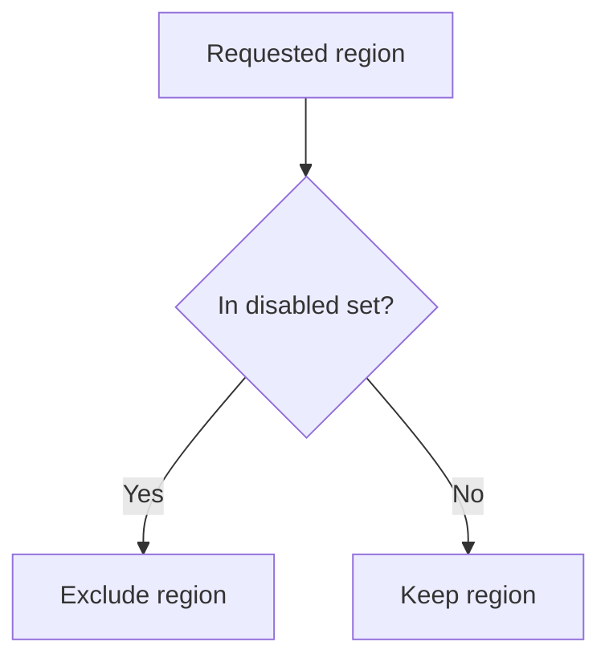

{/* BUNDLE_SIZE:START */}

> 2.04 kB minified + gzipped

{/* BUNDLE_SIZE:END */}

## Core Behavior

`Uniq` works with `ReadonlySet` collections. It provides data-last operations for membership,
transformations, and set comparisons.

- Creating a set from an array removes duplicate values.
- `union`, `intersection`, and `difference` combine sets without changing their inputs.
- Set membership uses JavaScript's equality rules; objects are compared by reference.

## Example: Deployment Targets

A deployment has a requested set of regions and a set temporarily disabled for maintenance. The
eligible regions are the requested regions that are not disabled.

`difference` tests each value in the input set against the supplied set and keeps values absent from
that set:



### Selecting Regions

```ts
import { Uniq, pipe } from "@pplnd/core";

const requested = Uniq.from.array(["east", "west", "east", "central"]);
const disabled = Uniq.from.array(["west"]);
const eligible = pipe(requested, Uniq.difference(disabled), Uniq.to.array);
// ["east", "central"]
```

## Core Operations

### Creating and Reading

| Signature | What it does | Result |
| :-------- | :----------- | :----- |
| `Uniq.empty()` / `singleton(item)` / `from.array(items)` | Creates a set. | `ReadonlySet<A>`. |
| `Uniq.has(item)` / `size` | Checks membership / reads the size. | Boolean / number. |
| `Uniq.is.empty` / `is.nonEmpty` / `is.subsetOf(other)` | Inspects a set. | Boolean; `is.nonEmpty` narrows the type. |
| `Uniq.to.array(set)` | Copies set values into an array. | `readonly A[]`. |
| `Uniq.NonEmpty.from.set(set)` | Checks for at least one value. | `Maybe<Uniq.NonEmpty<A>>`. |

### Updating and Combining

| Signature | What it does | Behavior |
| :-------- | :----------- | :------- |
| `Uniq.insert(item)` / `remove(item)` / `toggle(item)` | Adds, removes, or toggles membership. | Returns a set. |
| `Uniq.map(fn)` / `filter(fn)` / `filterMap(fn)` | Transforms or selects values. | Duplicate transformed values collapse. |
| `Uniq.union(other)` / `intersection(other)` / `difference(other)` | Combines or compares membership. | `difference` removes values in `other`. |
| `Uniq.reduce(initial, fn)` | Accumulates values. | Returns the final result. |
| `Uniq.NonEmpty.singleton(item)` / `map(fn)` / `reduce(fn)` / `to.array(set)` | Works with a known non-empty set. | Keeps a non-empty result where applicable. |

## Failure Behavior and Edge Cases

Two objects with identical properties are distinct set values unless they are the same object. For
value-based uniqueness, transform each object to a stable key before creating the set.

`difference(other)(input)` keeps values in `input` that are absent from `other`; reversing the
arguments reverses the comparison.
