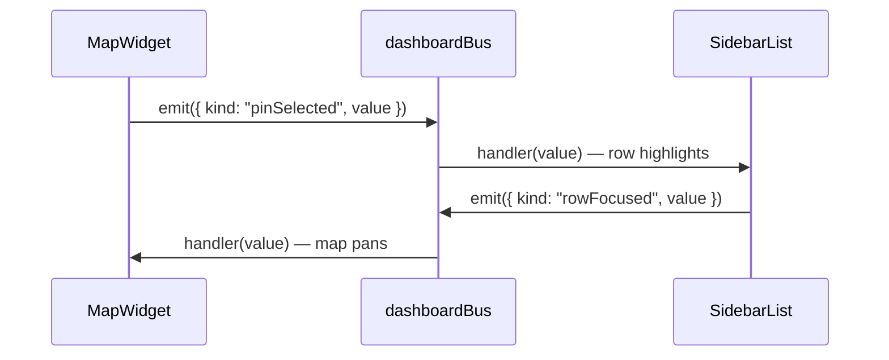

A mapping dashboard has a map widget and a sidebar list. Selecting a pin on the map must highlight
the list row; selecting a row must pan the map. Neither widget owns the other, so state wiring
through props would couple them — but hand-subscribing both to an event bus means keeping the
handler fresh without re-subscribing, and unsubscribing exactly when the widget dies. Miss the
unsubscribe and a closed widget still receives events; skip the freshness dance and the handler
closes over the first render's props.

## Core Behavior

`useEventBus` subscribes a stable handler to a single `EventBus` event key for the component's
lifetime.

- The subscription is created once per `(bus, key)` pair on mount; the latest handler is read from a
  ref synced on every commit, so deliveries after any commit observe current props and state without
  re-subscribing.
- Unmount or a key change drops the subscription; changing the key re-subscribes to the new one.
- The hook does not buffer or replay events — deliveries are live, and translation into render state
  is the handler's job.
- Handlers that throw follow the bus's own contract: a configured `onError` reports and delivery
  continues, otherwise the exception propagates to the emitter. The hook adds no second error
  channel.

Multi-key subscriptions have no dedicated hook: call `useEventBus` per key. That keeps handler
payload types exact per key instead of blurring them into a union. For cross-domain state — a bus
event that should *drive* a machine's transition — interpret the machine with a `bus` per the
[Machine guide](/guides/machine/) and bind it with [`useActor`](/guides/use-actor/).

## Example: Map and Sidebar Sync



```tsx
type DashboardEvents = {
	readonly pinSelected: { readonly rowId: string };
	readonly rowFocused: { readonly rowId: string };
};

const dashboardBus = EventBus.make<DashboardEvents>();

function SidebarList({ rows }: { rows: Row[] }) {
	const [focusedId, setFocusedId] = useState<string | null>(null);
	useEventBus(dashboardBus, "pinSelected", ({ rowId }) => setFocusedId(rowId));

	return rows.map((row) => <ListRow key={row.id} row={row} highlighted={row.id === focusedId}
		onFocus={() => EventBus.emit(dashboardBus, { kind: "rowFocused", value: { rowId: row.id } })} />);
}

function MapWidget() {
	useEventBus(dashboardBus, "rowFocused", ({ rowId }) => panTo(rowId));
	return <MapCanvas />;
}
```

### Handoff: When an Event Should Change Machine State

Highlighting a row is local state; a bus event that must *transition* a machine — session expired,
cart cleared — belongs in the machine's transition table via a bus subscription, not in a component
handler. See [`useActor`](/guides/use-actor/) for the binding and the
[Machine guide](/guides/machine/) for the inbound wiring.

## Core Operations

| Operation                        | What it does                         | Result                                    |
| :------------------------------- | :----------------------------------- | :---------------------------------------- |
| `useEventBus(bus, key, handler)` | Subscribes one key for the lifetime. | `void` — the handler drives render state. |
| changed `key`                    | Unsubscribes and re-subscribes.      | Payload type follows the new key.         |
| unmount                          | Unsubscribes.                        | No further deliveries.                    |

## Failure Behavior and Edge Cases

Events emitted before mount are not replayed — subscriptions are live. Changing the key drops the
old subscription before the new one starts, so a key-swap never double-delivers. The handler is
synced on every commit, which covers the stale-closure failure mode while keeping a single
subscription per `(bus, key)`. A throwing handler follows the bus contract — see the
[`EventBus` guide](/guides/event-bus/) for the `onError` and propagation semantics.
