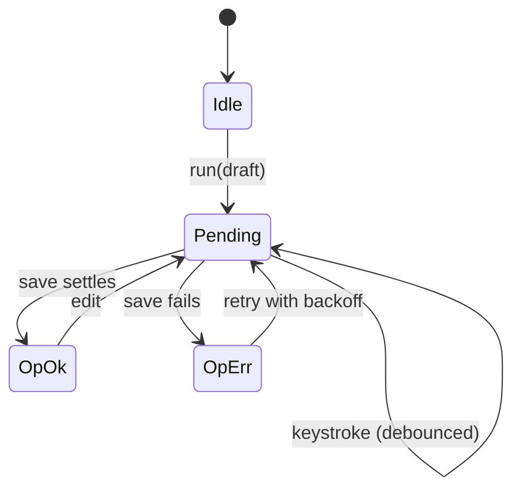

A note-taking app autosaves the draft. Keystrokes must not fire a save per character, overlapping
saves must not interleave writes, and a failed save should retry with backoff. Hand-rolled, that is
a hook full of timers, in-flight sets, and retry counters — each one a chance to save the wrong
revision or leave a timer running after unmount. The strategy already exists in the manager; the
component only needs to show its state.

## Core Behavior

`useOp` subscribes a component to an existing `Op.Manager`. The manager is created with
`Op.interpret` outside React — in `Component.state.ts` — where the strategy, retry policy, and
timeouts are configured; the hook's entire job is subscribe, re-render, forward.

- The manager's discriminated state union (`Idle`, `Pending`, `Queued`, `Retrying`, `OpOk`, `OpErr`,
  `OpNil`) re-renders the component on every transition — including `Queued { position }` and
  `Retrying { attempt, nextRetryIn }`, which no hand-rolled hook renders correctly.
- `run`, `abort`, and `reset` are the manager's own methods: stable identities, and `run` settles
  with the manager's outcome `Deferred` for coordination.
- The hook holds no copy of the manager's logic — the manager stays the single source of truth, and
  re-entrancy, epochs, and timer hygiene stay in core.

One canonical way: a mount-triggered request with no strategy belongs in
[`useLoad`](/guides/use-load/). The moment the run needs debouncing, queueing, or retries, build the
`Op` and bind it here. The [Op guide](/guides/op/) covers strategies; for the engine's types, see
[Reading the Types](/basics/types/).

## Example: Autosaving a Draft



```tsx
// Component.state.ts — strategy configured outside React
const saveOp = Op.make((draft: Draft) => persist(draft));
export const saveManager = Op.interpret(saveOp, {
	strategy: "debounced",
	duration: Duration.milliseconds(400),
	retry: RetryPolicy.fixed({ attempts: 3, delay: Duration.seconds(2) }),
});

// Autosaver.view.tsx — React renders the resulting state union
function Autosaver({ draft }: { draft: Draft }) {
	const { state, run } = useOp(saveManager);

	useEffect(() => run(draft), [draft]);

	return Op.is.pending(state) ? "Saving…"
		: Op.is.retrying(state) ? `Retrying (${state.attempt})…`
		: Op.is.idle(state) ? "All changes saved"
		: Op.is.ok(state) ? "Saved"
		: Op.is.err(state) ? `Save failed: ${state.error}`
		: "Interrupted";
}
```

### Handoff: Recurring Refresh on the Same Manager

An autosaver saves on change; a metrics panel runs the same manager on a schedule. Bind
[`useOpPoll`](/guides/use-op-poll/) to the same manager — `useOp` renders the runs, `useOpPoll`
drives them.

## Core Operations

| Operation        | What it does                       | Result                               |
| :--------------- | :--------------------------------- | :----------------------------------- |
| `useOp(manager)` | Subscribes to the manager's state. | `{ state, run, abort, reset }`.      |
| `state`          | The manager's discriminated union. | `Op.is.*` guards in render.          |
| `run(...args)`   | Forwards to `manager.run`.         | Settles with the outcome `Deferred`. |
| `abort()`        | Forwards to `manager.abort`.       | Settles in-flight runs as `OpNil`.   |
| `reset()`        | Forwards to `manager.reset`.       | Back to `Idle`.                      |

## Failure Behavior and Edge Cases

The listener identity never changes, so a handler that captures props stays fresh without
re-subscription storms. On unmount the subscription is dropped; a run started before unmount
continues to completion in the manager — the component stops rendering it, the save itself is not
cancelled. To cancel a run on exit, call `abort()` in the component's own cleanup; the aborted run
settles as `OpNil { reason: "aborted" }`. An unhandled subscriber exception would escape
notification — follow the two-layer rule: test strategy behavior against the manager directly, not
through the hook.
