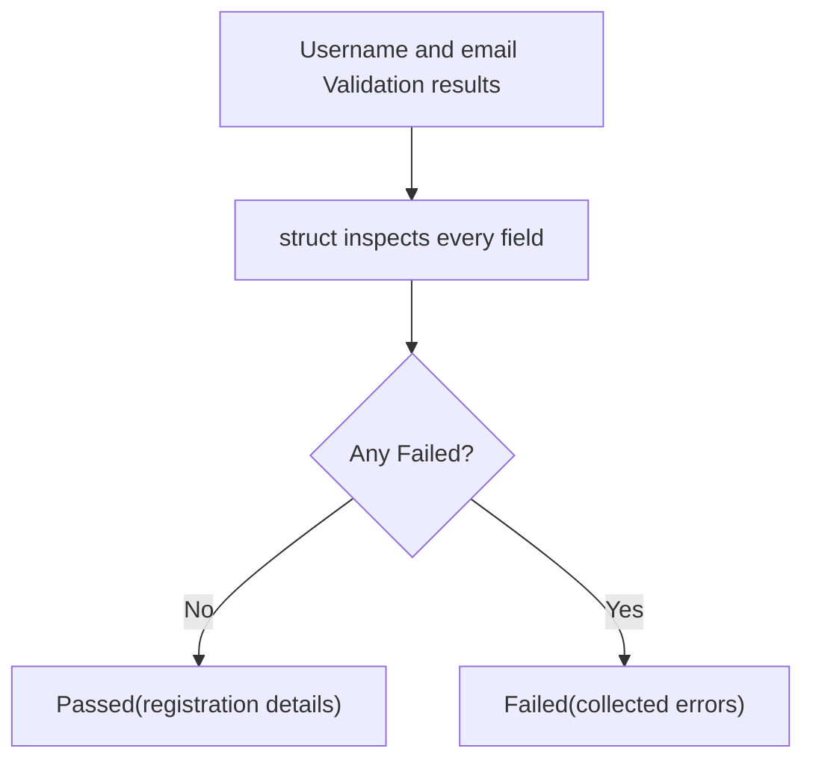

<!-- BUNDLE_SIZE:START -->

> 1.56 kB minified + gzipped

<!-- BUNDLE_SIZE:END -->

## Core Behavior

`Validation<E, A>` holds either a `Passed` value or a `Failed` non-empty list of errors.

- `struct` combines independent field results and collects every failure in own-key enumeration
  order.
- `apply` combines a wrapped function and argument, concatenating their errors in that order by
  default.
- `map` skips a failed value; `match` handles the complete error list or the passed value.

## Example: Account Registration

A registration form needs to check a username, email address, and password. Reporting all invalid
fields together lets the user correct them in one pass.

`struct` receives already-created field results and collects errors from every failed field. It
returns the combined values only when all fields pass:



For a failed username followed by a failed email, the error list contains the username errors first,
then the email errors. `struct` processes fields in own-key enumeration order and preserves the
order within each field's error list.

### Validating Registration Fields

A registration form may return after its first invalid field:

```ts
function checkRegistration(input: { username: string; email: string }): string | null {
  if (input.username.trim() === "") return "Username is required";
  if (!input.email.includes("@")) return "Email is invalid";
  return null;
}
```

The user must fix the username and submit again before seeing the email error. A single
`Validation.from.Predicate` makes one check return a value or an error list:

```ts
import { Validation } from "@pplnd/core";

const checkUsername = Validation.from.Predicate(
  (username: string) => username.trim().length > 0,
  () => "Username is required",
);

checkUsername(""); // Failed(["Username is required"])
```

Independent fields can be checked together. A rule comparing the username and password needs both
validated values, so the example converts to `Result` before that dependent check. The input has
already been decoded into strings by the caller.

```ts
import { pipe, Result, Validation } from "@pplnd/core";

interface RegistrationInput {
  username: string;
  email: string;
  password: string;
}

type FieldError = "USERNAME_REQUIRED" | "INVALID_EMAIL" | "PASSWORD_TOO_SHORT";
type RegistrationResponse = { status: number; body: string };

const checkUsername = Validation.from.Predicate(
  (username: string) => username.trim().length > 0,
  () => "USERNAME_REQUIRED" as const,
);
const checkEmail = Validation.from.Predicate(
  (email: string) => /^[^\s@]+@[^\s@]+\.[^\s@]+$/.test(email.trim()),
  () => "INVALID_EMAIL" as const,
);
const checkPassword = Validation.from.Predicate(
  (password: string) => password.length >= 12,
  () => "PASSWORD_TOO_SHORT" as const,
);

const validateRegistration = (input: RegistrationInput): Validation<FieldError, RegistrationInput> =>
  pipe(
    Validation.struct({
      username: checkUsername(input.username),
      email: checkEmail(input.email),
      password: checkPassword(input.password),
    }),
    Validation.map((registration) => ({
      ...registration,
      username: registration.username.trim(),
      email: registration.email.trim().toLowerCase(),
    })),
  );

const registrationResponse = (input: RegistrationInput): RegistrationResponse =>
  pipe(
    validateRegistration(input),
    Validation.to.Result((errors) => errors.join(", ")),
    Result.ensure(
      (registration) => registration.password !== registration.username,
      () => "PASSWORD_MATCHES_USERNAME",
    ),
    Result.match({
      ok: (registration) => ({ status: 200, body: `Ready to register ${registration.username}` }),
      err: (error) => ({ status: 400, body: error }),
    }),
  );

console.log(registrationResponse({ username: "", email: "invalid", password: "long-enough-password" }));
// { status: 400, body: "USERNAME_REQUIRED, INVALID_EMAIL" }
console.log(registrationResponse({ username: "longusername", email: "alex@example.com", password: "longusername" }));
// { status: 400, body: "PASSWORD_MATCHES_USERNAME" }
```

## Core Operations

### Creating Values

| Operation                                      | What it does                                                | Error or return type      |
| ---------------------------------------------- | ----------------------------------------------------------- | ------------------------- |
| `make.passed(value)` / `make.failed(error)`    | Wrap a value / a single error.                              | `Passed<A>` / `Failed<E>` |
| `make.failedAll(errors)`                       | Wrap an existing non-empty error array.                     | `Failed<E>`               |
| `tryCatch(operation, { onError })`             | Run synchronous code and map a thrown value to one error.   | `Validation<E, A>`        |
| `from.Predicate(predicate, onFalse)`           | Check a value; a type guard also narrows it.                | `Validation<E, A>`        |
| `from.nullable(onNull)` / `from.Maybe(onNone)` | Replace a missing value with one error.                     | `Validation<E, A>`        |
| `from.Result(result)`                          | Convert `Ok` to `Passed` and `Err` to a one-error `Failed`. | `Validation<E, A>`        |

### Combining Values

| Operation                | What it does                                     | Guarantee                                                                              |
| ------------------------ | ------------------------------------------------ | -------------------------------------------------------------------------------------- |
| `struct(fields)`         | Combine a record of already-created validations. | Collects errors in own-key enumeration order.                                          |
| `apply(argument)`        | Apply a wrapped function to a wrapped argument.  | Concatenates errors from the function and argument; `combineErrors` can override this. |
| `keyed.make(validators)` | Run one validator per matching input field.      | Returns a validation for each field.                                                   |

### Transforming Values

| Operation                                | What it does                                      | Guarantee                                                  |
| ---------------------------------------- | ------------------------------------------------- | ---------------------------------------------------------- |
| `map(transform)` / `mapError(transform)` | Transform a passed value / each error.            | The other case passes through.                             |
| `tap(effect)` / `tapError(effect)`       | Inspect a passed value / the complete error list. | Returns the original validation when the callback returns. |
| `recover(fallback)`                      | Run a fallback validation on failure.             | Receives the complete error list.                          |
| `recoverUnless(isBlocked, fallback)`     | Recover only when no error matches the predicate. | A matching error keeps the original failure.               |

### Running Code and Leaving Validation

| Operation                                             | What it does                                                | Return type                           |
| ----------------------------------------------------- | ----------------------------------------------------------- | ------------------------------------- |
| `match({ passed, failed })`                           | Handle both cases.                                          | The selected handler's return value.  |
| `getOrElse(fallback)`                                 | Extract success or call a no-argument fallback.             | Passed or fallback value.             |
| `is.passed(value)` / `is.failed(value)`               | Test and narrow the variant.                                | Boolean type guard.                   |
| `to.Result(validation)`                               | Convert to a fail-fast result.                              | An error contains the non-empty list. |
| `to.Result(combineErrors)`                            | Convert using a function to combine the errors.             | A curried converter to `Result`.      |
| `to.Maybe(validation)`                                | Convert success or failure to presence or absence.          | Discards errors.                      |
| `keyed.is.passed(fields)` / `keyed.is.failed(fields)` | Check whether all fields passed / any failed.               | The passed check narrows each field.  |
| `keyed.getPassed(fields)` / `keyed.getErrors(fields)` | Extract all passed values / errors grouped by failed field. | `Maybe` of the record.                |

For field-specific messages, `keyed.make` retains each field's result. Pass that record to `struct`
when a single validation with a combined error list is needed. `keyed.make` validators return the
same field type they accept; use `struct` directly when a check transforms a field to a different
type.

## Failure Behavior and Edge Cases

`struct` combines results that JavaScript has already evaluated; it does not schedule work or run
checks concurrently. An empty record passes with an empty object. Errors retain field enumeration
order and each field's internal error order. `apply` likewise receives an already-created argument;
its optional `combineErrors` callback must return a non-empty array.

For example, errors from both fields are retained, including multiple errors from one field:

```ts
import { Validation } from "@pplnd/core";

const registration = Validation.struct({
  username: Validation.make.failedAll(["USERNAME_REQUIRED", "USERNAME_FORMAT"]),
  email: Validation.make.failed("INVALID_EMAIL"),
});
// Failed(["USERNAME_REQUIRED", "USERNAME_FORMAT", "INVALID_EMAIL"])
```

Independent checks can all report failures. A check that needs another check's output cannot run
until that output exists; convert to `Result` for dependent fail-fast steps. `Validation` has no
`chain` or `assign` operation.

`tryCatch` catches synchronous throws from its operation and maps the thrown value to one error. A
throw from `onError`, a predicate, a mapper, a handler, or any other callback escapes. A promise
returned from `tryCatch` is a `Passed` value; a later rejection is not caught. Use `Task.Validation`
for independent asynchronous validations.

Error constructors preserve inline literal types, including
`Validation.make.failed("USERNAME_REQUIRED")`. Inline object errors can infer readonly literal
properties; supply a wider explicit type when needed. This is a TypeScript inference rule and does
not freeze objects. TypeScript 5.5 can widen primitive literals returned by callbacks, so use
`as const` when their exact error types are required.
