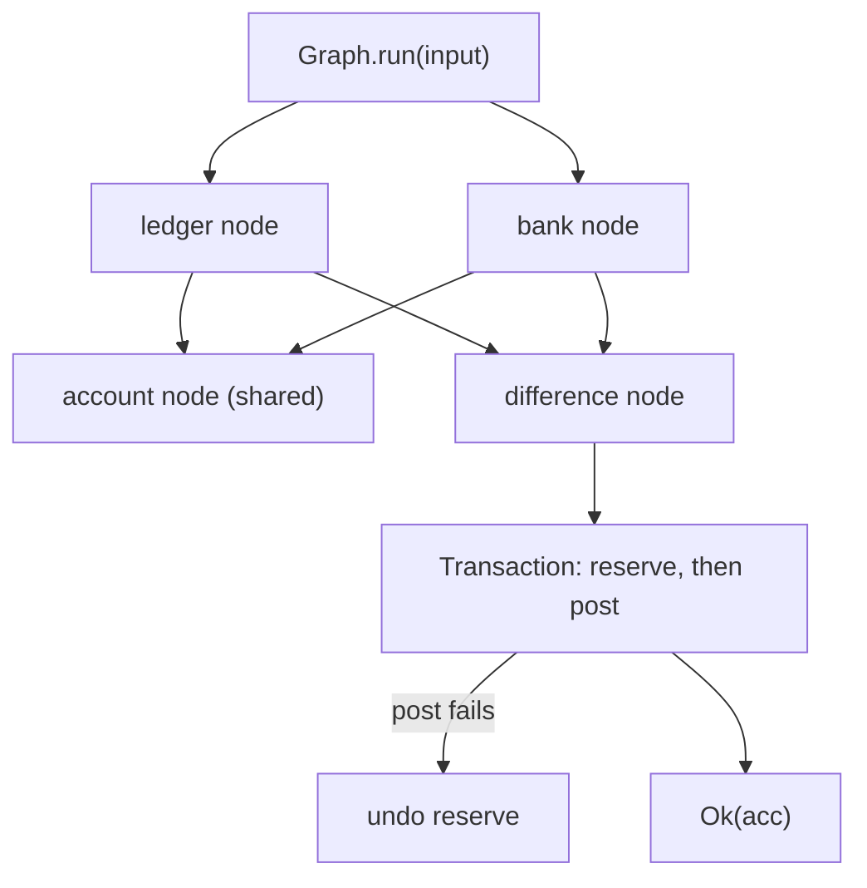

A nightly reconciliation job reads two upstream sources, compares them, and posts one adjustment.
The reads share an account lookup and can run in parallel. The write can fail after the adjustment
is reserved, so it needs a compensating action. The job also holds two handles — a database
connection and an advisory lock — that must be released even when a step fails.

Each failure belongs to a different stage, so each stage gets the module that owns it.



## Schedule the reads

Each node returns a `Task.Result`. A node starts when its dependencies succeed, and the shared
account lookup runs once per graph run even though two nodes depend on it.

```ts
import { Graph, Task } from "@pplnd/core";

interface ReconciliationInput {
  readonly accountId: string;
  readonly period: string;
}

type ReadError = { readonly kind: "SourceDown"; readonly source: string };

const account = Graph.node("account", ({ ctx }) =>
  Task.Result.tryCatch(
    () => accounts.find(ctx.input.accountId),
    { onError: (): ReadError => ({ kind: "SourceDown", source: "accounts" }) },
  ));

const ledger = Graph.node("ledger", { account }, ({ ctx, deps }) =>
  Task.Result.tryCatch(
    () => ledgerApi.read(deps.account.id, ctx.input.period),
    { onError: (): ReadError => ({ kind: "SourceDown", source: "ledger" }) },
  ));

const bank = Graph.node("bank", { account }, ({ ctx, deps }) =>
  Task.Result.tryCatch(
    () => bankApi.read(deps.account.externalId, ctx.input.period),
    { onError: (): ReadError => ({ kind: "SourceDown", source: "bank" }) },
  ));

const difference = Graph.node("difference", { ledger, bank }, ({ deps }) =>
  Task.Result.make.ok(deps.ledger.totalCents - deps.bank.totalCents));

const reconciliation = Graph.make(difference);
```

A failure in `bank` prevents `difference` from running and signals `ledger` to stop. The
[`Graph` guide](/guides/graph/) covers concurrency limits, shared-node execution, and the `Aborted`
outcome.

## Write it under compensation

The write is two external calls. If the second fails, the first must be reversed. A `Transaction`
runs steps in order and unwinds completed steps with their `undo` action in reverse order. The steps
close over the handles, so the same transaction can run against any connection:

```ts
import { Task, Transaction } from "@pplnd/core";

interface WriteInput {
  readonly accountId: string;
  readonly cents: number;
}

type WriteError = { readonly kind: "ReserveFailed" | "PostFailed"; readonly message: string };

const reconcileWith = (connection: DbClient, lock: LockHandle) => {
  const step = Transaction.stepFactory<WriteInput>();

  const reserve = step(
    "reserve",
    ({ ctx }) =>
      Task.Result.tryCatch(
        () => adjustments.reserve(connection, lock, ctx.input.accountId, ctx.input.cents),
        { onError: (error): WriteError => ({ kind: "ReserveFailed", message: String(error) }) },
      ),
    ({ ctx }) =>
      Task.tryCatch(() => adjustments.release(connection, ctx.output.id), { onError: () => {} }),
  );

  const post = step(
    "post",
    ({ ctx, deps }) =>
      Task.Result.tryCatch(
        () => journal.post(connection, deps.reserve.id, ctx.input.cents),
        { onError: (error): WriteError => ({ kind: "PostFailed", message: String(error) }) },
      ),
  );

  return Transaction.make(reserve, post);
};
```

`post` reads `reserve`'s output through `deps`, so step order and dependency names are checked when
the transaction is assembled. The [`Transaction` guide](/guides/transaction/) explains the step
context, the accumulated record, and how `undo` failures are reported instead of swallowed.

## Hold the handles

The job needs a connection and a lock for the whole run. `Resource` acquires them in order and
releases them in reverse order once the work settles, including when it settles with an error.

```ts
import { pipe, Resource, Task } from "@pplnd/core";

const connection = Resource.make(
  Task.Result.tryCatch(() => db.connect(), {
    onError: (): ReadError => ({ kind: "SourceDown", source: "db" }),
  }),
  (client) => Task.tryCatch(() => client.close(), { onError: () => {} }),
);

const lock = Resource.make(
  Task.Result.tryCatch(() => locks.acquire("reconciliation"), {
    onError: (): ReadError => ({ kind: "SourceDown", source: "lock" }),
  }),
  (handle) => Task.tryCatch(() => handle.release(), { onError: () => {} }),
);

const infra = Resource.all({ connection, lock });

const runGraph = (input: ReconciliationInput) =>
  (signal?: AbortSignal) => Graph.run(input, { signal })(reconciliation);

const runReconciliation = (input: ReconciliationInput) =>
  Resource.use(infra, {
    run: ({ connection, lock }: { readonly connection: DbClient; readonly lock: LockHandle }) =>
      pipe(
        runGraph(input),
        Task.Result.chain((cents: number) =>
          (signal?: AbortSignal) =>
            Transaction.run({ accountId: input.accountId, cents }, { signal })(
              reconcileWith(connection, lock),
            )
        ),
      ),
  });

const outcome = await runReconciliation({ accountId: "acct_88", period: "2026-10" });
// Ok(acc), or Err(ReadError | WriteError | Aborted | Transaction.Failure)
```

`runGraph` returns a function, so the graph starts when the resource work starts, not when the
module loads. The `run` parameter is annotated because the resource arrives after the options; the
[`Resource` guide](/guides/resource/) covers `chain`, `combine`, and the release contract.

## Failure behavior

Read failures settle the graph and cancel its siblings. Write failures settle the transaction with
`Transaction.Failure`, which names the failed step and lists any `undo` errors. Release tasks are
infallible: a close failure is handled inside the release task, not in the returned error channel.

Cancellation reaches every stage as [`Aborted`](/guides/aborted/). If the operator aborts between
the graph and the transaction, the transaction settles before starting a step and no write runs.

The transaction does not abort the graph. Sequence them inside `Resource.use` when the handles must
outlive both, as above, or compose them inside a single [`Op`](/guides/op/) when the whole job needs
retry and timeout policy.
