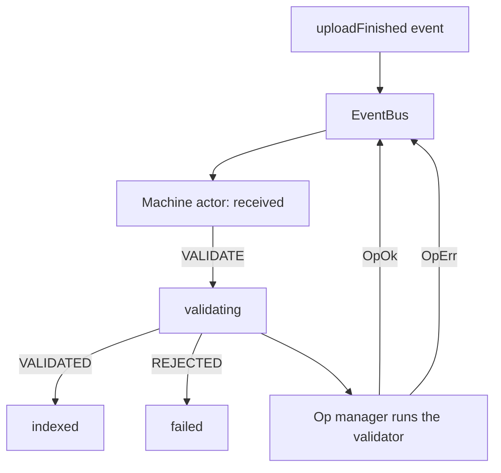

A document ingestion service reacts to uploads. A document moves from received to validating to
indexed or failed, and each step emits an event that other parts of the system listen to. Written
with callbacks and flags, the lifecycle becomes a set of booleans that can disagree: an "indexed"
flag set while the error banner is still visible, or a validation result that arrives after the
document was cancelled.

`EventBus` carries the messages. `Machine` decides which transitions are legal and ignores the rest.
`Op` runs the request the machine is waiting on.



## Describe the messages

The bus schema is the contract between producers and consumers. Every message carries its payload in
`value`, and a listener that selects `kind: "VALIDATED"` receives the parsed document, not an
unknown payload.

```ts
import { EventBus } from "@pplnd/core";

export type IngestEvents = {
  readonly uploadFinished: { readonly documentId: string; readonly bytes: number };
  readonly validate: { readonly documentId: string };
  readonly validated: { readonly documentId: string; readonly pages: number };
  readonly rejected: { readonly documentId: string; readonly reason: string };
  readonly cancelled: { readonly documentId: string };
};

export const ingestBus = EventBus.make<IngestEvents>();
```

`emit` delivers synchronously. If a subscriber emits another message on the same bus, the second
message is queued until the current delivery finishes, so a handler cannot recurse through the
stack. The [`EventBus` guide](/guides/event-bus/) covers ordered sequences and forwarding.

## Model the lifecycle

The machine names the states and the events each state accepts. A transition returns the next state;
an event with no handler leaves the state unchanged, so `VALIDATED` arriving twice cannot move an
`indexed` document backwards.

```ts
import { Machine } from "@pplnd/core";

type DocumentState =
  | Machine.State<"received", { readonly documentId: string }, "validating" | "cancelled">
  | Machine.State<"validating", { readonly documentId: string }, "indexed" | "failed" | "cancelled">
  | Machine.State<"indexed", { readonly documentId: string; readonly pages: number }, never>
  | Machine.State<"failed", { readonly documentId: string; readonly reason: string }, "validating">
  | Machine.State<"cancelled", { readonly documentId: string }, never>;

type DocumentEvents = {
  readonly validate: { readonly documentId: string };
  readonly validated: { readonly documentId: string; readonly pages: number };
  readonly rejected: { readonly documentId: string; readonly reason: string };
  readonly cancelled: { readonly documentId: string };
};

const documentMachine = Machine.make<DocumentState, DocumentEvents>({
  received: {
    on: {
      validate: (_state, { documentId }) => Machine.state("validating", { documentId }),
      cancelled: (_state, { documentId }) => Machine.state("cancelled", { documentId }),
    },
  },
  validating: {
    on: {
      validated: (_state, { documentId, pages }) => Machine.state("indexed", { documentId, pages }),
      rejected: (_state, { documentId, reason }) => Machine.state("failed", { documentId, reason }),
      cancelled: (_state, { documentId }) => Machine.state("cancelled", { documentId }),
    },
  },
  indexed: { on: {} },
  failed: {
    on: {
      validate: (_state, { documentId }) => Machine.state("validating", { documentId }),
    },
  },
  cancelled: { on: {} },
});
```

The allowed target kinds are part of each state's type, so a transition to an undeclared state is a
compile error. The [`Machine` guide](/guides/machine/) covers entry effects, exit cleanup, and the
actor's cancellation.

## Run the work under a policy

Validation is an external request that can fail and be retried. The manager owns the retry and the
timeout, and its settled outcome is translated into a bus message. That keeps the machine free of
network policy and keeps the bus free of retries.

```ts
import { Duration, Op, RetryPolicy, Task } from "@pplnd/core";

type ValidationError = { readonly kind: "Rejected"; readonly reason: string };
type ValidatedDocument = { readonly documentId: string; readonly pages: number };

const validateDocument = Op.make((documentId: string) =>
  Task.Result.tryCatch(
    async (signal) => {
      const response = await fetch(`/api/documents/${documentId}/validate`, { signal });
      if (!response.ok) throw new Error(await response.text());
      const body = await response.json() as { readonly pages: number };
      return { documentId, pages: body.pages } satisfies ValidatedDocument;
    },
    { onError: (error): ValidationError => ({ kind: "Rejected", reason: String(error) }) },
  )
);

const validation = Op.interpret(validateDocument, {
  strategy: "exclusive",
  retry: RetryPolicy.exponential({ attempts: 2, initial: Duration.milliseconds(300) }),
  timeout: { duration: Duration.seconds(20), onTimeout: (): ValidationError => ({ kind: "Rejected", reason: "timeout" }) },
});

const runValidation = (documentId: string) => {
  void validation.run(documentId);
};
```

`strategy: "exclusive"` drops a duplicate validation request for the same document while one is in
flight. The [`Op` guide](/guides/op/) covers the remaining strategies and the meaning of each
`OpNil` reason.

## Connect the three

The actor subscribes to the bus and republishes its own transitions. The machine decides whether an
event is legal; the manager performs the fallible work; the bus carries the outcome to everyone
else.

```ts
import { Machine } from "@pplnd/core";

const actor = Machine.interpret(documentMachine, {
  initial: Machine.state("received", { documentId: "doc_1" }),
  bus: ingestBus,
});

actor.subscribe((state) => {
  if (state.kind === "validating") {
    runValidation(state.value.documentId);
  }
});

validation.subscribe(() => {
  const outcome = validation.state;
  if (Op.Outcome.is.ok(outcome)) {
    EventBus.emit(ingestBus, {
      kind: "validated",
      value: { documentId: outcome.value.documentId, pages: outcome.value.pages },
    });
  }
  if (Op.Outcome.is.err(outcome)) {
    EventBus.emit(ingestBus, {
      kind: "rejected",
      value: { documentId: "doc_1", reason: outcome.error.reason },
    });
  }
});

EventBus.emit(ingestBus, { kind: "uploadFinished", value: { documentId: "doc_1", bytes: 2048 } });
EventBus.emit(ingestBus, { kind: "validate", value: { documentId: "doc_1" } });
```

The actor accepts `validate` because its current state declares a handler for it. An event that no
current state handles is ignored, which is how a duplicate or out-of-order message stops at the
boundary instead of corrupting the view.

## Failure behavior

A rejected validation settles the manager with `OpErr` and emits `rejected`, which moves the machine
to `failed`. A cancellation settles the manager with [`Aborted`](/guides/aborted/) and the document
moves to `cancelled` only if that event is emitted. Subscriber callbacks must not throw: an
exception escapes `emit` and stops delivery to the remaining subscribers.

The machine aborts the previous state's entry scope on every transition, so an asynchronous effect
started by `validating` cannot write into `indexed`. If the ingestion pipeline also needs durable
writes, hand the final state to a [`Transaction`](/guides/transaction/) instead of calling the
storage layer from the subscriber.
