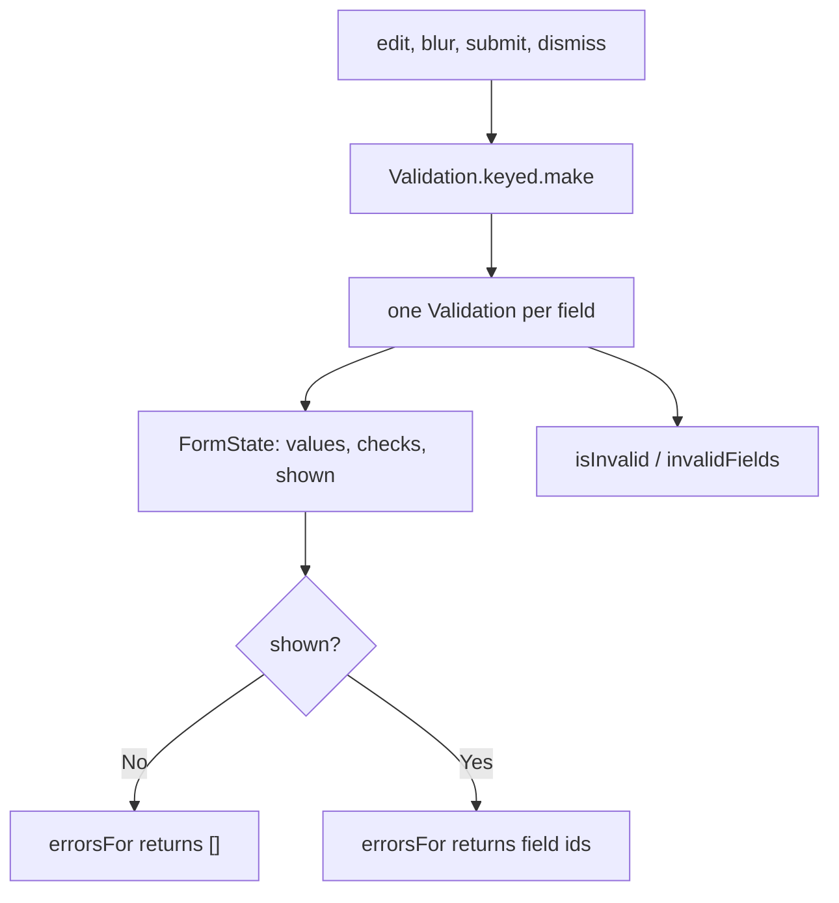

An operator opens a rental request and submits it empty. Three errors appear at once. Then they type
the asset tag and the tag error disappears while the other two stay. That is two different
behaviours — validate everything, reveal only when allowed — and mixing them into one "submit
handler" is where form state usually goes wrong.

This recipe keeps them separate. Validation is a pure function of the form values. Visibility is a
flag on the state. Triggers decide whether a run is shown or hidden.



## Give every rule its own error id

Each field is a list of rules. A rule is a `Predicate` plus the id it produces when it fails, so the
screen can map ids to copy without parsing messages:

```ts
import { type Predicate, Validation } from "@pplnd/core";

type ErrorId =
  | "REQUIRED_INPUT"
  | "TOO_LARGE"
  | "NOT_A_NUMBER"
  | "OUT_OF_RANGE"
  | "INVALID_EMAIL";

const isBlank = (text: string): boolean => text.trim().length === 0;
const isEmail = (text: string): boolean => /^[^@\s]+@[^@\s]+\.[^@\s]+$/.test(text);

const rule = <A>(predicate: Predicate<A>, errorId: ErrorId) =>
  (value: A): Validation<ErrorId, A> => Validation.from.Predicate(predicate, () => errorId)(value);
```

The predicates themselves compose with the [`Predicate`](/guides/predicate/) module. A field that
must not be blank uses `Predicate.not`; a field with two independent rules runs both and keeps both
ids:

```ts
import { pipe, Predicate, Validation } from "@pplnd/core";

const required = rule(Predicate.not(isBlank), "REQUIRED_INPUT");
const atMost = (limit: number) => rule((text: string) => text.length <= limit, "TOO_LARGE");
const emailShape = rule(isEmail, "INVALID_EMAIL");

const validateAssetTag = (raw: string): Validation<ErrorId, string> =>
  pipe(
    Validation.struct({
      required: required(raw),
      size: atMost(24)(raw),
    }),
    Validation.map(() => raw.trim()),
  );
```

`Validation.struct` runs both rules and keeps every failure. An empty email reports
`["REQUIRED_INPUT", "INVALID_EMAIL"]` rather than only the first, because two independent checks
ran. The [`Validation` guide](/guides/validation/) covers the accumulation order.

Numeric fields parse first, then check range. A failed parse short-circuits, because there is no
number to range-check:

```ts
import { Maybe, Num, Validation } from "@pplnd/core";

const validateDays = (raw: string): Validation<ErrorId, number> => {
  const parsed = Num.from.string(raw);
  if (Maybe.is.none(parsed)) {
    return Validation.make.failed("NOT_A_NUMBER");
  }
  return rule((value: number) => value >= 1 && value <= 30, "OUT_OF_RANGE")(parsed.value);
};

const validateEmail = (raw: string): Validation<ErrorId, string> =>
  pipe(
    Validation.struct({
      required: required(raw),
      shape: emailShape(raw),
    }),
    Validation.map(() => raw.trim().toLowerCase()),
  );
```

## Validate the whole form in one pass

`Validation.keyed.make` applies a validator per field and returns a record of outcomes. Every field
is checked on every run, so the state always knows the complete picture rather than one field at a
time:

```ts
import { Validation } from "@pplnd/core";

type FormValues = {
  readonly assetTag: string;
  readonly days: string;
  readonly email: string;
};

const validateRequest = Validation.keyed.make({
  assetTag: validateAssetTag,
  days: validateDays,
  email: validateEmail,
});

type Checks = ReturnType<typeof validateRequest>;
```

The record type is inferred from the validators, so adding a field to the schema is a compile error
at every place that builds a form value without it.

## Keep visibility on the state

The state holds the values, the latest checks, and one `shown` flag. A trigger decides whether this
run reveals errors. `edit` re-validates silently; `blur` and `submit` reveal; once revealed, later
edits keep errors visible so a fixed field clears immediately.

```ts
type FormState = {
  readonly values: FormValues;
  readonly checks: Checks;
  readonly shown: boolean;
};

type FormEvent =
  | { readonly kind: "edit"; readonly values: FormValues }
  | { readonly kind: "blur"; readonly values: FormValues }
  | { readonly kind: "submit"; readonly values: FormValues }
  | { readonly kind: "dismiss" };

const init = (values: FormValues): FormState => ({
  values,
  checks: validateRequest(values),
  shown: false,
});

const update = (state: FormState, event: FormEvent): FormState => {
  if (event.kind === "dismiss") {
    return { ...state, shown: false };
  }
  const reveal = event.kind === "blur" || event.kind === "submit";
  return {
    values: event.values,
    checks: validateRequest(event.values),
    shown: state.shown || reveal,
  };
};
```

`init` runs a validation pass before the first keystroke. Nothing renders it while `shown` is false,
which is why an untouched form does not open covered in errors.

## Read what the screen needs

The UI asks three questions: is it shown, is it invalid, and which fields are invalid. The errors
themselves come from `Validation.keyed.getErrors`, gated by `shown`:

```ts
import { Maybe, pipe, Validation } from "@pplnd/core";

const fields = ["assetTag", "days", "email"] as const;
type Field = (typeof fields)[number];

const isShown = (state: FormState): boolean => state.shown;

const isInvalid = (state: FormState): boolean => Validation.keyed.is.failed(state.checks);

const invalidFields = (state: FormState): readonly Field[] =>
  fields.filter((field) => state.checks[field].kind === "Failed");

const errorsFor = (state: FormState, field: Field): readonly ErrorId[] => {
  if (!state.shown) {
    return [];
  }
  return pipe(
    Validation.keyed.getErrors(state.checks),
    Maybe.match({
      some: (errors) => errors[field] ?? [],
      none: () => [],
    }),
  );
};
```

A submit handler combines them: validate, reveal, and only send when every field passed. The passed
values are already parsed, so `days` arrives as a number:

```ts
declare function sendRentalRequest(values: {
  readonly assetTag: string;
  readonly days: number;
  readonly email: string;
}): void;

const submit = (state: FormState): FormState => {
  const next = update(state, { kind: "submit", values: state.values });
  if (!isInvalid(next)) {
    const payload = Maybe.getOrElse(() => null)(Validation.keyed.getPassed(next.checks));
    if (payload !== null) {
      sendRentalRequest(payload);
    }
  }
  return next;
};
```

The call order shows the three questions in sequence:

```ts
let state = init({ assetTag: "", days: "", email: "" });
errorsFor(state, "assetTag"); // [] — validated, not shown

state = update(state, { kind: "submit", values: state.values });
isShown(state); // true
isInvalid(state); // true
invalidFields(state); // ["assetTag", "days", "email"]
errorsFor(state, "assetTag"); // ["REQUIRED_INPUT"]
errorsFor(state, "email"); // ["REQUIRED_INPUT", "INVALID_EMAIL"]

state = update(state, { kind: "edit", values: { ...state.values, assetTag: "EQ-118" } });
errorsFor(state, "assetTag"); // [] — the fixed field clears while the others stay
```

## Failure behavior

A field's errors are a non-empty array of ids, in the order `Validation.struct` evaluated the rules.
The record from `getErrors` contains only failing fields, so `errors[field] ?? []` is the whole
lookup.

`shown` is a UI concern, not a validation concern. Resetting it with `dismiss` keeps the checks, so
the next trigger can reveal the same result without validating again.

Rules, mappers, and subscribers must not throw; a predicate that throws escapes through
`Validation.struct` and the form stops updating. Keep each rule a pure boolean test and put anything
fallible behind [`Result`](/guides/result/) before it reaches the schema.

When one field's validity depends on another, validate the pair in one rule that reads both values;
`keyed` validators receive only their own field. The [choosing guide](/basics/choosing/) explains
when this belongs in `Validation` rather than `Result`.
