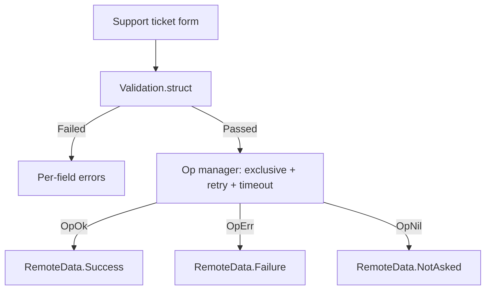

An operator submits a support ticket. One field is invalid, but the form does not say which until
the request comes back; by then the button has re-enabled and a second click has already sent the
same form. The screen shows two results for one submission.

This recipe builds one feature from four modules. Each step is a separate concern, and each module
owns exactly one of them:



## Validate at the boundary

The form has three fields and one cross-field rule. `Validation.struct` runs every check and returns
all failures at once, so the user fixes the whole form in one pass instead of one field per submit.

```ts
import { Validation } from "@pplnd/core";

interface TicketForm {
  readonly subject: string;
  readonly priority: string;
  readonly assignee: string;
}

type TicketError = string;

const validateSubject = (subject: string): Validation<TicketError, string> =>
  subject.trim().length >= 8
    ? Validation.make.passed(subject.trim())
    : Validation.make.failed("Subject must be at least 8 characters");

const validatePriority = (priority: string): Validation<TicketError, "low" | "high"> =>
  priority === "low" || priority === "high"
    ? Validation.make.passed(priority)
    : Validation.make.failed("Priority must be low or high");

const validateAssignee = (assignee: string): Validation<TicketError, string> =>
  assignee.length > 0
    ? Validation.make.passed(assignee)
    : Validation.make.failed("An assignee is required");

const validateTicket = (form: TicketForm) =>
  Validation.struct({
    subject: validateSubject(form.subject),
    priority: validatePriority(form.priority),
    assignee: validateAssignee(form.assignee),
  });

const check = validateTicket({ subject: "Printer", priority: "urgent", assignee: "" });
// Failed(["Subject must be at least 8 characters", "Priority must be low or high", "An assignee is required"])
```

`Validation` stops nothing: every validator runs, and the caller receives the complete list. The
[`Validation` guide](/guides/validation/) covers per-field error grouping with `Validation.keyed`.

## Run it under a policy

Submitting is a request that can overlap with itself. An `Op` manager settles the previous call when
a new one arrives, and applies retry and timeout rules without the handler knowing about them.

```ts
import { Duration, Op, RetryPolicy, Task } from "@pplnd/core";

type Ticket = { readonly id: string; readonly subject: string };
type SubmitError = { readonly kind: "Rejected"; readonly message: string } | { readonly kind: "Timeout"; };

const submitTicket = Op.make((form: TicketForm & { readonly priority: "low" | "high" }) =>
  Task.Result.tryCatch(
    async (signal) => {
      const response = await fetch("/api/tickets", {
        method: "POST",
        body: JSON.stringify(form),
        signal,
      });
      if (!response.ok) throw new Error(await response.text());
      return response.json() as Promise<Ticket>;
    },
    { onError: (error): SubmitError => ({ kind: "Rejected", message: String(error) }) },
  )
);

const ticketManager = Op.interpret(submitTicket, {
  strategy: "exclusive",
  retry: RetryPolicy.exponential({ attempts: 2, initial: Duration.milliseconds(200) }),
  timeout: { duration: Duration.seconds(10), onTimeout: (): SubmitError => ({ kind: "Timeout" }) },
});
```

`strategy: "exclusive"` drops a second submit while the first is in flight, which is the correct
behaviour for a button. The [`Op` guide](/guides/op/) covers the other strategies and what `OpNil`
means for a dropped or replaced call.

## Render the state it produces

The manager already tracks its own lifecycle. Deriving the screen from `manager.state` keeps one
source of truth, and `RemoteData.from.OpState` performs the mapping without a hand-written `match`:

```ts
import { pipe, RemoteData } from "@pplnd/core";

type TicketView = RemoteData<SubmitError, Ticket>;

const render = (view: TicketView): string =>
  pipe(
    view,
    RemoteData.match({
      notAsked: () => "Fill in the form",
      loading: () => "Submitting...",
      failure: (error) => error.kind === "Timeout" ? "The server did not answer" : error.message,
      success: (ticket) => `Ticket ${ticket.id} created`,
    }),
  );

ticketManager.subscribe(() => {
  const view = RemoteData.from.OpState(ticketManager.state);
  render(view);
  // hand view to your view layer
});

const handleSubmit = (form: TicketForm): readonly string[] => {
  const validation = validateTicket(form);
  if (Validation.is.failed(validation)) {
    return validation.errors;
  }
  void ticketManager.run(validation.value);
  return [];
};
```

Field errors and request errors stay separate. The form owns validation; the manager owns the
request. A settled `OpNil` maps to `NotAsked` because there is no value and no error to show, and
the next run moves the state again.

## Failure behavior

A validation failure never reaches the network. A rejected request settles the manager with `OpErr`
and the error produced by `Task.Result.tryCatch`. A timeout is an `OpErr` from `onTimeout`, not a
cancellation: the deadline covers the whole retry sequence. Replacement and dropping are `OpNil`
with a reason, and they are not request failures. If the caller aborts, the signal reaches the
`fetch` call and the manager settles with [`Aborted`](/guides/aborted/).

If the API can stay down for a while, wrap the same task in a
[`CircuitBreaker`](/guides/circuit-breaker/) before the manager so repeated failures fail fast
instead of retrying into a dead service.

If the API enforces a quota, wrap the task in a [`RateLimiter`](/guides/rate-limiter/) instead. Put
the limiter inside the retry loop, so every attempt takes its own permit, and keep the retry
predicate aware of the refusal: a call that settles with `RateLimitExceeded` carries `retryAfter`,
which is the hint the screen needs to say when the submit can be tried again.
